# Boletín 1

## Resumen de commits

| # | Mensaje del commit | Qué se hizo | Autor | Enlace |
|---|--------------------|-------------|-------|--------|
| 1 | `chore: proyecto Maven inicial de la API de tareas`        | Inicialización del repositorio        | Lucía Olmos Martínez   | [9303a30] |
| 2 | `chore(editor): añade .editorconfig`        | Se añade el fichero .editconfig         | Lucía Olmos Martínez   | [5528832] |
| 3 | `feat(tasks): añade filtro de tareas por estado` | En la rama feat/filtro-estado, se realiza un filtro nuevo          | Lucía Olmos Martínez   | [b805415] |
| 4 | `chore(build): añade Spotless para formateo automático` | Añado el plugin de Spotless al pom.xml          | Lucía Olmos Martínez   | [cdc4a36] |
| 5 | `chore(config): cambia nombre de aplicación en rama A` | Modificación del nombre de la aplicación en la rama A          | Lucía Olmos Martínez   | [21fe944] |
| 6 | `chore(config): cambia nombre de aplicación en rama B` | Modificación del nombre de la aplicación en la rama B          | Lucía Olmos Martínez   | [5fe1d58] |
| 7 | `chore(config): resuelve conflicto entre ramas` | Unificación de las ramas A y B en el main          | Lucía Olmos Martínez   | [b6e6795] |

## Detalle por commit

### 1. `chore: proyecto Maven inicial de la API de tareas`
- **Qué se hizo:** Inicialización del repositorio
- **Autor:** Lucía Olmos Martínez
- **Relación con el boletín:** apartado 3, parte B y D
- **Uso de IA:** ChatGPT (GPT-5.6 Sol), prompt: Prompt de ejemplo: Genera un proyecto Maven con Spring Boot 3 y Java 21: una API REST de gestión de tareas (entidad Task con id, título, descripción, estado, prioridad y fecha límite). Usa Spring Data JPA con Hibernate para la persistencia y H2 en memoria como base de datos. Incluye endpoints CRUD, capa de servicio, repositorio JPA, validaciones con Bean Validation, manejo de errores con @RestControllerAdvice y tests unitarios con JUnit 5.

### 2. `chore(editor): añade .editorconfig`
- **Qué se hizo:** Se añade el fichero .editconfig
- **Autor:** Lucía Olmos Martínez
- **Relación con el boletín:** apartado 3, parte D
- **Uso de IA:** no se ha usado.

### 3. `feat(tasks): añade filtro de tareas por estado`
- **Qué se hizo:** En la rama feat/filtro-estado, se realiza un filtro nuevo
- **Autor:** Lucía Olmos Martínez
- **Relación con el boletín:** apartado 3, parte D
- **Uso de IA:** ChatGPT (GPT-5.6 Sol), prompt: haz un pequeño cambio no trivial sobre el proyecto.

### 4. `chore(build): añade Spotless para formateo automático`
- **Qué se hizo:** Añado el plugin de Spotless al pom.xml
- **Autor:** Lucía Olmos Martínez
- **Relación con el boletín:** apartado 3, parte E
- **Uso de IA:** no se ha usado.

### 5. `chore(config): cambia nombre de aplicación en rama A`
- **Qué se hizo:** Modificación del nombre de la aplicación en la rama A
- **Autor:** Lucía Olmos Martínez
- **Relación con el boletín:** apartado 3, parte F
- **Uso de IA:** no se ha usado.

### 6. `chore(config): cambia nombre de aplicación en rama B`
- **Qué se hizo:** Modificación del nombre de la aplicación en la rama B
- **Autor:** Lucía Olmos Martínez
- **Relación con el boletín:** apartado 3, parte F
- **Uso de IA:** no se ha usado.

### 7. `chore(config): resuelve conflicto entre ramas`
- **Qué se hizo:** Unificación de las ramas A y B en el main
- **Autor:** Lucía Olmos Martínez
- **Relación con el boletín:** apartado 3, parte F
- **Uso de IA:** no se ha usado.

## Descripción narrativa de lo hecho en la sesión y relación con los commits

### Parte A - Instalación y verificación del entorno

#### Comprobación de Git, JDK21 y Maven

Compruebo que los comandos

```bash
git --version
java -version
mvn -version
```

devuelven las versiones exactas requeridas tanto de Git como de JDK y Maven.
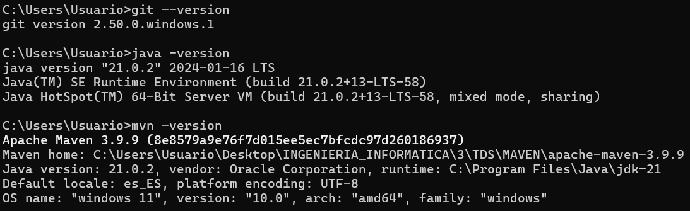

#### Configuración de la identidad de Git

Realizo la configuración global de Git para que aparezcan los datos y opciones correctos:
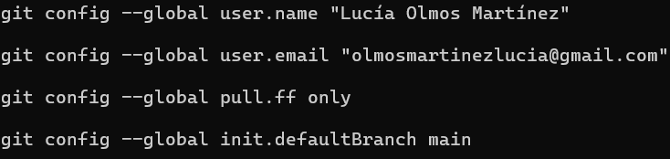

### Parte B - Generar la aplicación con ayuda de IA

Mando el siguiente prompt a ChatGPT en su modelo GPT-5.6 Sol:

```text
Genera un proyecto Maven con Spring Boot 3 y Java 21: una API REST de gestión de tareas (entidad Task con id, título, descripción, estado, prioridad y fecha límite). Usa Spring Data JPA con Hibernate para la persistencia y H2 en memoria como base de datos. Incluye endpoints CRUD, capa de servicio, repositorio JPA, validaciones con Bean Validation, manejo de errores con @RestControllerAdvice y tests unitarios con JUnit 5.
```

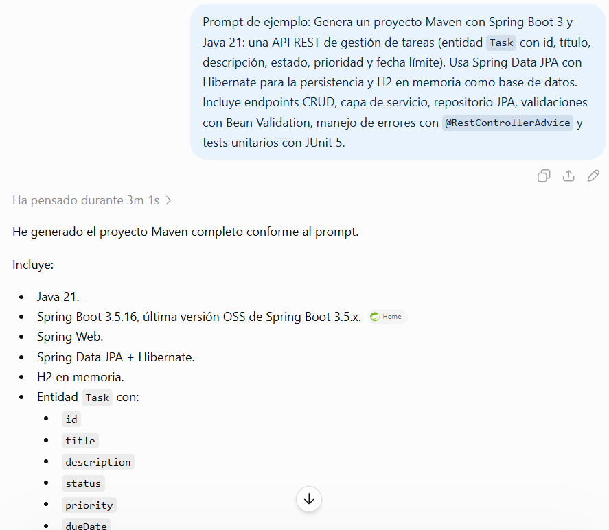

Adjunta además un fichero .zip con el proyecto, que se puede iniciar mediante ``java -jar target/task-api-0.0.1-SNAPSHOT.jar``.

### Parte C - Construir y probar en local

Como he dicho anteriormente, la aplicación se lanza mediante ``java -jar target/task-api-0.0.1-SNAPSHOT.jar`` tras ejecutar el comando ```mvn clean package```.
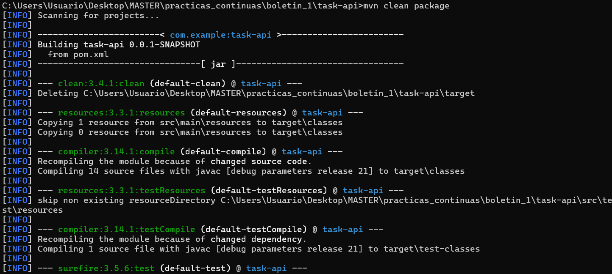

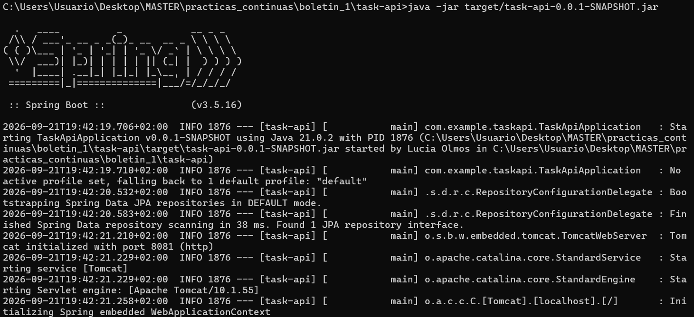

Tras lanzar la aplicación realizo algunas pruebas para comprobar que la aplicación funciona:
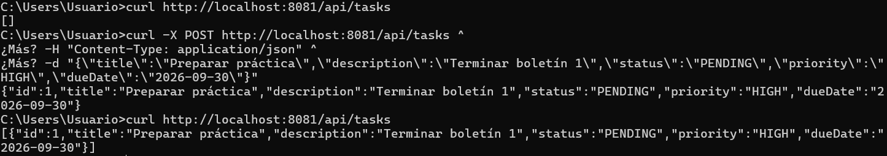

### Parte D - Control de versiones con Git

Creo el repositorio de git y creo los ficheros de configuración: .gitignore y .gitattributes:
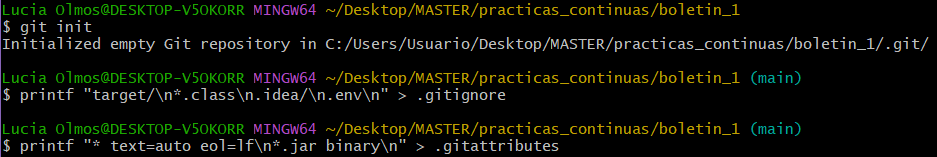

Añado todos los cambios realizados en el repositorio y realizo un primer commit (commit 1):
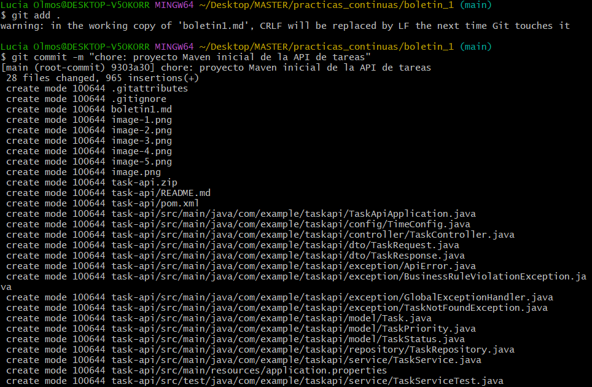

Creo el fichero .editorconfig y realizo un commit de esto (commit 2):
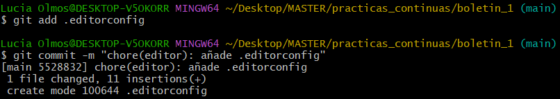

Creo una rama nueva llamada filtro-estado donde realizo el cambio no trivial:
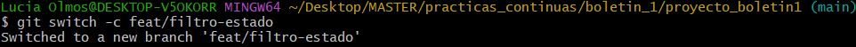

Compruebo que funciona de manera correcta el filtro del estado de las tareas que he realizado:
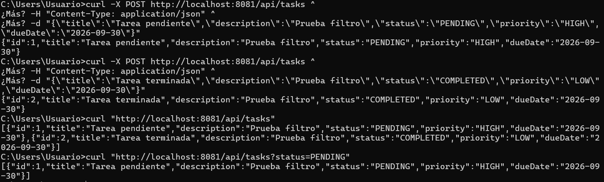

Tras comprobarlo realizo un commit de estos cambios (commit 3):
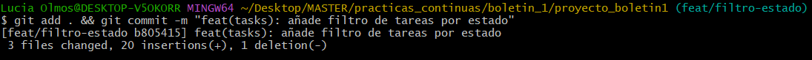


Cambio a la rama main y realizo el merge de la rama:
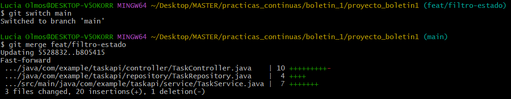

Aquí está el historial de lo realizado hasta ahora:
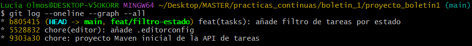

### Parte E - Formateo automático en cada commit

Tras realizar la modificación necesaria en el fichero pom.xml, ejecuto el comando ```mvn spotless:check``` sobre el proyecto:
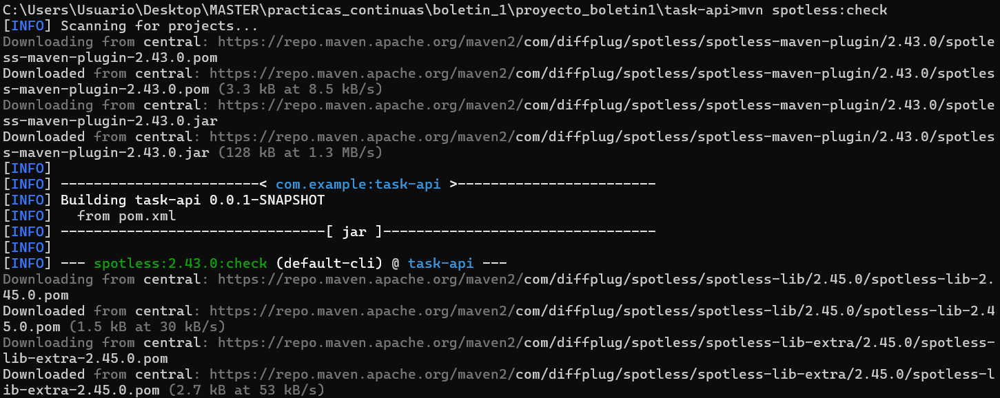

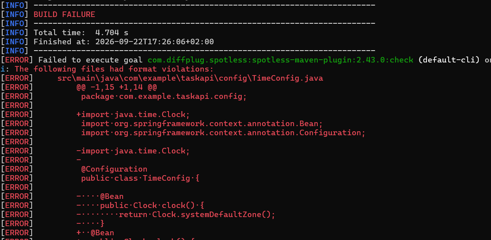

Podemos observar que no cumple el estilo, por lo que ejecuto el comando ```mvn spotless:apply``` para que solucione esto:
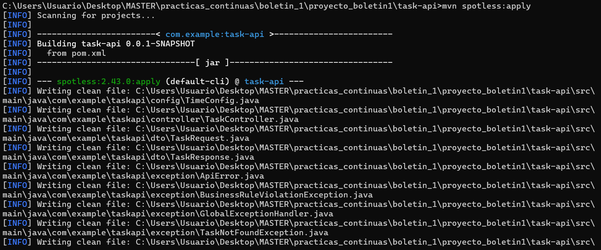

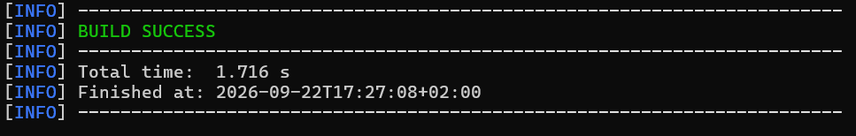

Vuelvo a realizar ejecutar ```mvn spotless:check``` y se observa que ya no hay ningún error:
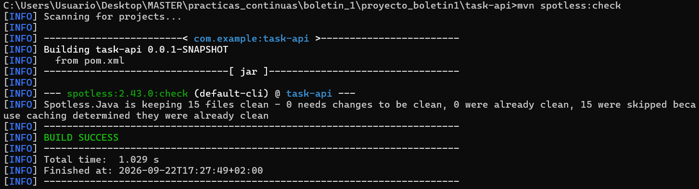

Creo el hook de pre-commit para que se realice esto automáticamente cada vez que trato de hacer un commit, le doy permisos de ejecución al fichero e indico el directorio de hooks:
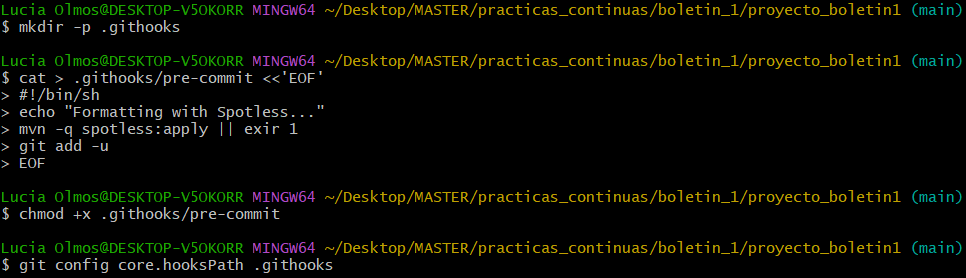
(se puede observar que en el comando ```cat``` cometo un error que soluciono después)

Realizo un único commit de todo lo realizado (commit 4):
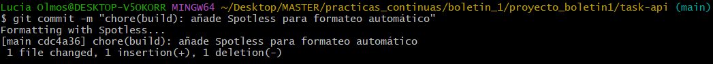

Modifico la indentación de la clase Task para poder probar lo realizado:
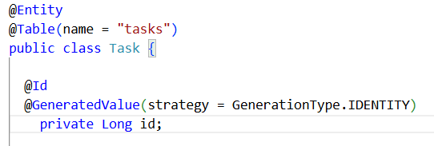

Realizo el commit que soluciona automáticamente los problemas de indentación:
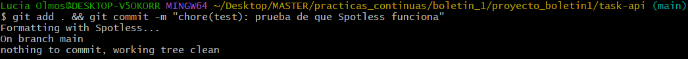

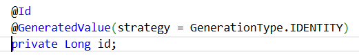

### Parte F - Provocar y resolver un conflicto

Para poder simular un conflicto, creo en primer lugar una rama a, modifico el nombre de la aplicación en el fichero ```application.properties``` y realizo el commit de este cambio (commit 5):
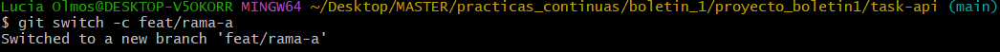

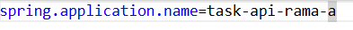

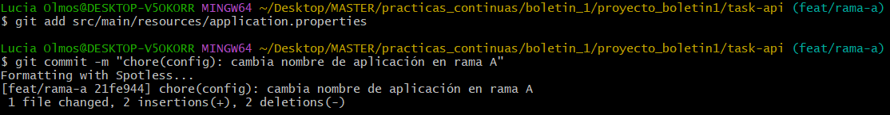

Hago lo mismo con una segunda rama b (commit 6):
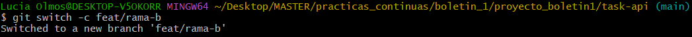

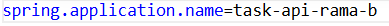

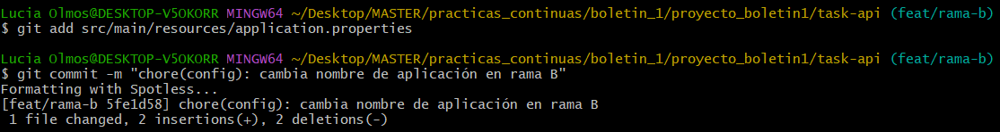

Al unificar la rama a con el main no existe ningún conflicto, pero, al tratar de unificar la rama b, salta un conflicto en la línea modificada:
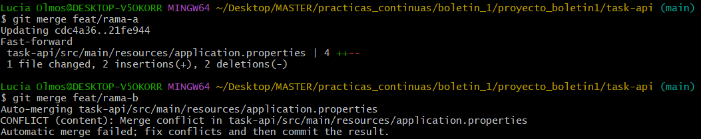

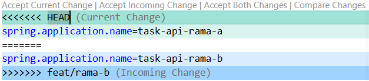

Tras resolver el conflicto, dejando la versión de la rama a, finalizamos la unificación (commit 7):
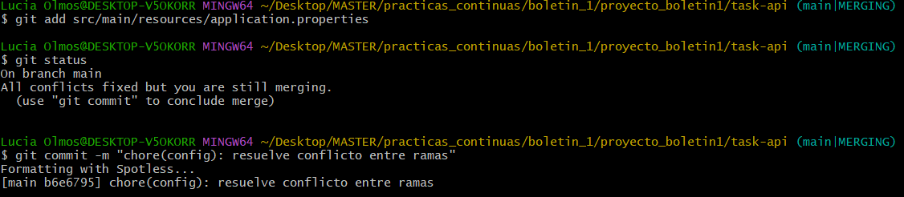

Así queda finalmente el historial de todos los commits realizados:
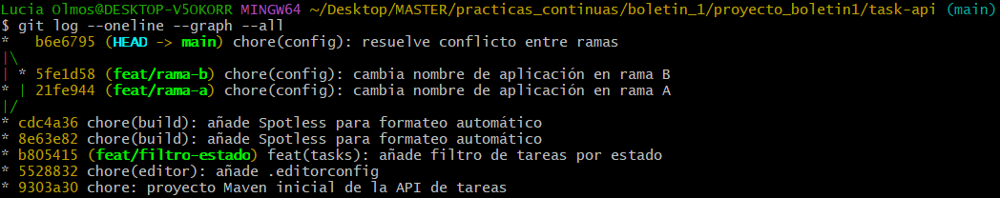