# Boletín 2

## Resumen de commits

| # | Mensaje del commit | Qué se hizo | Autor | Enlace |
|---|--------------------|-------------|-------|--------|
| 1 | `docs(readme): añade requisitos y puesta en marcha desde cero` | Completa el README con requisitos y los pasos para arrancar el proyecto desde cero | Maria Ballester | [48af258](https://github.com/mariaballesteer/Practicas-PC-parejas/commit/48af258) |
| 2 | `chore(github): añade plantilla de pull request` | Añade `.github/PULL_REQUEST_TEMPLATE.md` | Lucía Olmos Martínez | [972642b](https://github.com/mariaballesteer/Practicas-PC-parejas/commit/972642b) |
| 3 | `chore(Github): añade plantilla para mejoras` | Añade `.github/ISSUE_TEMPLATE/enhancement.md` | Lucía Olmos Martínez | [6b01cac](https://github.com/mariaballesteer/Practicas-PC-parejas/commit/6b01cac) |
| 4 | `chore(Github): añade plantilla error` | Añade `.github/ISSUE_TEMPLATE/bug.md` | Lucía Olmos Martínez | [cd52432](https://github.com/mariaballesteer/Practicas-PC-parejas/commit/cd52432) |
| 5 | `fix(Github): modifica plantilla mejoras` | Se añaden espacios al final de las primeras tres líneas de la plantilla de mejoras| Lucía Olmos Martínez | [6fe58cd](https://github.com/mariaballesteer/Practicas-PC-parejas/commit/6fe58cd) |
| 6 | `fix(Github): arreglo plantilla mejora` | Arreglo sobre la misma plantilla, tras revisar que no funcionaba | Lucía Olmos Martínez | [0d67ecf](https://github.com/mariaballesteer/Practicas-PC-parejas/commit/0d67ecf) |
| 7 | `fix(Github): arreglo plantilla error` | Corrige el error equivalente al anterior en la plantilla de error | Lucía Olmos Martínez | [b7f683e](https://github.com/mariaballesteer/Practicas-PC-parejas/commit/b7f683e) |
| 8 | `chore(Github): añade codeowners` | Añade `.github/CODEOWNERS` con las dos integrantes de la pareja | Lucía Olmos Martínez | [32e3af7](https://github.com/mariaballesteer/Practicas-PC-parejas/commit/32e3af7) |
| 9 | `Add files via upload` | Sube `CONTRIBUTING.md` desde la interfaz web de GitHub | Lucía Olmos Martínez | [0463ff5](https://github.com/mariaballesteer/Practicas-PC-parejas/commit/0463ff5) |
| 10 | `Feat(buscar tarea): añadir buscar tarea (#4)` | PR fusionado con squash: añade `GET /api/tareas/buscar?q=` | Lucía Olmos Martínez | [46b4334](https://github.com/mariaballesteer/Practicas-PC-parejas/commit/46b4334) |
| 11 | `feat(estadisticas): Añade GET /api/tareas/estadisticas (#5)` | PR fusionado con squash: añade `GET /api/tareas/estadisticas` | Maria Ballester | [cc6a604](https://github.com/mariaballesteer/Practicas-PC-parejas/commit/cc6a604) |
| 12 | `doc(tareas): modificación del puerto para conflicto (#6)` | PR fusionado con squash: rama A del ejercicio de conflicto (cambia el puerto a 8081) | Lucía Olmos Martínez | [ab3327b](https://github.com/mariaballesteer/Practicas-PC-parejas/commit/ab3327b) |
| 13 | `docs(readme): cambio de readme para conflicto (#7)` | PR fusionado con squash: rama B del ejercicio de conflicto (devuelve el puerto a 8080), resuelto tras un conflicto real | Maria Ballester | [9ea907a](https://github.com/mariaballesteer/Practicas-PC-parejas/commit/9ea907a) |

Autoría comprobada clonando el repositorio y ejecutando `git log --reverse --format='%h|%s|%an'`.

> La Parte F tiene además tres commits propios, pero viven en el fork de Lucía sobre el repositorio de otra pareja (`OlgaTYP/Practicas-continuas`), no en `Practicas-PC-parejas`. Se detallan en su propio apartado, al final.

## Detalle por commit

### 1. `docs(readme): añade requisitos y puesta en marcha desde cero`
- **Qué se hizo:** se añadieron al README las secciones "Requisitos" (Git, JDK 21, Maven) y "Puesta en marcha desde cero", con los pasos de clonado, activación del hook y arranque, todo junto.
- **Autor:** Maria Ballester
- **Relación con el boletín:** Parte A, último punto ("Completa el README... cómo poner todo en marcha desde cero").
- **Uso de IA:** Claude propuso el texto de ambas secciones; se adaptó el contenido a la URL real del repositorio.

### 2. `chore(github): añade plantilla de pull request`
- **Qué se hizo:** se creó `.github/PULL_REQUEST_TEMPLATE.md` con el contenido exacto del boletín.
- **Autor:** Lucía Olmos Martínez
- **Relación con el boletín:** Parte B, plantilla de PR.
- **Uso de IA:** no se ha usado; el contenido es el que da el propio boletín.

### 3. `chore(Github): añade plantilla para mejoras`
- **Qué se hizo:** se creó `.github/ISSUE_TEMPLATE/enhancement.md`.
- **Autor:** Lucía Olmos Martínez
- **Relación con el boletín:** Parte B, plantillas de issue.
- **Uso de IA:** Claude propuso la estructura de la plantilla (cabecera con `name`, `about`, `title`, `labels`, y secciones de descripción, problema, propuesta y checklist).

### 4. `chore(Github): añade plantilla error`
- **Qué se hizo:** se creó `.github/ISSUE_TEMPLATE/bug.md`, con la misma estructura que la de mejora, adaptada a informes de error.
- **Autor:** Lucía Olmos Martínez
- **Relación con el boletín:** Parte B, plantillas de issue.
- **Uso de IA:** Claude propuso la estructura.

### 5. `fix(Github): modifica plantilla mejoras`
- **Qué se hizo:** se añaden espacios al final de las primeras tres líneas de la plantilla de mejoras.
- **Autor:** Lucía Olmos Martínez
- **Relación con el boletín:** Parte B; modificación menor de la plantilla de mejoras.
- **Uso de IA:** no se ha usado.

### 6. `fix(Github): arreglo plantilla mejora`
- **Qué se hizo:** arreglo sobre la misma plantilla, tras revisar que no funcionaba.
- **Autor:** Lucía Olmos Martínez
- **Relación con el boletín:** Parte B; corrección de un fallo detectado al comprobar si GitHub reconoce las plantillas.
- **Uso de IA:** Claude detectó el fallo (comparando el archivo subido a GitHub con el original) y explicó la causa y la corrección exacta.

### 7. `fix(Github): arreglo plantilla error`
- **Qué se hizo:** corrige el error equivalente al anterior en la plantilla de error.
- **Autor:** Lucía Olmos Martínez
- **Relación con el boletín:** Parte B; corrección de un fallo detectado al comprobar si GitHub reconoce las plantillas.
- **Uso de IA:** igual que el commit anterior.

### 8. `chore(Github): añade codeowners`
- **Qué se hizo:** se creó `.github/CODEOWNERS` con una única regla (`*`) que asigna a las dos integrantes de la pareja como revisoras de todo el repositorio.
- **Autor:** Lucía Olmos Martínez
- **Relación con el boletín:** Parte B, `CODEOWNERS`.
- **Uso de IA:** no se ha usado; el contenido sigue el ejemplo del boletín con los usuarios reales.

### 9. `Add files via upload`
- **Qué se hizo:** se subió `CONTRIBUTING.md` (62 líneas) desde la interfaz web de GitHub, con el flujo de trabajo, la política de fusión (squash) y cómo poner en marcha el entorno.
- **Autor:** Lucía Olmos Martínez
- **Relación con el boletín:** Parte B, `CONTRIBUTING.md`.
- **Uso de IA:** Claude propuso una plantilla base para el documento, adaptada después con los datos reales del proyecto.

### 10. `Feat(buscar tarea): añadir buscar tarea (#4)`
- **Qué se hizo:** commit de squash del PR #4. Añade el endpoint `GET /api/tareas/buscar?q=texto`, que busca coincidencias en título o descripción sin distinguir mayúsculas, junto con una excepción nueva (`ParametroInvalidoException`) y un manejador para `MissingServletRequestParameterException`, de forma que un parámetro `q` ausente o vacío responde `400` con el mismo formato de error que el resto de la API.
- **Autor:** Lucía Olmos Martínez
- **Relación con el boletín:** Parte D, primer ciclo de Pull Request.
- **Uso de IA:** Claude escribió el código completo (servicio, controlador, excepción y manejador) y los tests, a partir del issue publicado. Lucía lo aplicó, lo probó con `mvn clean package` y con `curl`, y abrió el PR; Maria lo revisó y aprobó.

### 11. `feat(estadisticas): Añade GET /api/tareas/estadisticas (#5)`
- **Qué se hizo:** commit de squash del PR #5. Añade el endpoint `GET /api/tareas/estadisticas`, que devuelve el número de tareas agrupadas por estado y por prioridad, usando `EnumMap` para que todas las claves aparezcan siempre, incluidas las que valen `0`.
- **Autor:** Maria Ballester
- **Relación con el boletín:** Parte D, segundo ciclo de Pull Request.
- **Uso de IA:** Claude escribió el código completo y los tests, a partir del issue publicado por Lucía. Maria lo aplicó, lo probó con `mvn clean package` y con `curl`, y abrió el PR; Lucía lo revisó y aprobó como propietaria del código.

### 12. `doc(tareas): modificación del puerto para conflicto (#6)`
- **Qué se hizo:** commit de squash del PR #6. Es la rama A del ejercicio de conflicto de la Parte E: cambia a `8081` el puerto que menciona el README, y toca también una línea de `TareaServiceTest.java`.
- **Autor:** Lucía Olmos Martínez
- **Relación con el boletín:** Parte E, primera rama, la que se fusiona sin problema.
- **Uso de IA:** Claude planteó el ejercicio (dos ramas desde el mismo `main`, tocando la misma línea); el cambio en sí es manual.

### 13. `docs(readme): cambio de readme para conflicto (#7)`
- **Qué se hizo:** commit de squash del PR #7. Es la rama B del ejercicio: devuelve el puerto del README a `8080`. Como partía de un `main` más antiguo, al abrir el PR apareció un conflicto real en dos archivos (`README.md` y `TareaServiceTest.java`), resuelto con el editor de conflictos de GitHub.
- **Autor:** Maria Ballester
- **Relación con el boletín:** Parte E, segunda rama, la que debe traer el avance de `main`.
- **Uso de IA:** no se ha usado en la resolución final del conflicto (ver nota en la descripción narrativa).

## Descripción narrativa de lo hecho en la sesión y relación con los commits

### Parte A — Publicar el repositorio

Creamos el repositorio `Practicas-PC-parejas` en GitHub, vacío y público, y conectamos el repositorio local con `git remote add origin` y `git push -u origin main`. Los 11 commits del Boletín 1 quedaron así publicados en GitHub.

Después se dio de alta a Lucía como colaboradora y se completó el README con los requisitos y la puesta en marcha (commit 1).

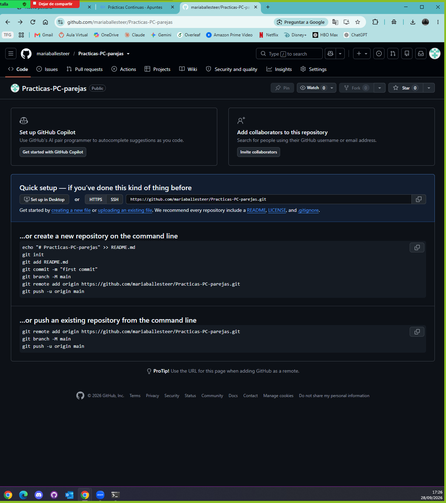
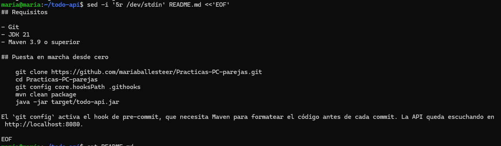

### Parte B — Gobernanza del repositorio

Se añadió la plantilla de Pull Request (commit 2), las dos plantillas de Issue (commits 3, 4 y 5) y el archivo `CODEOWNERS` (commit 8). Se modificaron las plantillas de issue debido a que no se habían añadido las líneas `---` necesarias para que GitHub pudiese reconocerlas (commits 6 y 7). 

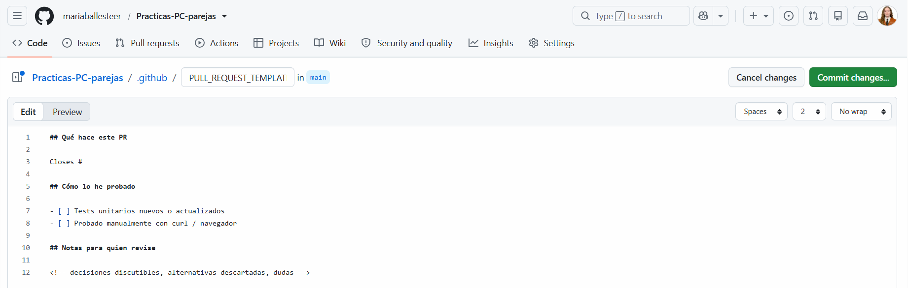
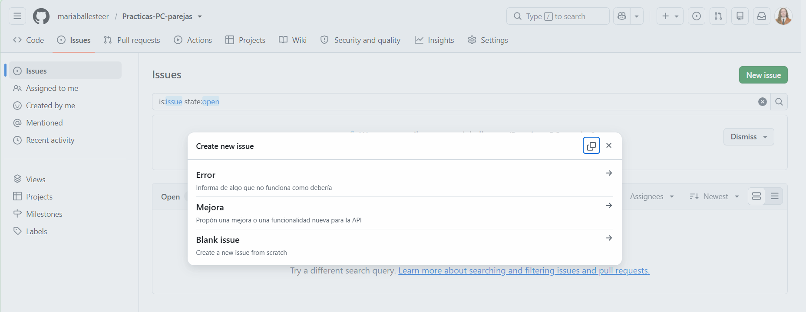

El `CODEOWNERS` se comprobó válido directamente en GitHub ("This CODEOWNERS file is valid"), y las dos plantillas de issue aparecen ya correctamente al crear uno nuevo.

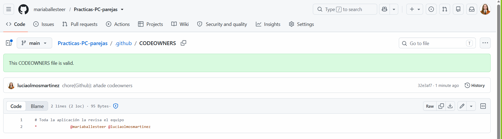

Se añadió también `CONTRIBUTING.md` (commit 9), y se configuró en **Settings → General → Pull Requests** la estrategia de fusión: solo *Allow squash merging* está marcada, con el título del PR como mensaje de commit por defecto, y con *Automatically delete head branches* activado para que las ramas se borren solas al fusionar.

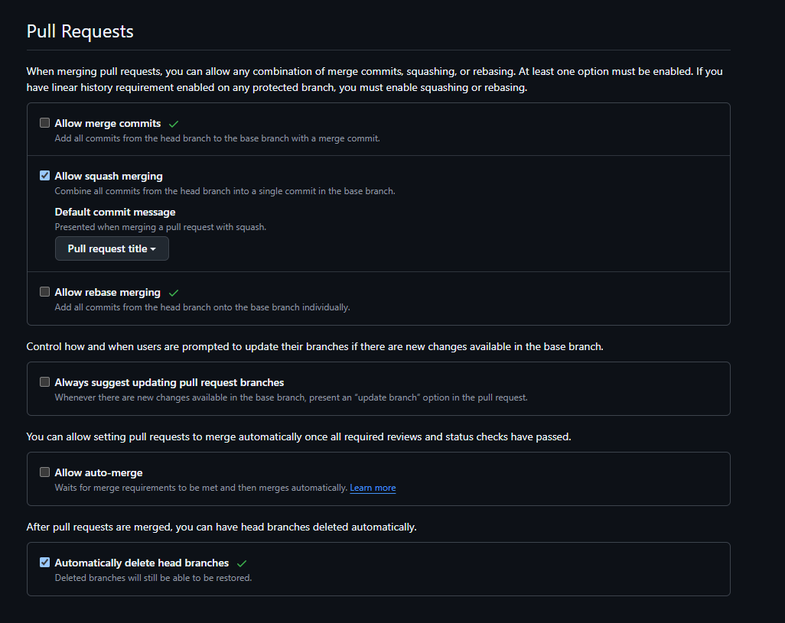

Se ha elegido squash porque cada Pull Request de este proyecto representa un cambio con significado (un endpoint, una corrección), así que interesa que en `main` quede un único commit por PR, con los commits intermedios de revisión ya absorbidos, y que ese commit lleve el título del PR en formato Conventional Commits que se nos presento en el boletín anterior.

### Parte C — Proteger la rama main

Se creó una regla de protección para `main` en **Settings → Branches**: Pull Request obligatorio con al menos 1 aprobación, revisión de Code Owners, resolución de conversaciones obligatoria, aprobaciones que caducan al subir nuevos commits, sin *bypass* para administradoras, y sin permitir *force push* ni borrado de la rama.

Con esto se consigue que nadie, ni siquiera quien administra el repositorio, puede cambiar `main` sin que la otra integrante de la pareja lo revise y apruebe; una aprobación no vale si después se cambia el código; y el historial de `main` no se puede reescribir ni borrar por accidente.

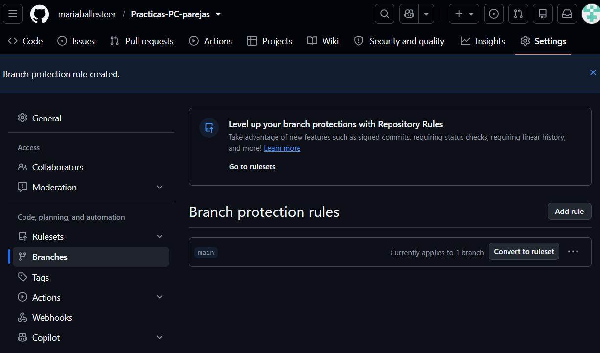

Se comprobó intentando un push directo:

```bash
echo "prueba" >> README.md
git commit -am "chore: intento de push directo"
git push
```

El servidor lo rechazó con `GH006: Protected branch update failed for refs/heads/main`, confirmando que la regla funciona.

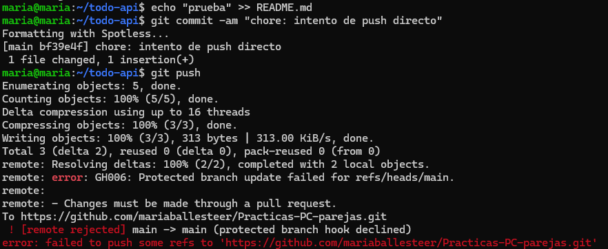

### Parte D — Trabajo por Pull Requests

Se hicieron los dos ciclos de PR que pide el boletín, con los roles cruzados entre las dos:

**Ciclo 1 — Búsqueda de tareas.** Maria publicó el issue (`#3`) y Lucía implementó `GET /api/tareas/buscar?q=texto` en la rama `feat/buscar-tarea`, con el código y los tests que le proporcionó la IA, realizando dos commits diferentes. 

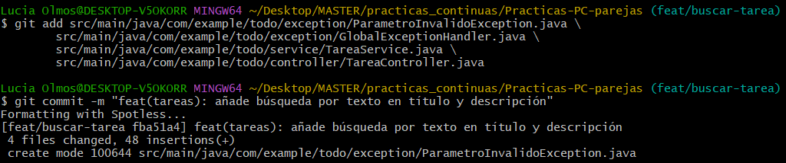
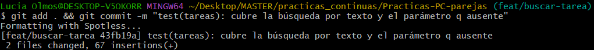

Comprobó que funcionaba bien:

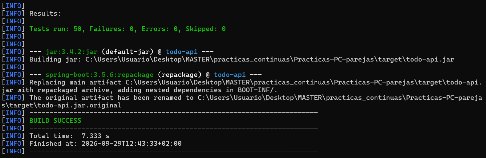

Publicó el PR siguiendo la estructura de la plantilla:

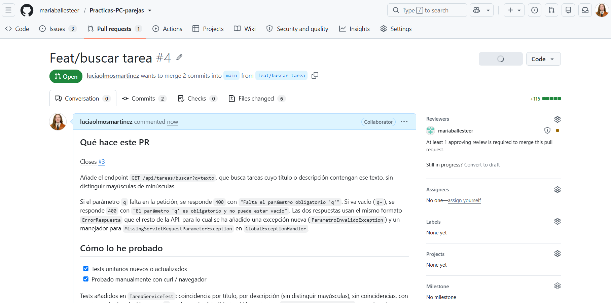

Y Maria sugirió un pequeño cambio:

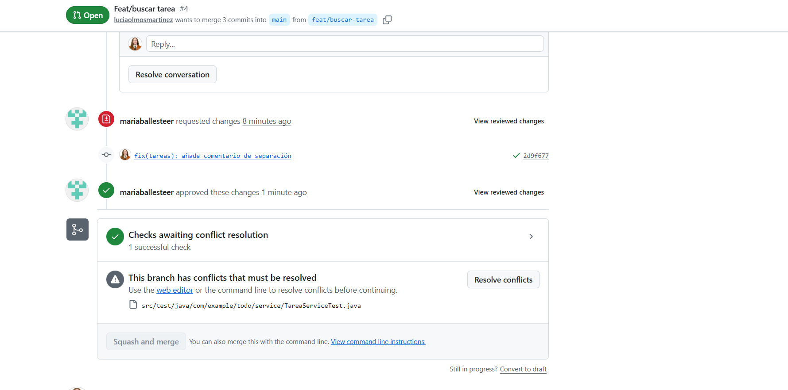

Tras realizar el cambio, como el ciclo 2 ya se había llevado a cabo y ambos issues requerían modificar un mismo fichero, saltó un conflicto que se solucionó manteniendo ambos cambios y se llevó a cabo fusión con squash tras la aprobación de Maria (commit 10).

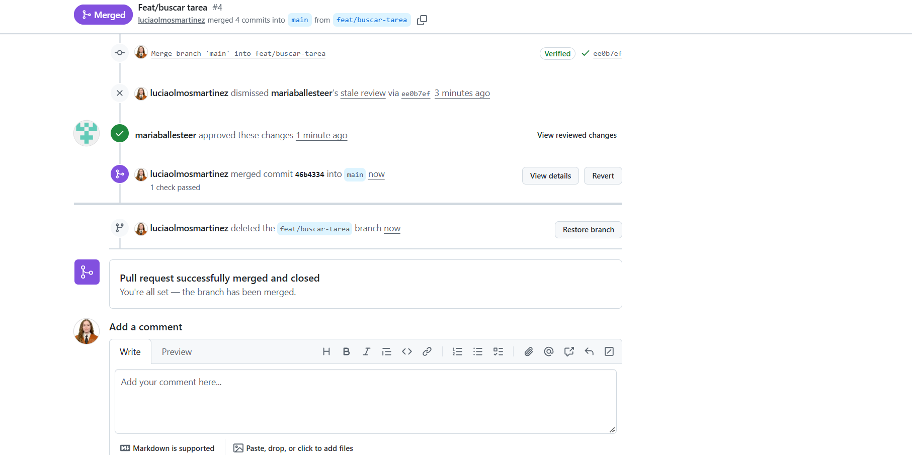

**Ciclo 2 — Estadísticas.** De la misma manera, Lucía publicó el issue (`#2`)

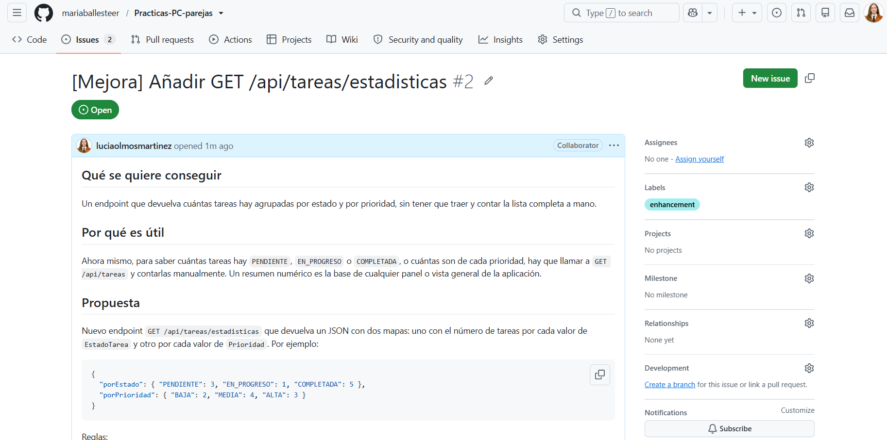

y Maria implementó `GET /api/tareas/estadisticas` en la rama `feat/estadisticas`, realizando también dos commits. 

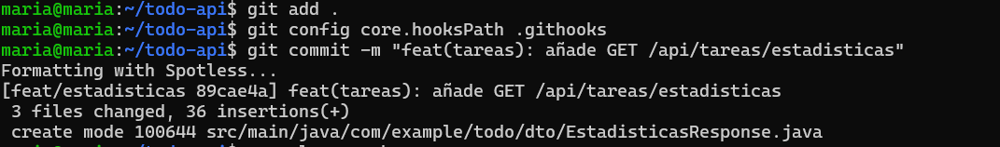
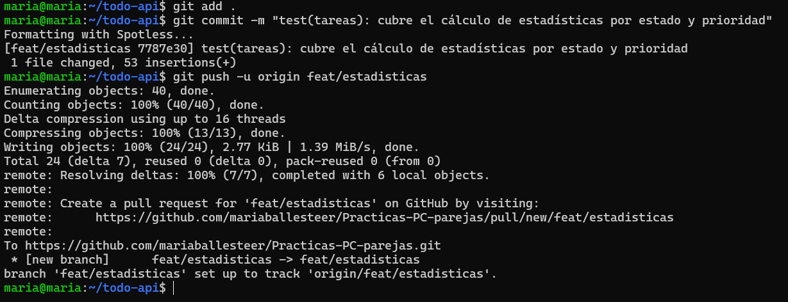

Tras esto, comprobó a través de `curl`y los tests que todo funcionaba bien:

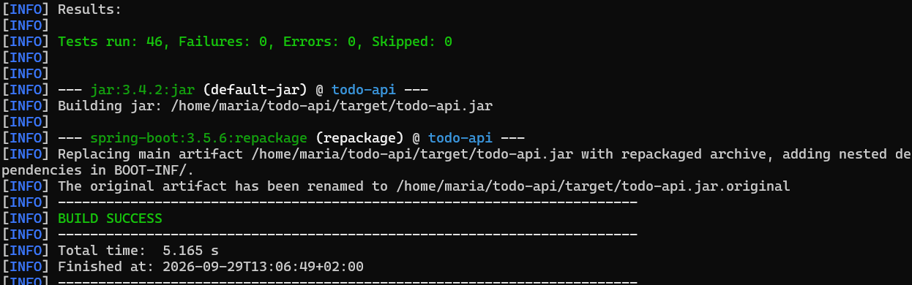
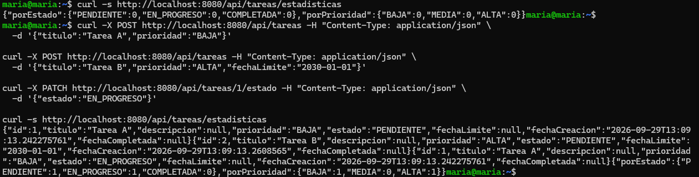
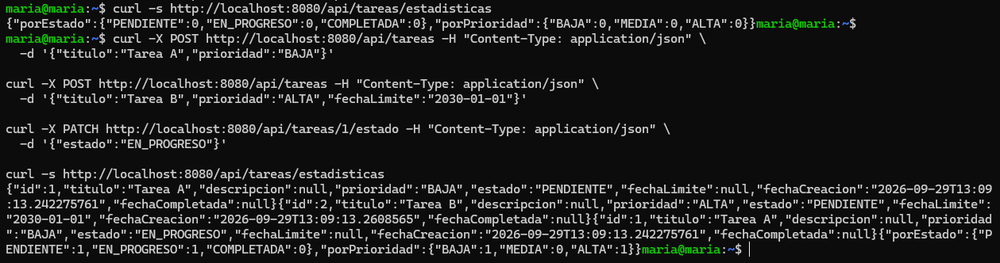

Entonces, realizó el PR (`#5`) y Lucía lo revisó y aprobó. Finalmente, Maria lo fusionó con squash (commit 11).

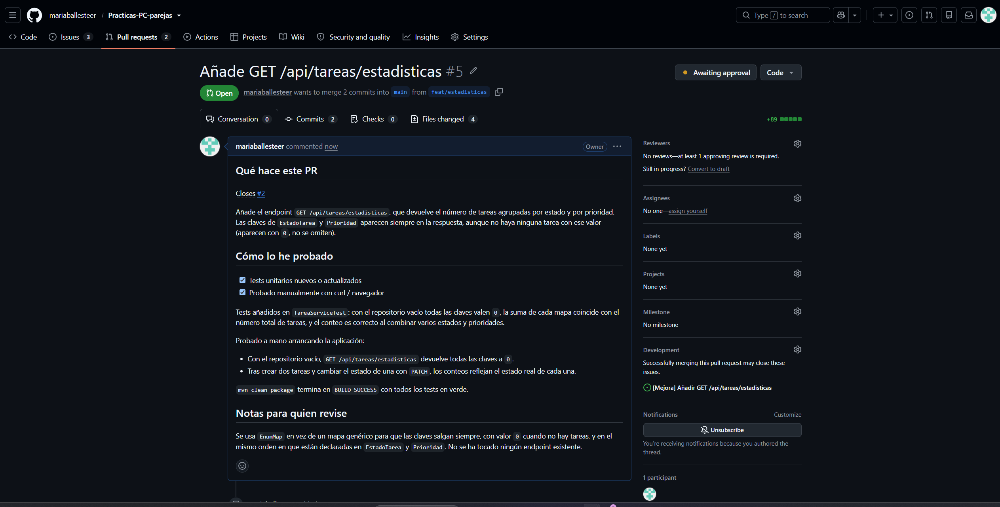
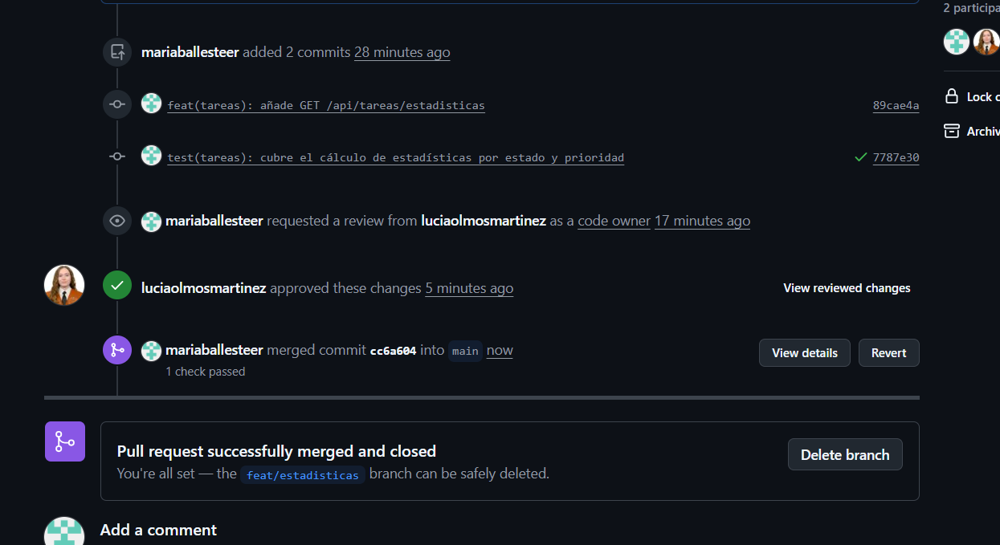

### Parte E — Provocar un conflicto en un PR

Se crearon dos ramas desde el mismo `main`: `doc/readme-a` (Lucía) 

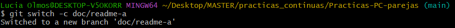

y `docs/readme-b` (Maria) de la misma manera.

La rama A (`doc/readme-a`) se fusionó primero sin problema, vía PR #6. Pero, al abrir el PR de la rama B (#7), GitHub avisó de un conflicto real en dos archivos: `README.md` (la misma línea del puerto) y `TareaServiceTest.java`.

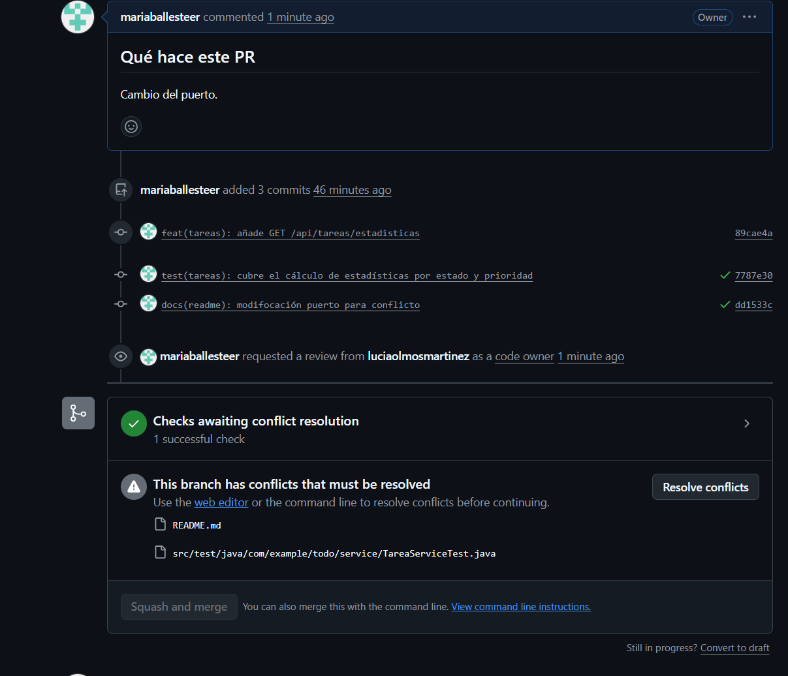

> **Nota sobre cómo se resolvió.** El conflicto se resolvió con el **editor de conflictos integrado de GitHub** (la opción "Resolve conflicts" del propio PR), que trabaja sobre un merge, no sobre un rebase. El resultado final es correcto, ya que el conflicto se resolvió y el PR se pudo fusionar.

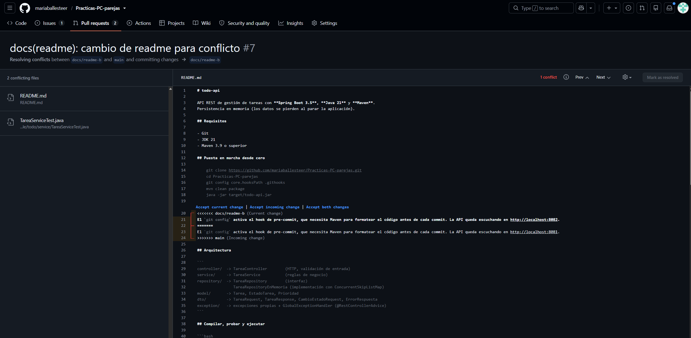
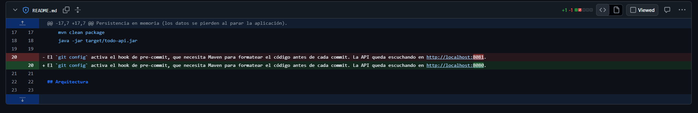

### Parte F — PR con fork

Se contribuyó al repositorio `https://github.com/OlgaTYP/Practicas-continuas.git`. Se eligió el issue `#2` del repositorio `OlgaTYP/Practicas-continuas`, sobre filtrar `GET /api/tasks` por estado. Lucía hizo fork del repositorio (`luciaolmosmartinez/Practicas-continuas-Roxana-Olga`). Maria escribió el código del filtro (`TaskController`, `TaskService`, `GlobalExceptionHandler`) y Lucía añadió los tests y corrigió el formato con Spotless.

Commits de esta contribución (en el fork):

| Commit | Qué se hizo | Autor | Enlace |
|---|---|---|---|
| `feat(tarea): filtrar Get /api/tasks por estado` | Añade el filtro por `status`, con manejo de un valor inválido | Maria Ballester | [555d05e](https://github.com/luciaolmosmartinez/Practicas-continuas-Roxana-Olga/commit/555d05e) |
| `test(tareas): cubre el filtro por estado y un estado inválido` | Tests del filtro | Lucía Olmos Martínez | [ea0ca83](https://github.com/luciaolmosmartinez/Practicas-continuas-Roxana-Olga/commit/ea0ca83) |
| `fix(formato): corrección del formato según spotless` | Aplica el formato que exige el hook de pre-commit de ese proyecto | Lucía Olmos Martínez | [2f23cd9](https://github.com/luciaolmosmartinez/Practicas-continuas-Roxana-Olga/commit/2f23cd9) |

Tras crear el fork, se creó la nueva rama `filtro-estado` sobre la que se trabajó:

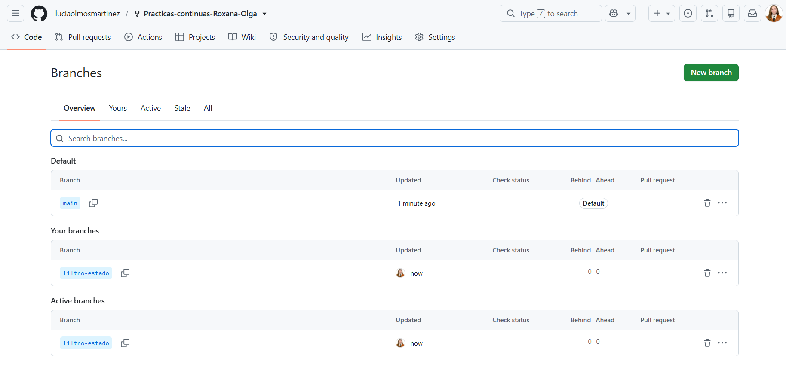

Se clonó el fork y se trató de actualizar por si había algo nuevo en el repositorio original. Tras esto, se realizan los cambios, se hace commit y push:

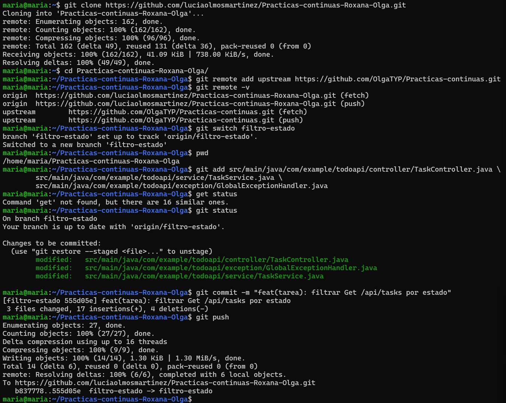
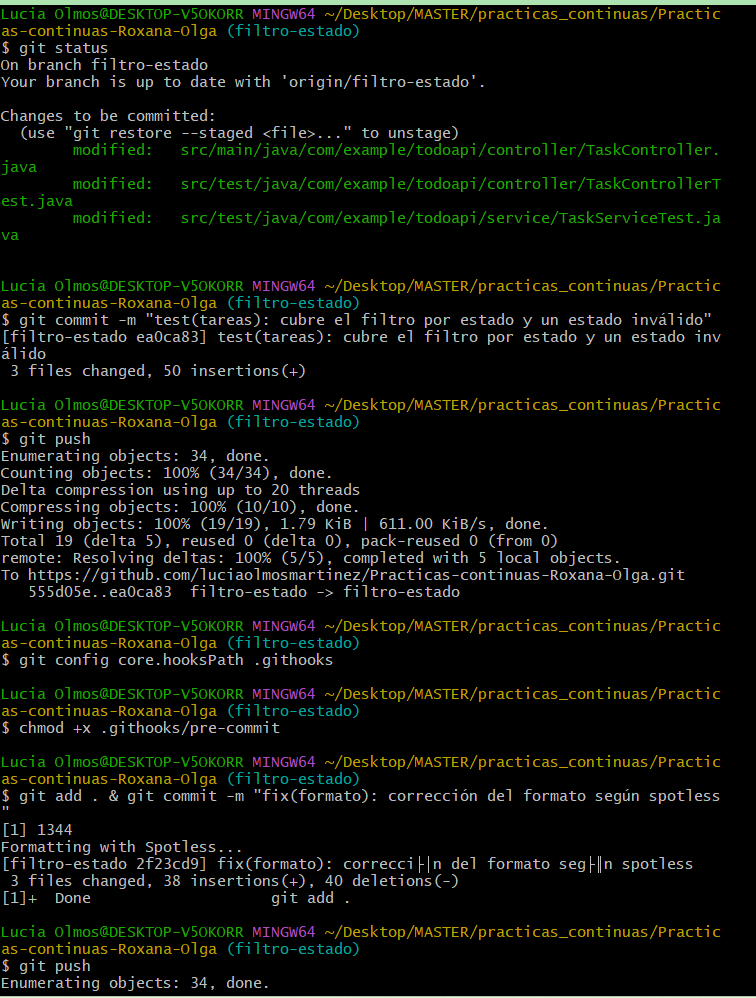

Se aplicó el formato Spotless a posteriori:

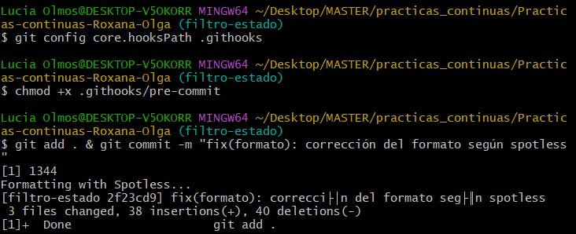

Se comprobó que la aplicación funciona bien tras los cambios.

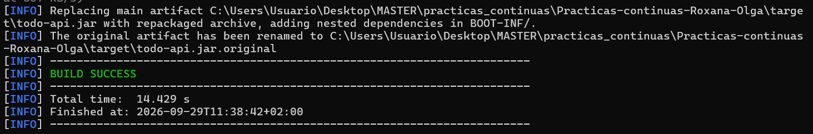

Tras todo esto, se realizó el PR correspondiente que aparece en el repositorio original:

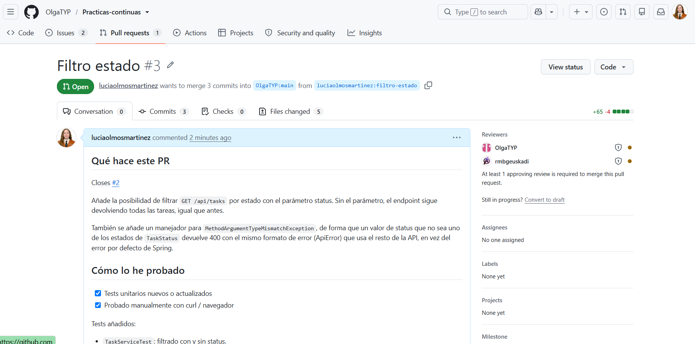

#### Contribución recibida de la otra pareja

La otra pareja también resolvió, desde un fork, un issue nuestro: el issue `#1` de `mariaballesteer/Practicas-PC-parejas`, *"[Mejora] Filtrar por fecha límite y ordenar el listado de tareas"*. OlgaTYP abrió desde su fork, rama `feature/filtro-fechas-orden`, el PR [#9 — feat: filtrar y ordenar tareas por fecha y prioridad](https://github.com/mariaballesteer/Practicas-PC-parejas/pull/9), con `Closes #1` y siguiendo nuestra plantilla de PR. Añadió los filtros `fechaDesde` y `fechaHasta` (inclusivos, con validación de que `fechaDesde` no sea posterior a `fechaHasta`) y la ordenación `orden=FECHA_LIMITE` / `orden=PRIORIDAD`, combinables con los filtros existentes. Tocó 5 archivos (+141 −12). Gracias al CONTRIBUTING.md, GitHub solicitó automáticamente la revisión.

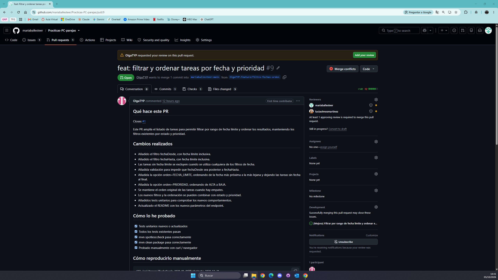

**Revisión.** Maria revisó el PR. Primero se comprobó el código en la pestaña *Files changed* (los 5 archivos marcados como vistos):

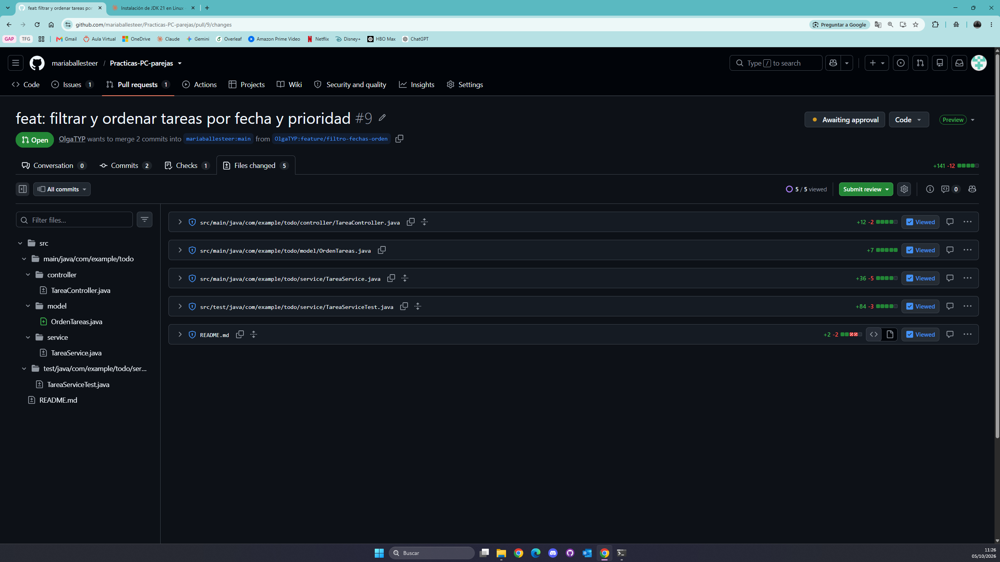

Después se probó en local: se pasó la batería de tests (`mvn clean package`, 58 tests en verde, `BUILD SUCCESS`), se arrancó la aplicación y se probaron con `curl` los filtros y la ordenación (tareas con distintas fechas y prioridades, rango de fechas, solo `fechaDesde`, solo `fechaHasta`, `orden=FECHA_LIMITE`, `orden=PRIORIDAD` y una combinación de todos).

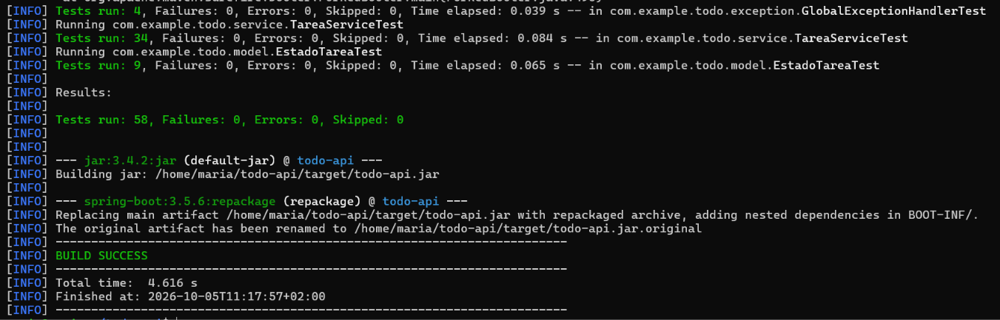
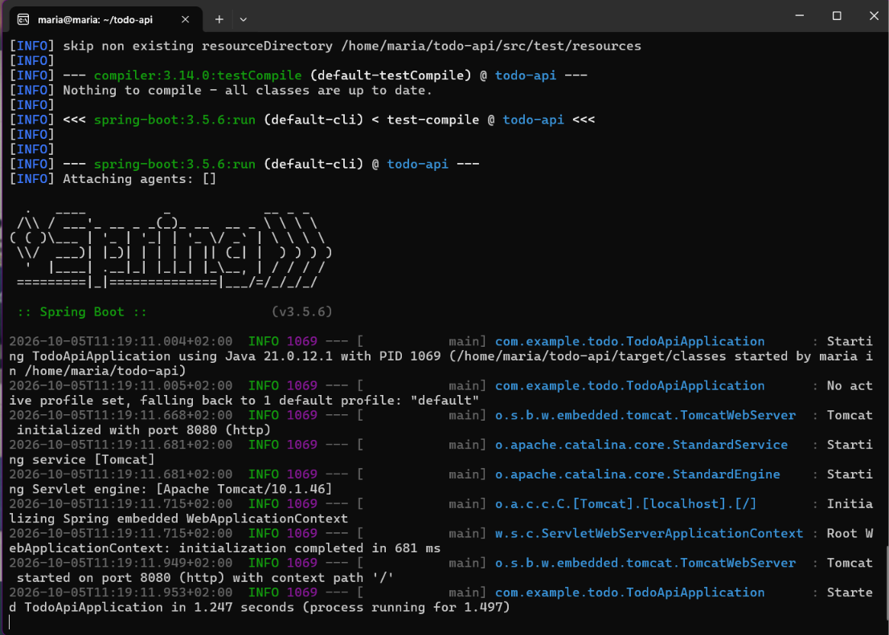
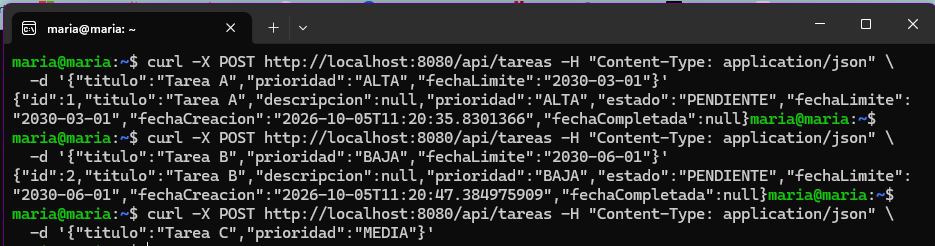
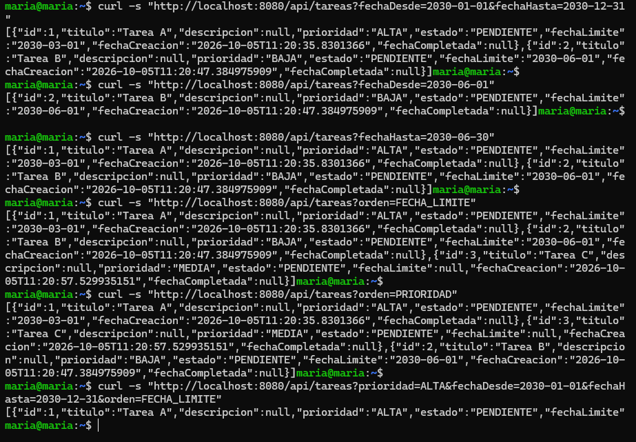

**Conflicto.** Mientras el PR esperaba revisión, `main` había avanzado (por los PR de estadísticas y de búsqueda de la Parte D), y GitHub marcó *"This branch has conflicts that must be resolved"* en `TareaService.java`. El conflicto era sencillo: ambas ramas habían añadido un `import` en la misma zona (`java.util.Comparator` por parte del PR y `java.util.EnumMap` por parte de `main`).

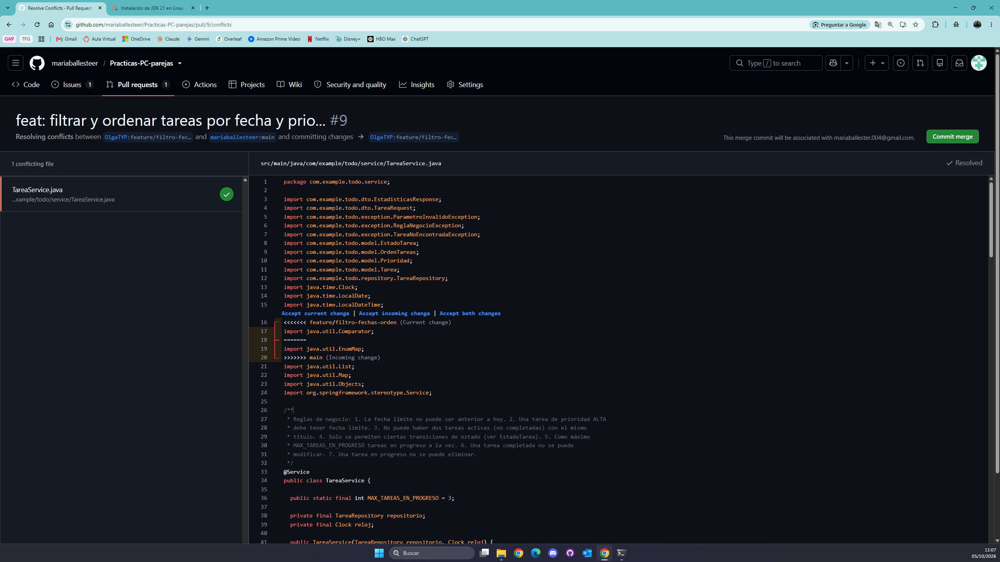

Se resolvió con el editor de GitHub (*Resolve conflicts*), conservando **ambos** imports (*Accept both changes*), y se pulsó *Commit merge*:

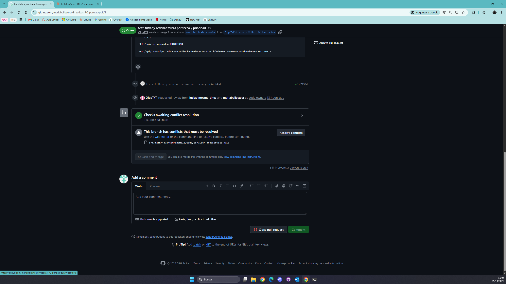
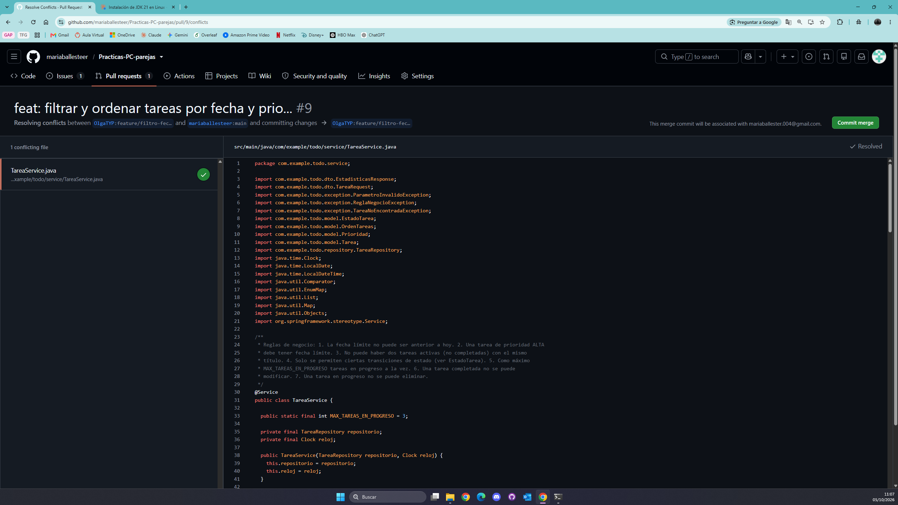

Esto añadió al PR el commit `Merge branch 'main' into feature/filtro-fechas-orden` ([d04947e](https://github.com/mariaballesteer/Practicas-PC-parejas/commit/d04947e)). Como pasa en el conflicto de la Parte E, se hizo con un merge desde la interfaz web y no con un rebase.

**Aprobación y fusión.** Al subir ese commit la protección de `main` seguía exigiendo la revisión de las code owners (*Review required — Merging is blocked*), con el check de GitGuardian en verde. Maria aprobó el PR (*Changes approved*, sin conflictos con la rama base), y se fusionó con **Squash and merge**, la estrategia elegida en la Parte B, quedando el PR cerrado y fusionado en `main` (commit [4b5ab57](https://github.com/mariaballesteer/Practicas-PC-parejas/commit/4b5ab57)).

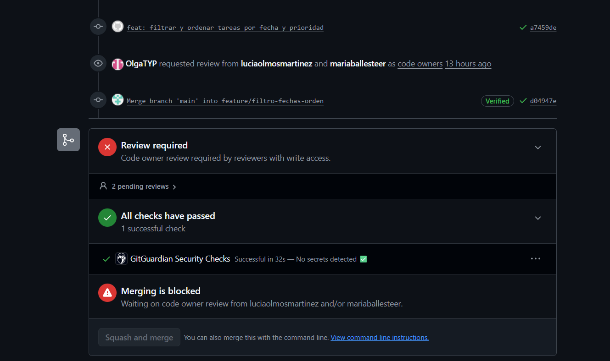
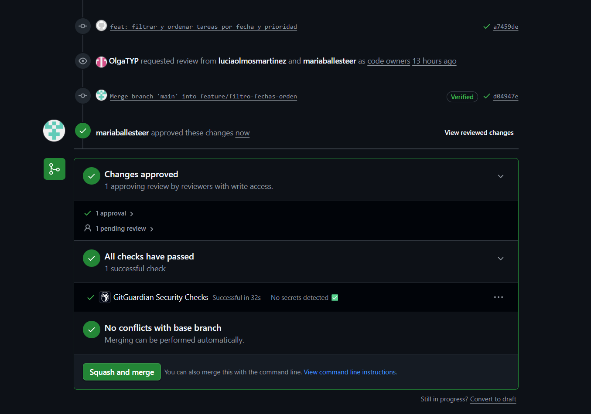
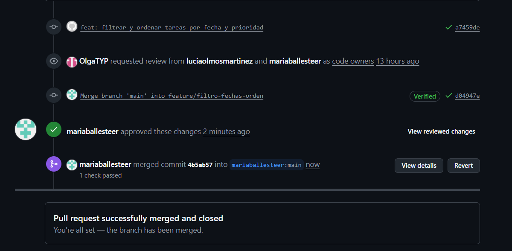