# Boletín 3

## Resumen de commits

| # | Mensaje del commit | Qué se hizo | Autor | Enlace |
|---|--------------------|-------------|-------|--------|
| 1 | `chore (docker): añadida la virtualizacion con docker (#10)` | PR fusionado con squash: conteneriza la API completa (Dockerfile multi-stage, Compose con PostgreSQL, migración de H2 a JPA, configuración por `.env`, Actuator y dev container). | Maria Ballester | [8ae9d5d](https://github.com/mariaballesteer/Practicas-PC-parejas/commit/8ae9d5d) |

Autoría comprobada clonando el repositorio y ejecutando `git log --oneline -5`:

```text
maria@maria:~/todo-api$ git log --oneline -5
8ae9d5d (HEAD -> main, origin/main, origin/HEAD) chore (docker): añadida la virtualizacion con docker (#10)
4b5ab57 feat: filtrar y ordenar tareas por fecha y prioridad (#9)
9ea907a docs(readme): cambio de readme para conflicto (#7)
ab3327b doc(tareas): modificación del puerto para conflicto (#6)
46b4334 Feat(buscar tarea): añadir buscar tarea (#4)
```

Como en el Boletín 2, la estrategia de fusión del repositorio es *squash merge*, así que todo el trabajo de este boletín (ramas, commits intermedios, revisión) queda recogido en un único commit sobre `main`. El detalle de los ficheros tocados es el siguiente:

```text
maria@maria:~/todo-api$ git show --stat 8ae9d5d
commit 8ae9d5d02b350ac08e23e8911376b407117fde82 (HEAD -> main, origin/main, origin/HEAD)
Author: María-Ballester <mariaballester.004@gmail.com>
Date:   Mon Oct 5 20:27:24 2026 +0200

    chore (docker): añadida la virtualizacion con docker (#10)

 .devcontainer/devcontainer-lock.json                                    | 14 ++++++++++++++
 .devcontainer/devcontainer.json                                         | 16 ++++++++++++++++
 .dockerignore                                                           |  9 +++++++++
 .env.example                                                            |  4 ++++
 .gitignore                                                              |  1 +
 Dockerfile                                                              | 27 +++++++++++++++++++++++++++
 README.md                                                               | 58 +++++++++++++++++++++++++++++++++++++++++++++++++++++++---
 docker-compose.yml                                                      | 29 +++++++++++++++++++++++++++++
 pom.xml                                                                 | 13 +++++++++++++
 src/main/java/com/example/todo/model/Tarea.java                         | 22 +++++++++++++++++++++-
 src/main/java/com/example/todo/repository/TareaJpaRepository.java       | 10 ++++++++++
 src/main/java/com/example/todo/repository/TareaRepositoryEnMemoria.java |  4 +---
 src/main/java/com/example/todo/repository/TareaRepositoryJpa.java       | 44 ++++++++++++++++++++++++++++++++++++++++++++
 src/main/java/com/example/todo/service/TareaService.java                |  2 ++
 src/main/resources/application.properties                               |  7 +++++++
 15 files changed, 253 insertions(+), 7 deletions(-)
```

## Detalle por commit

### 1. `chore (docker): añadida la virtualizacion con docker (#10)`
- **Qué se hizo:** en la rama `boletin3-docker` añadimos el `Dockerfile` multi-stage y el `.dockerignore` (Parte C); migramos la persistencia de H2 a PostgreSQL con JPA, creando `TareaJpaRepository` y `TareaRepositoryJpa` y retocando `Tarea` y `TareaService` (Parte D.1); añadimos `docker-compose.yml` para levantar la API junto a PostgreSQL (Parte D.2); sacamos las credenciales a `.env`/`.env.example` y las excluimos con `.gitignore` (Parte E); añadimos Spring Boot Actuator en `pom.xml` y `application.properties` (Parte B); y añadimos el dev container en `.devcontainer/` (Parte F). También actualizamos el `README.md` con las instrucciones de arranque por Docker y por Dev Container (Parte G).
- **Autor:** Maria Ballester
- **Relación con el boletín:** Partes A a G completas. Las Partes H e I no tocan el repositorio, así que no tienen commit asociado solo se documentan.
- **Uso de IA:** Claude propuso el código de la migración de H2 a PostgreSQL (`TareaRepositoryJpa`, `TareaJpaRepository`) a partir del prompt de ejemplo de la Parte D.1, y ayudó a diagnosticar el error `java: not found` del dev container de la Parte F.

## Descripción narrativa de lo hecho en la sesión y relación con los commits

### Parte A — Primeros pasos con Docker

Docker Desktop ya estaba instalado. Comprobamos la versión del motor y de Compose, y ejecutamos la imagen de prueba:

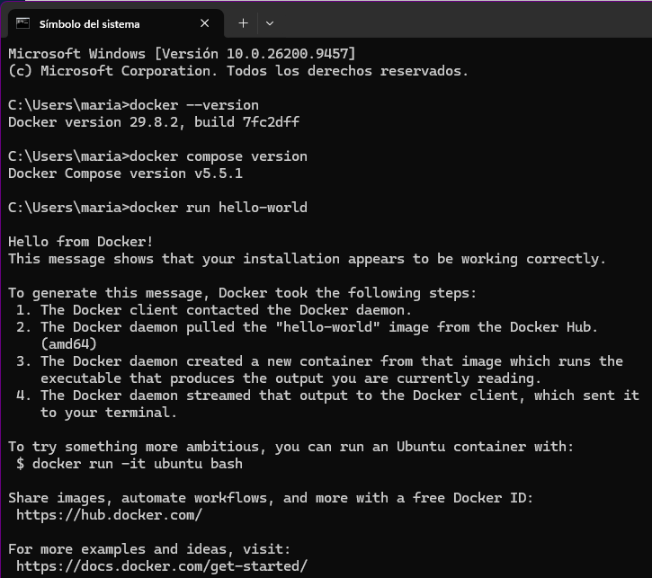

### Parte B — Endpoint de salud

Añadimos la dependencia `spring-boot-starter-actuator` al `pom.xml` y, en `application.properties`, las dos líneas que exponen solo `health` e `info`:

```properties
management.endpoints.web.exposure.include=health,info
management.endpoint.health.show-details=when-authorized
```

Arrancamos la aplicación en local y comprobamos el endpoint:

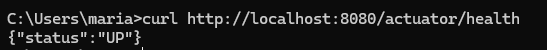

### Parte C — Dockerfile multi-stage

Creamos el `Dockerfile` multi-stage y el `.dockerignore` tal como los da el boletín.

Construimos la imagen y arrancamos un contenedor (en este punto la app todavía usa H2, por eso `/api/tareas` devuelve una lista vacía):

```text
C:\Users\maria>docker build -t tareas-api:0.1 .
C:\Users\maria>docker run --rm -p 8080:8080 tareas-api:0.1
```

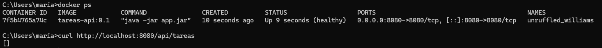

**Comparación de tamaños.** Construimos también solo la etapa intermedia con `--target build` y comparamos:

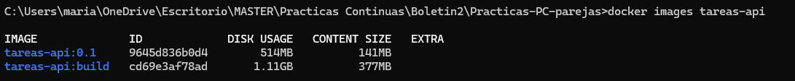

Nuestra versión de Docker (29.8.2) ya no muestra una única columna `SIZE`, sino dos: `DISK USAGE` (el espacio que ocupa en disco, incluyendo capas base que puede compartir con otras imágenes ya descargadas) y `CONTENT SIZE` (el tamaño propio y único de esa imagen). En ambas columnas la etapa `build` es mucho más pesada que la final: la etapa `build` arrastra el JDK completo, Maven y el repositorio local de dependencias (`~/.m2`), mientras que la imagen final solo tiene el JRE, `curl` y el JAR (141 MB de contenido propio frente a 377 MB). Esa diferencia es exactamente la razón de ser del multi-stage build.

**Caché de capas.** Para comprobar el efecto del orden de las instrucciones, cambiamos una línea de `TareaService.java` (un comentario):

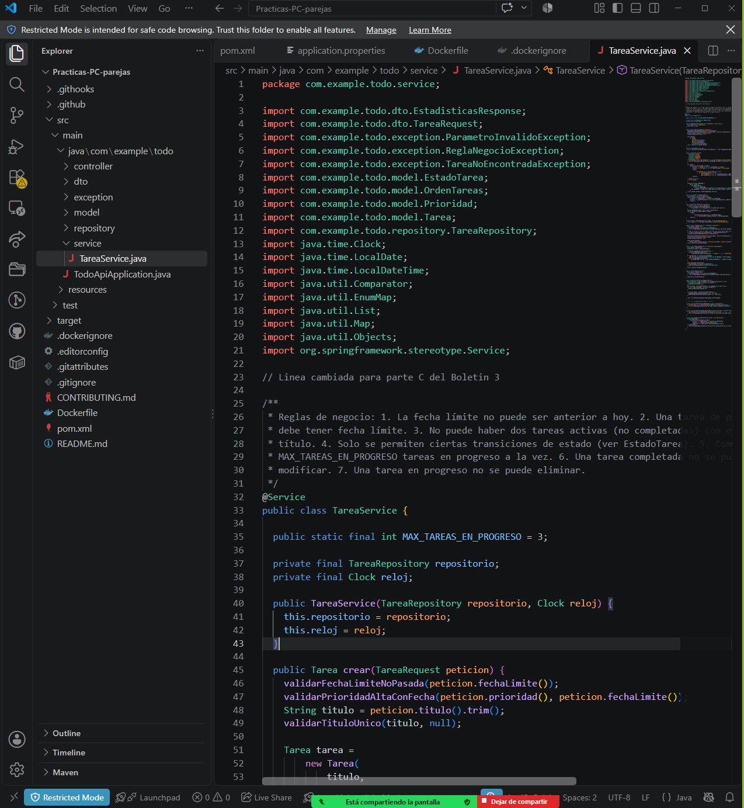

Como estamos en Windows no tenemos `time`, así que usamos `powershell -Command "Measure-Command {<comando a medir> | Out-Default }"`. Con el Dockerfile en su orden original (`COPY pom.xml .` y `RUN mvn dependency:go-offline` antes de `COPY src ./src`), solo cambia la capa de `src` y las siguientes; la descarga de dependencias sigue en caché (`CACHED`) y la build tarda **17,6 s** en total (9,2 s de `mvn clean package`):

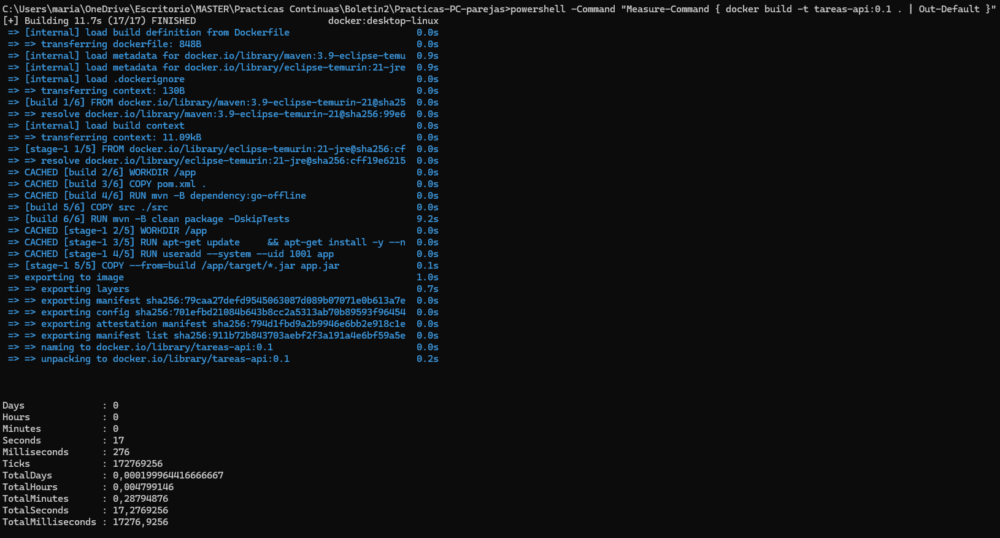

Después movimos `COPY src ./src` por encima de `COPY pom.xml .`, cambiamos otra vez la misma línea y reconstruimos. Esta vez `RUN mvn dependency:go-offline` ya no está en caché (tarda 43,8 s) y la build completa sube a **56,4 s**:

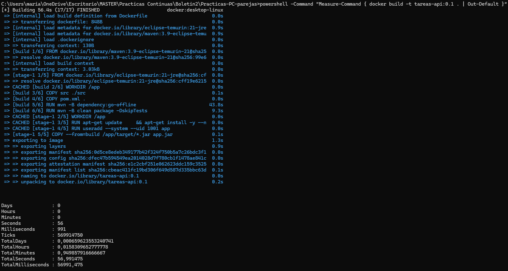

La diferencia se explica por cómo funciona la caché de capas: Docker invalida una capa y todas las siguientes en cuanto cambia alguna de las anteriores, aunque esas capas posteriores no hayan cambiado su propio contenido. Al poner `COPY src ./src` primero, cualquier cambio en el código invalida también `COPY pom.xml .` y la descarga de dependencias, obligando a repetir `mvn dependency:go-offline` entero aunque el `pom.xml` sea idéntico. Dejamos el Dockerfile en su orden original, con el `pom.xml` y las dependencias copiadas primero.

### Parte D — De H2 a PostgreSQL con Compose

#### D.1 Cambiar la base de datos

Le pasamos a Claude el prompt de ejemplo del boletín para sustituir H2 por PostgreSQL manteniendo Spring Data JPA. El cambio creó `TareaJpaRepository` (la interfaz `JpaRepository`) y `TareaRepositoryJpa` (la implementación de `TareaRepository` que delega en ella), y tocó `Tarea.java` (anotaciones JPA) y `TareaService.java`. El repositorio en memoria (`TareaRepositoryEnMemoria`) se quedó en el proyecto pero dejó de ser el bean activo. Comprobamos que `application.properties` no tenía ya ninguna propiedad de H2 y que quedaba la línea:

```properties
spring.jpa.hibernate.ddl-auto=update
```

#### D.2 docker-compose.yml

Creamos el `docker-compose.yml` con el contenido del boletín: un servicio `db` con `postgres:16`, healthcheck con `pg_isready`, volumen nombrado `db-data`, y un servicio `api` construido desde el `Dockerfile`, con `depends_on.db.condition: service_healthy` para que la API no arranque hasta que PostgreSQL esté listo. En este punto las credenciales (`secret_local_dev`) todavía estaban escritas a mano en el YAML, como advierte el recuadro OJO del boletín; en la Parte E lo arreglamos, y en la Parte G se ve qué pasa exactamente si no se arregla.

#### D.3 Comprobar la persistencia

Levantamos el stack completo:

```text
C:\...\Practicas-PC-parejas>docker compose up --build -d
[+] Building 67.1s (19/19) FINISHED
 => [build 4/6] RUN mvn -B dependency:go-offline                                    52.9s
 => [build 6/6] RUN mvn -B clean package -DskipTests                                 9.5s
 [...]
 ✔ Image postgres:16                    Pulled                                      17.0s
 ✔ Image practicas-pc-parejas-api       Built                                       67.4s
 ✔ Container practicas-pc-parejas-db-1  Healthy                                      6.2s
 ✔ Container practicas-pc-parejas-api-1 Started                                      6.3s

C:\...\Practicas-PC-parejas>docker compose ps
NAME                         IMAGE                      SERVICE   STATUS                    PORTS
practicas-pc-parejas-api-1   practicas-pc-parejas-api   api       Up 27 seconds (healthy)   0.0.0.0:8080->8080/tcp
practicas-pc-parejas-db-1    postgres:16                db        Up 33 seconds (healthy)   127.0.0.1:5432->5432/tcp
```

En los logs de `api` se ve que Hibernate conecta de verdad contra PostgreSQL (no contra H2):

```text
C:\...\Practicas-PC-parejas>docker compose logs -f api
api-1  | [...] HikariPool-1 - Added connection org.postgresql.jdbc.PgConnection@6febec41
api-1  | [...] Database version: 16.15
api-1  | [...] Started TodoApiApplication in 6.45 seconds (process running for 7.211)
```

Primero partimos de cero con `down -v` para asegurarnos de que no quedaba ningún dato de pruebas anteriores, y volvimos a levantar el stack:

```text
C:\...\Practicas-PC-parejas>docker compose down -v
 ✔ Volume practicas-pc-parejas_db-data  Removed
C:\...\Practicas-PC-parejas>docker compose up -d
```

Insertamos una tarea y comprobamos que estaba:

```text
C:\Users\maria>curl -X POST http://localhost:8080/api/tareas -H "Content-Type: application/json" -d "{\"titulo\": \"Comprobar persistencia\", \"prioridad\": \"ALTA\", \"fechaLimite\": \"2026-12-31\"}"
{"id":1,"titulo":"Comprobar persistencia", [...] "estado":"PENDIENTE", [...]}

C:\Users\maria>curl http://localhost:8080/api/tareas
[{"id":1,"titulo":"Comprobar persistencia", [...]}]
```

Después hicimos un ciclo de `down` **sin** `-v` seguido de `up -d`, y la tarea seguía ahí:

```text
C:\...\Practicas-PC-parejas>docker compose down
 ✔ Container practicas-pc-parejas-api-1 Removed
 ✔ Container practicas-pc-parejas-db-1  Removed
 ✔ Network practicas-pc-parejas_default Removed
C:\...\Practicas-PC-parejas>docker compose up -d

C:\Users\maria>curl http://localhost:8080/api/tareas
[{"id":1,"titulo":"Comprobar persistencia", [...]}]
```

**Diferencia entre `down` y `down -v`.** `docker compose down` para y elimina los contenedores y la red de Compose, pero **no** toca los volúmenes nombrados: el volumen `db-data` sigue existiendo con todos sus datos, por eso al volver a hacer `up` PostgreSQL arranca con la misma base de datos y la tarea sigue ahí. `docker compose down -v` además borra los volúmenes nombrados: al arrancar de nuevo, PostgreSQL inicializa un volumen vacío desde cero.

### Parte E — Sacar la configuración a un fichero `.env`

Seguimos los siete pasos del boletín: creamos `.env.example` (versionado, sin valores reales) y nuestro `.env` local con `POSTGRES_DB=tareas`, `POSTGRES_USER=app` y `POSTGRES_PASSWORD=secret_local_dev`; añadimos `.env` al `.gitignore`; comprobamos que `.env` ya estaba en el `.dockerignore` de la Parte C; y sustituimos los valores escritos a mano en `docker-compose.yml` por `${POSTGRES_DB}`, `${POSTGRES_USER}` y `${POSTGRES_PASSWORD:?Define POSTGRES_PASSWORD en el fichero .env}`, dejando el healthcheck de `db` con `$$` para que se resuelva dentro del contenedor y no en el host.

Antes de levantar nada comprobamos la sustitución con `docker compose config`:

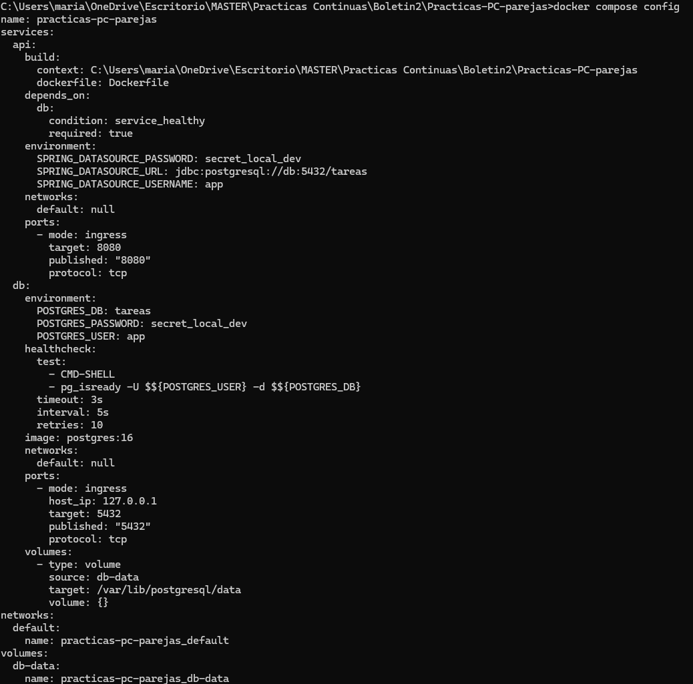

En la salida aparecen ya `tareas`, `app` y la contraseña en lugar de `${...}`, así que las variables se estaban leyendo bien del `.env`. Volvimos a comprobarlo tras el `docker compose down -v && docker compose up --build -d` final, con el mismo resultado:

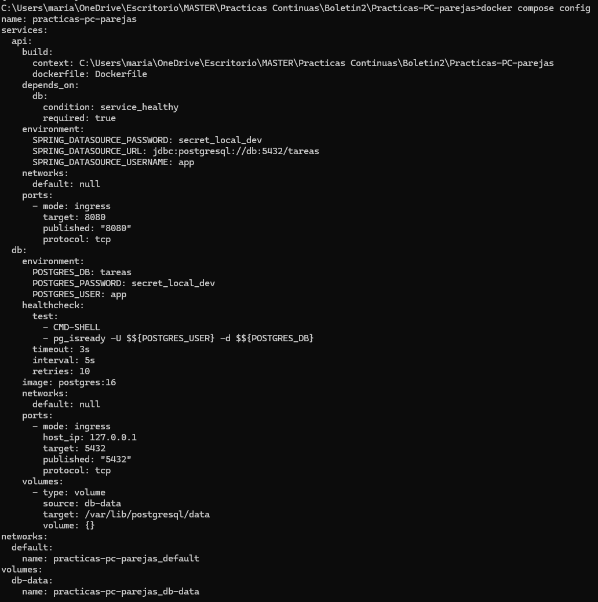

### Parte F — Dev container

Creamos `.devcontainer/devcontainer.json` siguiendo la plantilla del boletín (imagen `mcr.microsoft.com/devcontainers/java:21`, features de Java y de `docker-in-docker`, puertos `8080` y `5432` reenviados, y el `postCreateCommand` que copia `.env.example` a `.env`, activa el hook de Git y descarga las dependencias de Maven).

Al abrir el proyecto con *Dev Containers: Reopen in Container* nos encontramos con un problema que no estaba en el guion: la imagen base ya trae su propio JDK (en `/usr/lib/jvm/msopenjdk-current`), pero el Maven que instala la feature de Java no lo encontraba y fallaba con `java: not found`. Lo resolvimos fijando `JAVA_HOME` explícitamente, tanto en `remoteEnv` como al principio del `postCreateCommand` (para que `mvn dependency:go-offline` lo tenga ya al crear el contenedor).

**¿Para qué sirve la feature docker-in-docker?**
**`docker-in-docker`** permite ejecutar el propio cliente y motor de Docker *dentro* del dev container, montando el socket de Docker del host. Hace falta porque, dentro del dev container, `docker compose up` de la Parte D necesita poder construir y arrancar contenedores sin tener que instalar Docker a mano en esa imagen.
**¿Qué hace cada una de las tres órdenes de postCreateCommand?**
**Las tres órdenes de `postCreateCommand`**, `test -f .env || cp .env.example .env` crea el `.env` local la primera vez que se abre el contenedor (sin sobrescribir uno que ya exista); `git config core.hooksPath .githooks` activa el hook de pre-commit de Spotless del Boletín 1 automáticamente; `mvn -B dependency:go-offline` descarga las dependencias de Maven nada más crear el contenedor.

Una vez dentro del dev container, ejecutamos `docker compose up --build` y comprobamos desde el navegador de nuestra máquina (fuera del contenedor) que la API respondía:

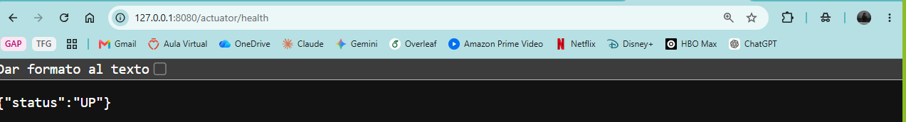

### Parte G — Versionar los cambios

Documentamos en el `README.md` cómo levantar el proyecto con Docker (`docker compose up --build -d`, comprobar `docker compose ps` y el endpoint de salud) y cómo levantar el proyecto con Dev Container (*Reopen in Container* y luego el mismo `docker compose up --build`).

Creamos la rama `boletin3-docker` con todos los cambios del boletín (`Dockerfile`, `.dockerignore`, `docker-compose.yml`, `.env.example`, `.gitignore`, `pom.xml`, `application.properties`, los ficheros de persistencia JPA, `.devcontainer/` y el `README.md`) y abrimos el PR #10, *"chore (docker): añadida la virtualizacion con docker"*, pidiendo revisión a Lucía como propietaria:


En la revisión, se aceptó el pull request, pero GitGuardian indicaba que se podía ver una contraseña en el código:


Por ello, se marcó que era necesario realiza un cambio en el fichero `application.properties`. Se modificó el fichero para que ya no apareciese, pero después se tuvo que modificar el historial de commits para que no quedase constancia alguna de la contraseña. Tras estos dos cambios, GitGuardian indicó que ya no existía ningún problema y se terminó aceptando el pull request, realizando después el merge:


### Parte H — Registry de Docker

Nos registramos en [hub.docker.com](https://hub.docker.com/) y generamos un *Personal Access Token* desde la configuración de la cuenta. Iniciamos sesión en la terminal con el token en vez de la contraseña:

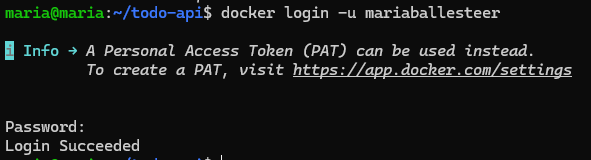

Etiquetamos la imagen local con el nombre de usuario de Docker Hub, tanto con la versión como con `latest`:

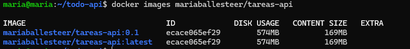

Subimos las dos etiquetas al registry:

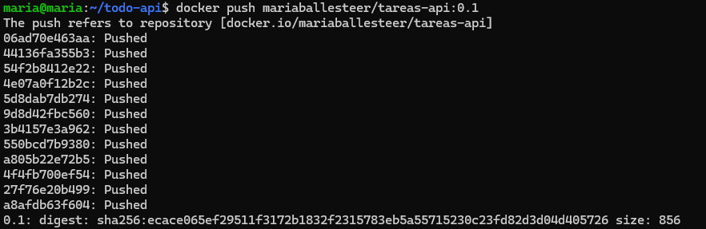
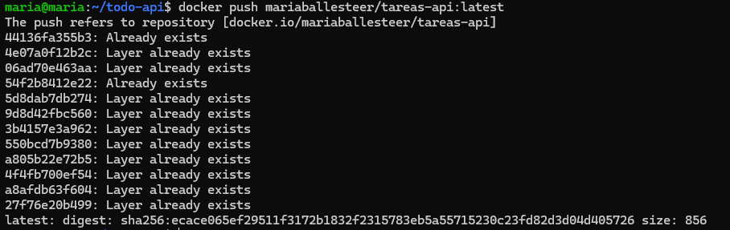

Al subir `latest` todas las capas salieron como *"Already exists"* / *"Layer already exists"*, por lo que Docker Hub no tiene que volver a subir ningún byte, solo registrar la nueva etiqueta.

Comprobamos en la web que el repositorio `mariaballesteer/tareas-api` había quedado público, con la etiqueta `latest` disponible para quien quiera descargarla:

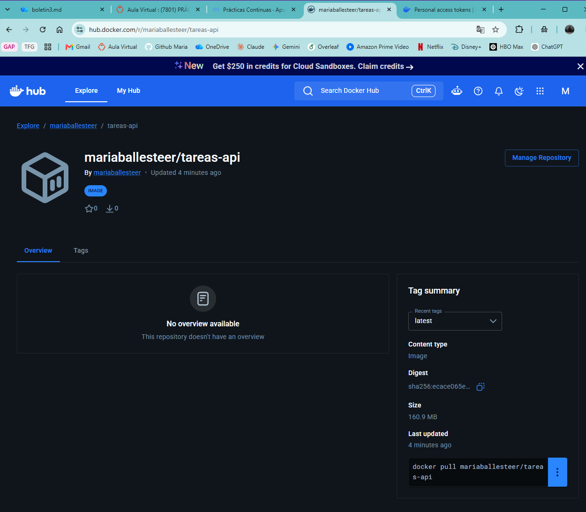

Por último comprobamos que se podía descargar sin más contexto que el nombre de la imagen: borramos las imágenes locales y las volvimos a traer con `docker pull`:

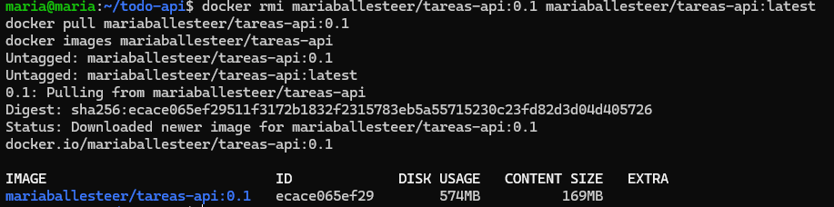

### Parte I — Entorno de pruebas reproducible

El objetivo de esta parte es construir un contenedor que tenga todo lo necesario para ejecutar la batería de tests de un proyecto open source, sin instalar nada en la máquina local y sin modificar el repositorio del proyecto.

#### 1. Repositorio elegido

| Dato | Valor |
|---|---|
| Repositorio | [`pallets/click`](https://github.com/pallets/click) |
| Descripción | Librería de Python para crear interfaces de línea de comandos |
| Popularidad | 17,8k estrellas en GitHub |
| Licencia | BSD-3-Clause |

Es un proyecto popular y no trivial: tiene más de 2.200 tests, una configuración de pruebas con `pytest` y `tox`, y se mantiene activamente. Además es una librería pura de Python, por lo que no necesita servicios externos (bases de datos, colas, etc.) para sus tests.

#### 2. Análisis de requisitos

Fuente principal: el archivo [`pyproject.toml`](https://github.com/pallets/click/blob/main/pyproject.toml) del repositorio.

| Requisito | Valor | Dónde se indica |
|---|---|---|
| Lenguaje | Python 3.10 o superior (`requires-python = ">=3.10"`) | `pyproject.toml` |
| Versiones probadas por el proyecto | Python 3.10 a 3.14, además de `py3.14t` y PyPy 3.11 | entornos de `tox` en `pyproject.toml` |
| Sistema de build | `flit_core` (>=3.11,<4) | `pyproject.toml` |
| Gestor de dependencias | `uv` (con `tox-uv`) | grupos de dependencias y `default-groups` de `uv` |
| Dependencias de tests | Grupo `tests`: `pytest` | `pyproject.toml` |
| Herramienta de orquestación | `tox` | grupo `dev` |
| Comando de tests | `pytest -v --tb=short` | entorno por defecto de `tox` |
| Configuración de pytest | `testpaths = ["tests"]` y `addopts = "-m 'not stress'"` | `pyproject.toml` |

El proyecto define varios grupos de dependencias (`tests`, `tests-random`, `dev`, `docs`, `typing`, `pre-commit`...). Para ejecutar los tests solo hace falta el grupo `tests`, más el propio paquete.

**Dependencias del sistema.** El `pyproject.toml` no menciona ninguna, y de hecho no las lista en ningún sitio. Aparecieron al ejecutar los tests (ver apartado 4).

#### 3. Dockerfile

El Dockerfile se guarda fuera del clon de `click`, de modo que el repositorio del proyecto no se modifica:

```dockerfile
FROM python:3.12-slim

# Dependencia del sistema: los tests de click usan "less" como paginador
RUN apt-get update \
    && apt-get install -y --no-install-recommends less \
    && rm -rf /var/lib/apt/lists/*

# uv gestiona el entorno y las dependencias del proyecto
COPY --from=ghcr.io/astral-sh/uv:latest /uv /usr/local/bin/uv

# El entorno virtual vive en la imagen, no en la carpeta montada
ENV UV_PROJECT_ENVIRONMENT=/opt/venv
ENV UV_LINK_MODE=copy

# El codigo fuente se monta como volumen en /app
WORKDIR /app

CMD ["sh", "-c", "uv sync --no-default-groups --group tests && uv run pytest -v --tb=short -rs"]
```

Decisiones de diseño:

- **`python:3.12-slim`**: cumple el requisito de Python 3.10 o superior y es una imagen pequeña. El inconveniente es que no incluye utilidades del sistema como `less`.
- **`apt-get install less`**: dependencia del sistema que necesitan los tests. Se limpia la caché de `apt` en la misma capa para que no aumente el tamaño de la imagen.
- **`uv` copiado desde su imagen oficial**: es el gestor que usa el proyecto, así se instalan las mismas versiones que fija su `uv.lock`.
- **`UV_PROJECT_ENVIRONMENT=/opt/venv`**: el entorno virtual se crea dentro de la imagen y no en `/app`. Así la carpeta montada (el código del proyecto) no se llena de archivos generados como `.venv`.
- **`UV_LINK_MODE=copy`**: evita avisos de `uv` al trabajar entre sistemas de archivos distintos.
- **Sin `COPY` del código**: el código fuente se monta como volumen (`-v`) en lugar de copiarse en la imagen. Así la imagen es reutilizable y cualquier cambio en el código se prueba sin reconstruirla.
- **`uv sync --no-default-groups --group tests`**: instala el paquete y solo el grupo de dependencias de tests, sin las herramientas de desarrollo, documentación o tipado.
- **`-rs`** en `pytest`: muestra el motivo de cada test omitido.

#### 4. Construcción y ejecución

Preparación (el clon y el Dockerfile viven en una carpeta aparte, fuera de cualquier repositorio nuestro):

```bash
mkdir ~/B3parteI && cd ~/B3parteI
git clone https://github.com/pallets/click.git
# se crea aquí el Dockerfile
```

Construcción de la imagen y ejecución de los tests montando el código como volumen:

```bash
docker build -t click-tests .
cd click
docker run --rm -v "$PWD":/app click-tests
```

##### Primera ejecución: 24 tests fallan

```text
=== 24 failed, 2238 passed, 24 skipped, 31000 deselected, 1 xfailed in 4.56s ===
```

Los 24 fallos eran del mismo test, `tests/test_utils/test_echo_via_pager.py::test_echo_via_pager`, en todas las variantes que usan `less` como paginador. Un ejemplo:

```text
AssertionError: Unexpected pager output in test case 'Plain string argument'
assert '' == 'just text\n'
```

Diagnosticamos que el test comprueba que `click.echo_via_pager` envía el texto a un programa paginador externo. Los casos parametrizados usan `less`, y la imagen `python:3.12-slim` no lo incluye. Sin paginador no se recibe ninguna salida, de ahí `'' == 'just text\n'`. No es un error de `click`: es una dependencia del sistema operativo que no aparece en `pyproject.toml` y que solo se descubre ejecutando los tests en un entorno limpio.

La solución es tan simple como instalar `less` en el Dockerfile con `apt-get install` (primera instrucción `RUN` del Dockerfile de arriba), reconstruir la imagen y volver a ejecutar.

##### Segunda ejecución: todos los tests pasan

```text
SKIPPED [16] tests/test_termui.py:387: Tests user-input using the msvcrt module.
SKIPPED [3] tests/test_termui.py:397: Tests special character inputs using the msvcrt module.
SKIPPED [2] tests/test_termui.py:412: Tests user-input using the msvcrt module.
SKIPPED [2] tests/test_termui.py:569: Windows-specific editor paths
SKIPPED [1] tests/test_testing.py:629: Windows-only test
======== 2262 passed, 24 skipped, 31000 deselected, 1 xfailed in 4.04s =========
```

Interpretación del resultado:

- **2262 passed, 0 failed:** todos los tests ejecutados pasan.
- **24 skipped:** todos son tests exclusivos de Windows (módulo `msvcrt`, rutas de editores de Windows). Es lo esperado en un contenedor Linux.
- **31000 deselected:** los tests de estrés, excluidos por defecto con `-m 'not stress'` en la configuración del proyecto.
- **1 xfailed:** un fallo previsto, marcado como tal por los propios autores del proyecto.

##### Comprobación de que el repositorio no se ha modificado

```bash
cd ~/B3parteI/click
git status
```

```text
maria@maria:~/B3parteI/click$ git status
On branch main
Your branch is up to date with 'origin/main'.

nothing to commit, working tree clean
```
#### Fuentes consultadas para el apartado I

- Repositorio: <https://github.com/pallets/click>
- Configuración del proyecto: <https://github.com/pallets/click/blob/main/pyproject.toml>
- Guía de contribución (instrucciones de entorno de desarrollo): <https://palletsprojects.com/contributing/>