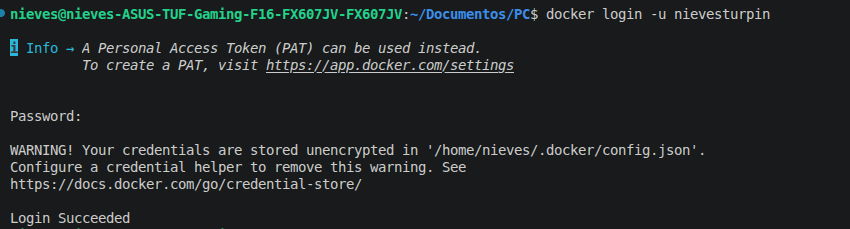
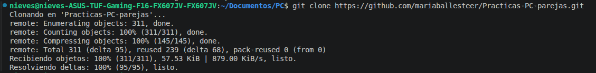
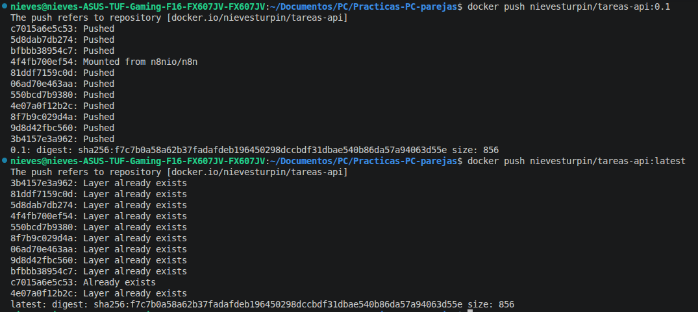
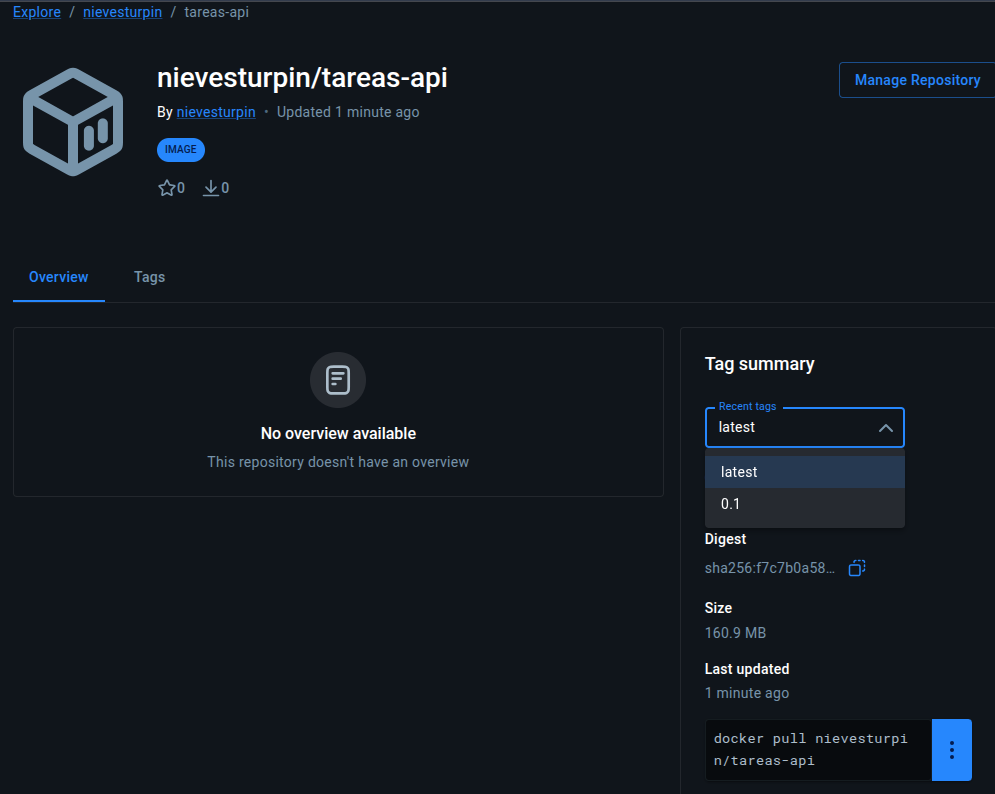
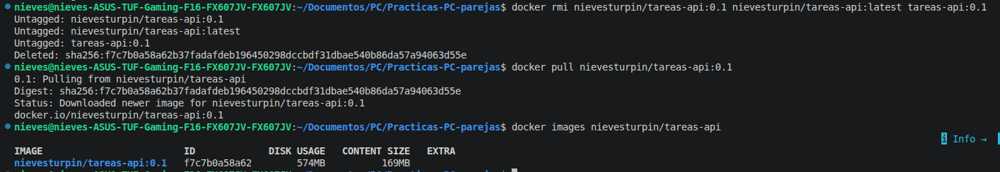
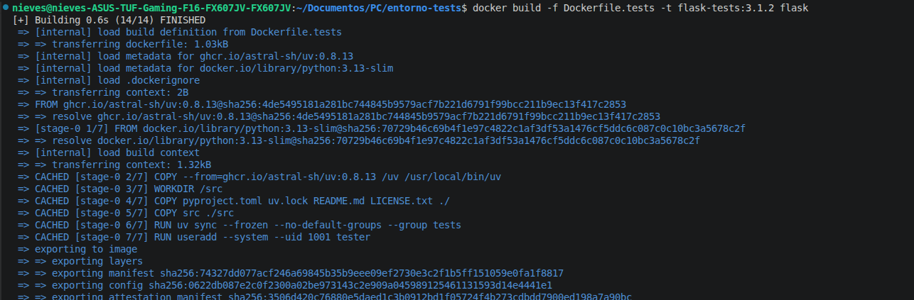
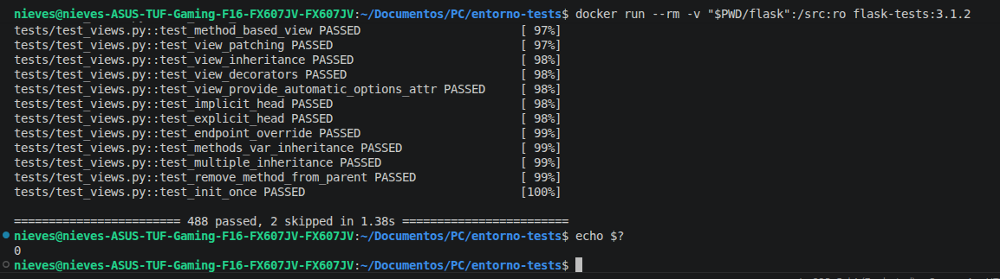
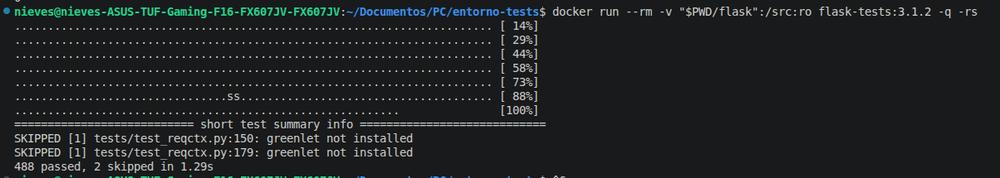
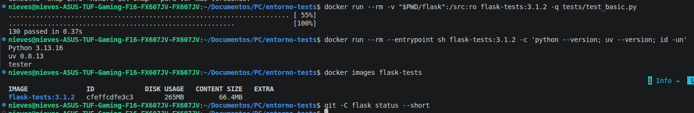

# Boletín 3 — Partes H e I: pasos desde cero

Guía de comandos en orden. La explicación de cada decisión está en la memoria (`boletin3.md`).


## Parte H — Subir la imagen a Docker Hub

Usuario de Docker Hub: `nievesturpin`.

Se ha dividido el proceso en 8 pasos: 

### H.1 — Crear un token de acceso

1. Entrar en <https://hub.docker.com> con la cuenta `nievesturpin`.
2. *Account settings → Personal access tokens → Generate new token*.
3. Permisos: **Read & Write**. Copiar el token (solo se muestra una vez).

### H.2 — Iniciar sesión

```bash
docker login -u nievesturpin
```

Cuando pida `Password`, se tiene que pegar el token. Debe responder `Login Succeeded`.


✅ En esta máquina ya hay una sesión abierta como `nievesturpin`. Se comprueba con:

```bash
docker info | grep -i username
```

### H.3 — Clonar el repositorio del grupo ✅

```bash
cd ~/Documentos/PC
git clone https://github.com/mariaballesteer/Practicas-PC-parejas.git
cd Practicas-PC-parejas
```

Solo se clona para construir la imagen. No se hace ningún commit ni push al repositorio.

### H.4 — Construir la imagen ✅

```bash
docker build -t tareas-api:0.1 .
docker images tareas-api
```

La primera vez tarda un poco (descarga las dependencias de Maven). Resultado: `tareas-api:0.1`, 574MB.

### H.5 — Etiquetar la imagen para Docker Hub ✅

```bash
docker tag tareas-api:0.1 nievesturpin/tareas-api:0.1
docker tag tareas-api:0.1 nievesturpin/tareas-api:latest
docker images | grep tareas-api
```

Las tres líneas deben mostrar el mismo `IMAGE ID`.

### H.6 — Subir la imagen

```bash
docker push nievesturpin/tareas-api:0.1
docker push nievesturpin/tareas-api:latest
```

Esto crea el repositorio **público** `nievesturpin/tareas-api` en Docker Hub. El segundo `push` es casi instantáneo (`Layer already exists`).


### H.7 — Verificar

1. Abrir <https://hub.docker.com/r/nievesturpin/tareas-api> y comprobar que aparecen los tags `0.1` y `latest`.




2. Borrar las copias locales y descargar la imagen desde el registro:

```bash
docker rmi nievesturpin/tareas-api:0.1 nievesturpin/tareas-api:latest tareas-api:0.1
docker pull nievesturpin/tareas-api:0.1
docker images nievesturpin/tareas-api
```


### H.8 — Cerrar sesión (opcional)

```bash
docker logout
```
---

## Parte I — Entorno de pruebas reproducible

Repositorio elegido: [pallets/flask](https://github.com/pallets/flask), tag `3.1.2`.

### I.1 — Crear la carpeta de trabajo y clonar el repositorio

Fuera del repositorio del grupo:

```bash
mkdir entorno-tests && cd entorno-tests
git clone --depth 1 --branch 3.1.2 https://github.com/pallets/flask.git
```

### I.2 — Analizar los requisitos

Análisis hecho sobre el clon del tag `3.1.2`. Cada dato lleva el fichero del repositorio del que sale.

#### Lenguaje y versiones

- **Lenguaje**: Python. El paquete está en `src/flask/` y los tests en `tests/` (22 ficheros `test_*.py`).
- **Versión mínima**: Python 3.9.

  ```toml
  # pyproject.toml, línea 22
  requires-python = ">=3.9"
  ```

- **Versiones que el proyecto prueba**: 3.9, 3.10, 3.11, 3.12, 3.13 y PyPy 3.11.

  ```toml
  # pyproject.toml, [tool.tox]
  env_list = [
      "py3.13", "py3.12", "py3.11", "py3.10", "py3.9",
      "pypy3.11",
  ```

  La matriz de integración continua (`.github/workflows/tests.yaml`) coincide, y usa 3.13 como versión principal: es la única que se ejecuta también en Windows y macOS.

**Decisión**: Python **3.13**, la versión más reciente soportada y la principal en el CI del proyecto.

#### Gestor de paquetes

- **`uv`**. El repositorio incluye un fichero `uv.lock` con 84 paquetes fijados a una versión exacta, y el CI instala y ejecuta todo con `uv`:

  ```yaml
  # .github/workflows/tests.yaml
  - uses: astral-sh/setup-uv@... # v6.5.0
  - run: uv run --locked tox run -e ...
  ```

- No hay `requirements.txt`: las dependencias se declaran en `pyproject.toml` y se fijan en `uv.lock`.

**Decisión**: instalar con `uv sync --frozen`, que usa exactamente las versiones de `uv.lock` sin volver a resolverlas.

#### Herramienta de build

- **`flit_core`**, necesaria para instalar el propio Flask como paquete.

  ```toml
  # pyproject.toml, [build-system]
  requires = ["flit_core<4"]
  build-backend = "flit_core.buildapi"
  ```

  No hay que instalarla a mano: `uv` la descarga en un entorno aislado al instalar el proyecto.

#### Dependencias de ejecución

```toml
# pyproject.toml, [project]
dependencies = [
    "blinker>=1.9.0",
    "click>=8.1.3",
    "importlib-metadata>=3.6.0; python_version < '3.10'",
    "itsdangerous>=2.2.0",
    "jinja2>=3.1.2",
    "markupsafe>=2.1.1",
    "werkzeug>=3.1.0",
]
```

`importlib-metadata` solo aplica a Python < 3.10, así que en 3.13 no se instala.

#### Dependencias de test

```toml
# pyproject.toml, [dependency-groups]
tests = [
    "asgiref",
    "greenlet ; python_version < '3.11'",
    "pytest",
    "python-dotenv",
]
```

`greenlet` solo aplica a Python < 3.11, así que en 3.13 no se instala. Esto explica los 2 tests omitidos del paso I.5 (`greenlet not installed`).

El proyecto define más grupos (`dev`, `docs`, `pre-commit`, `typing`) y `uv` instala varios por defecto:

```toml
# pyproject.toml, [tool.uv]
default-groups = ["dev", "pre-commit", "tests", "typing"]
```

**Decisión**: instalar solo el grupo `tests` con `--no-default-groups --group tests`. `ruff`, `tox`, `mypy`, `pyright` o `pre-commit` no hacen falta para ejecutar los tests y engordarían la imagen.

#### Cómo se ejecutan los tests

- Con **`pytest`** sobre la carpeta `tests/`, tratando cualquier *warning* como error:

  ```toml
  # pyproject.toml, [tool.pytest.ini_options]
  testpaths = ["tests"]
  filterwarnings = [
      "error",
  ]
  ```

- El proyecto los lanza a través de `tox`, que acaba ejecutando este comando con el grupo `tests`:

  ```toml
  # pyproject.toml, [tool.tox.env_run_base]
  dependency_groups = ["tests"]
  commands = [[
      "pytest", "-v", "--tb=short", "--basetemp={env_tmp_dir}",
  ```

**Decisión**: ejecutar `pytest -v --tb=short` directamente. `tox` sirve para probar varias versiones de Python a la vez; en un contenedor con una única versión no aporta nada.

#### Dependencias del sistema

**Ninguna.** No hace falta compilador, ni `git`, ni librerías del sistema, ni servicios externos (base de datos, red):

- Todas las dependencias se instalan desde paquetes precompilados (*wheels*). La única con código nativo es `markupsafe`, y también viene precompilada.
- Comprobado en la imagen construida: no contiene `gcc` ni `git`, y los tests pasan.

**Decisión**: imagen base `python:3.13-slim` (Debian 13) sin ningún `apt-get install`.

#### Resumen

| Requisito | Valor | Fuente |
|---|---|---|
| Lenguaje | Python | `pyproject.toml` |
| Versión | `>=3.9`; se usa 3.13 | `pyproject.toml` (`requires-python`, `[tool.tox]`), `.github/workflows/tests.yaml` |
| Gestor de paquetes | `uv` | `uv.lock`, `.github/workflows/tests.yaml` |
| Herramienta de build | `flit_core<4` | `pyproject.toml` (`[build-system]`) |
| Dependencias de ejecución | `blinker`, `click`, `itsdangerous`, `jinja2`, `markupsafe`, `werkzeug` | `pyproject.toml` (`[project] dependencies`) |
| Dependencias de test | `pytest`, `asgiref`, `python-dotenv` | `pyproject.toml` (`[dependency-groups] tests`) |
| Ejecución de tests | `pytest -v --tb=short` sobre `tests/` | `pyproject.toml` (`[tool.pytest.ini_options]`, `[tool.tox.env_run_base]`) |
| Dependencias del sistema | Ninguna | `uv.lock` (todo en *wheels*) |

Versiones exactas que quedan instaladas en la imagen (salida de `uv pip list`), todas tomadas de `uv.lock`:

```text
Package       Version
------------- -------
asgiref       3.9.1
blinker       1.9.0
click         8.2.1
flask         3.1.2   (editable, /src)
iniconfig     2.1.0
itsdangerous  2.2.0
jinja2        3.1.6
markupsafe    3.0.2
packaging     25.0
pluggy        1.6.0
pygments      2.19.2
pytest        8.4.1
python-dotenv 1.1.1
werkzeug      3.1.3
```

### I.3 — Crear el Dockerfile

Crear el fichero `~/Documentos/PC/entorno-tests/Dockerfile.tests` (al lado de la carpeta `flask`, no dentro) con este contenido:

```dockerfile
# Entorno reproducible para ejecutar los tests de pallets/flask (tag 3.1.2)
FROM python:3.13-slim

# uv: gestor de paquetes que usa el proyecto (uv.lock)
COPY --from=ghcr.io/astral-sh/uv:0.8.13 /uv /usr/local/bin/uv

# El entorno virtual vive fuera de /src para que el bind mount no lo tape
ENV UV_PROJECT_ENVIRONMENT=/opt/venv \
    UV_LINK_MODE=copy \
    PATH="/opt/venv/bin:$PATH" \
    PYTHONDONTWRITEBYTECODE=1

WORKDIR /src

# Solo lo necesario para resolver e instalar dependencias (capa cacheable)
COPY pyproject.toml uv.lock README.md LICENSE.txt ./
COPY src ./src

# Versiones exactas de uv.lock: dependencias de runtime + grupo "tests".
# Flask se instala en modo editable, apuntando a /src/src (el código montado).
RUN uv sync --frozen --no-default-groups --group tests

# Usuario sin privilegios
RUN useradd --system --uid 1001 tester
USER tester

# El código se monta en /src en tiempo de ejecución
ENTRYPOINT ["pytest", "-p", "no:cacheprovider"]
CMD ["-v", "--tb=short"]
```

Comprobar la estructura:

```bash
ls ~/Documentos/PC/entorno-tests
# Dockerfile.tests  flask
```

### I.4 — Construir la imagen

Desde `~/Documentos/PC/entorno-tests`:

```bash
docker build -f Dockerfile.tests -t flask-tests:3.1.2 flask
```



### I.5 — Ejecutar los tests

```bash
docker run --rm -v "$PWD/flask":/src:ro flask-tests:3.1.2
```


### I.6 — Comprobaciones para la memoria

```bash
# Motivo de los 2 tests omitidos
docker run --rm -v "$PWD/flask":/src:ro flask-tests:3.1.2 -q -rs
```



```bash
# Un solo fichero de tests
docker run --rm -v "$PWD/flask":/src:ro flask-tests:3.1.2 -q tests/test_basic.py

# Versiones y usuario dentro del contenedor
docker run --rm --entrypoint sh flask-tests:3.1.2 -c 'python --version; uv --version; id -un'

# Tamaño de la imagen
docker images flask-tests

# El repositorio clonado no se ha modificado (no debe mostrar nada)
git -C flask status --short
```



### I.7 — Limpieza (opcional)

```bash
docker rmi flask-tests:3.1.2
```

---
