# Boletín 4

## Resumen de commits

| # | Mensaje del commit | Qué se hizo | Autor | Enlace |
|---|--------------------|-------------|-------|--------|
| 1 | `ci: añade pipeline básico de integración continua (#12)` | Squash del PR #12 (rama `boletin4A`): crea `.github/workflows/ci.yml` con un único job `build` que ejecuta `mvn --batch-mode verify`. | Lucía Olmos Martínez | [f1e9393](https://github.com/mariaballesteer/Practicas-PC-parejas/commit/f1e9393) |
| 2 | `ci: separar el pipeline en jobs (#13)` | Squash del PR #13 (rama `ci/jobs`): divide `ci.yml` en tres jobs encadenados con `needs`: `lint`, `test` y `package`. | Maria Ballester | [7b9684c](https://github.com/mariaballesteer/Practicas-PC-parejas/commit/7b9684c) |
| 3 | `ci: fallo y arreglo del formato (#14)` | Squash del PR #14 (rama `ci/fallo-formato`, 3 commits): desordena `TareaController.java` saltando el hook con `--no-verify`, comprueba que `lint` falla y `test` y `package` se saltan, y lo corrige para que el pipeline vuelva a verde. | Maria Ballester | [62a2661](https://github.com/mariaballesteer/Practicas-PC-parejas/commit/62a2661) |
| 4 | `ci: un test falla` | En la rama `feat/fallo_test` (PR #15, cerrado sin fusionar), cambia una aserción de `TareaRepositoryEnMemoriaTest` para que falle y comprobar que la protección de `main` bloquea la fusión. | Lucía Olmos Martínez | [b66da59](https://github.com/mariaballesteer/Practicas-PC-parejas/commit/b66da59) |
| 5 | `test: rompe aserción a propósito para comprobar CI (#18)` | Squash del PR #18 (rama `test/romper-test-ci`, 2 commits): cambia a propósito la aserción de `crear_conFechaLimiteHoy_seAcepta` para que el job `test` falle y la restaura después, con el pipeline otra vez en verde. | Nieves Turpín | [d1ccaca](https://github.com/mariaballesteer/Practicas-PC-parejas/commit/d1ccaca) |
| 6 | `Feat/ci ampliaciones (#19)` | Squash del PR #19 (rama `feat/ci-ampliaciones`, 4 commits): añade el workflow `ai-review.yml`, que resume con IA los cambios de cada PR usando el secreto `OLLAMA_API_KEY` (y comenta "La IA ha fallado" si algo falla), y el badge de estado del CI en el `README.md`. | Nieves Turpín | [9d7fc98](https://github.com/mariaballesteer/Practicas-PC-parejas/commit/9d7fc98) |

## Detalle por commit

### 1. `ci: añade pipeline básico de integración continua (#12)`
- **Qué se hizo:** en la rama `boletin4A` (commit original `b2fb8f9`) creamos `.github/workflows/ci.yml` con el pipeline del enunciado: un único job `build` que hace checkout, configura JDK 21 con caché de Maven y ejecuta `mvn --batch-mode verify`. Se disparaba con `push` a `main` y con `pull_request`. El PR #12 se aprobó, el check `CI / build` pasó en verde y se fusionó con squash en `main` (`f1e9393`).
- **Autor:** Lucía Olmos Martínez
- **Relación con el boletín:** Parte A, primer pipeline de CI.
- **Uso de IA:** nada.

### 2. `ci: separar el pipeline en jobs (#13)`
- **Qué se hizo:** en la rama `ci/jobs` (commit original `79ff39b`) reestructuramos `ci.yml`: sustituimos el job `build` por tres jobs encadenados (`lint` → `test` → `package`), ampliamos `permissions` con `actions: read` y `checks: write` para `dorny/test-reporter`, añadimos el informe JUnit con `if: always()` y la subida del JAR como artefacto `app-jar`. Se fusionó con squash en `main` (`7b9684c`).
- **Autor:** Maria Ballester
- **Relación con el boletín:** Parte C, separar responsabilidades en jobs.
- **Uso de IA:** nada.

### 3. `ci: fallo y arreglo del formato (#14)`
- **Qué se hizo:** en la rama `ci/fallo-formato` desordenamos `TareaController.java` (sangrías irregulares y espacios sobrantes) y lo confirmamos con `git commit --no-verify` para saltar el hook de Spotless (commit `86cd6ab`). En el PR #14 el job `lint` falló y `test` y `package` quedaron *skipped*. Después restauramos el formato con Spotless (commit `09141d5`), el pipeline se relanzó y los tres jobs pasaron a verde. Tras la aprobación de la revisora, el PR se fusionó con squash en `main` (`62a2661`), que reúne los tres commits de la rama (`79ff39b`, `86cd6ab` y `09141d5`).
- **Autor:** Maria Ballester
- **Relación con el boletín:** Parte C, provocar un fallo de formato, comprobar que corta el pipeline, corregirlo y volver a ejecutar.
- **Uso de IA:** nada.

### 4. `ci: un test falla`
- **Qué se hizo:** en la rama `feat/fallo_test` cambiamos en `TareaRepositoryEnMemoriaTest.guardar_asignaIdsCorrelativos` el id esperado del segundo elemento de `2L` a `3L` y abrimos el PR #15. Con la protección de `main` ya activa, el check `test` salió en rojo, `package` se saltó y GitHub bloqueó la fusión. El PR se cerró sin fusionar y se borró la rama, por lo que este commit no está en `main`.
- **Autor:** Lucía Olmos Martínez
- **Relación con el boletín:** Parte D, comprobar que el CI actúa como barrera.
- **Uso de IA:** nada.

### 5. `test: rompe aserción a propósito para comprobar CI (#18)`
- **Qué se hizo:** en la rama `test/romper-test-ci` cambiamos en `TareaServiceTest` la aserción de `crear_conFechaLimiteHoy_seAcepta` de `isEqualTo(HOY)` a `isEqualTo(HOY.plusDays(1))` (commit `c40ff63`) y abrimos el PR #18. El job `lint` pasó, `test` falló y `package` se saltó. Después restauramos la aserción a `isEqualTo(HOY)` y hicimos push a la misma rama (commit `f048802`): el pipeline del PR #18 se relanzó y los tres jobs pasaron a verde. Como los dos commits se anulan entre sí, el PR no cambia el código; se fusionó con squash en `main` (`d1ccaca`).
- **Autor:** Nieves Turpín
- **Relación con el boletín:** Parte B, provocar un fallo, comprobar que el CI lo detecta y que el check vuelve a verde tras el arreglo.
- **Uso de IA:** nada.

### 6. `Feat/ci ampliaciones (#19)`
- **Qué se hizo:** en la rama `feat/ci-ampliaciones` creamos `.github/workflows/ai-review.yml` (commit `25c4bcb`). En cada `pull_request` obtiene el diff respecto a la rama base, lo envía a la API de Ollama Cloud (`gpt-oss:120b`) y publica el resumen como comentario en el PR con `gh`. La API key se lee del secreto `OLLAMA_API_KEY` y, si algo falla, el comentario es "La IA ha fallado". Añadimos debajo del título del `README.md` el badge del workflow `ci.yml` sobre `main`, enlazado al historial de ejecuciones (commit `8a2b742`). Para comprobar el caso de error cambiamos temporalmente `MODELO` a `noexiste` (commit `956898b`) y volvimos a poner `gpt-oss:120b` antes de fusionar (commit `6d69382`). Se fusionó con squash en `main` (`9d7fc98`).
- **Autor:** Nieves Turpín
- **Relación con el boletín:** Parte E, gestión de secretos y badge de estado del CI, incluida la verificación del caso de error que pide el enunciado.
- **Uso de IA:** Claude propuso la estructura del workflow (llamada a la API con `curl` y `jq`, tratamiento de errores y permisos `pull-requests: write`), generó la línea de markdown del badge y sugirió el método para provocar el fallo.

## Descripción narrativa de lo hecho en la sesión y relación con los commits

### Parte A — Primer pipeline de CI

Partimos de `main` actualizado y creamos la rama `boletin4A`. En ella añadimos `.github/workflows/ci.yml` con el pipeline del enunciado.

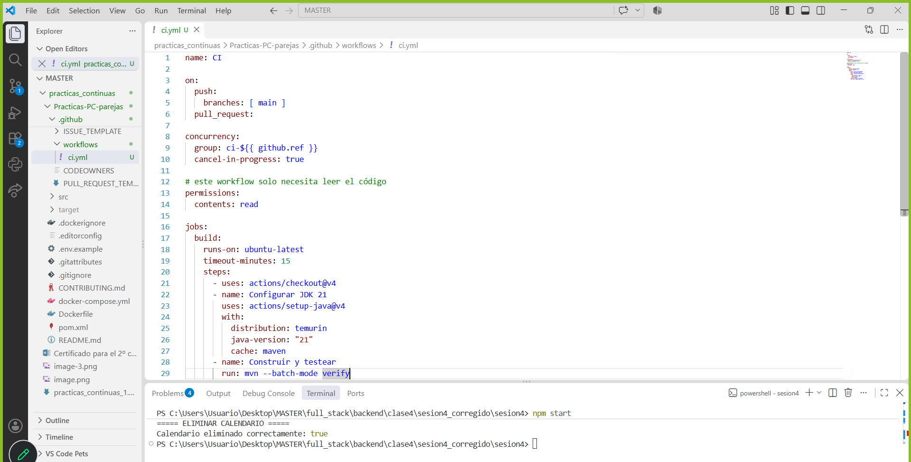

Hicimos commit con el mensaje `ci: añade pipeline básico de integración continua`, que incluye un único fichero nuevo de 29 líneas:

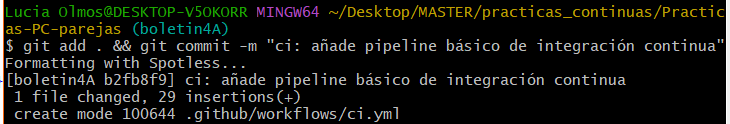

Subimos la rama con `git push --set-upstream origin boletin4A`:

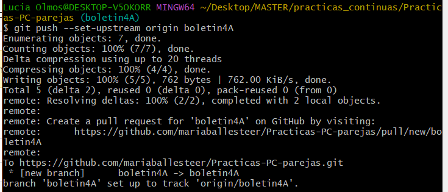

Abrimos el PR contra `main` con la plantilla del repositorio:

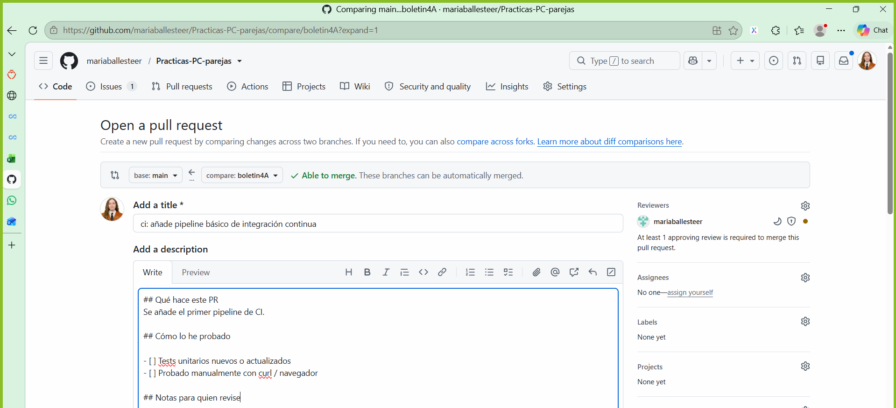

El workflow se lanzó por el evento `pull_request` y el check `CI / build` terminó en verde en 24 s. Con la aprobación de la revisora, el PR #12 quedó listo para fusionar sin conflictos:

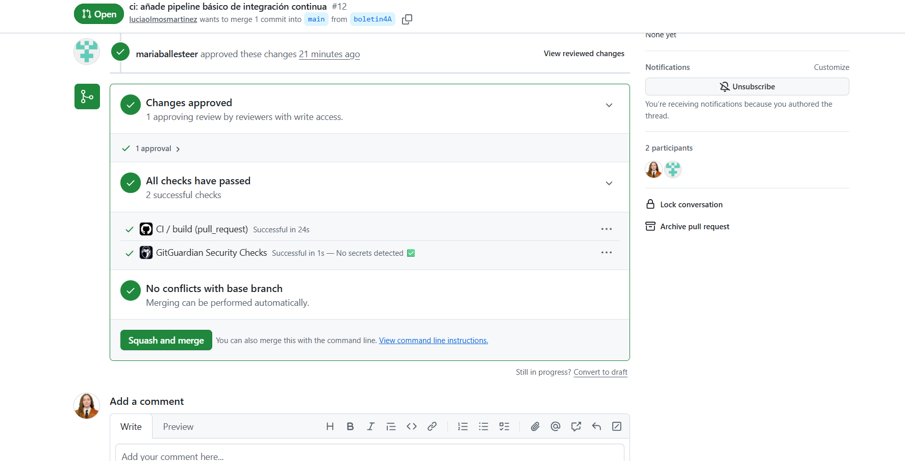

Lo fusionamos con *Squash and merge* (commit `f1e9393` en `main`) y se borró la rama:

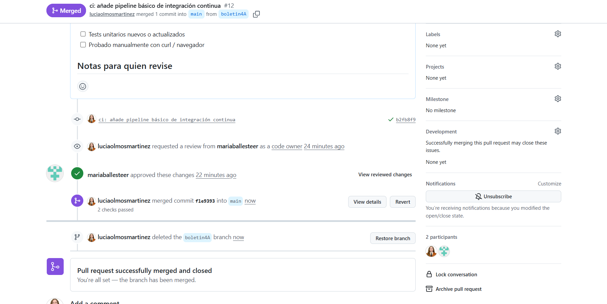

**Campo concurrency**

```yaml
concurrency:
  group: ci-${{ github.ref }}
  cancel-in-progress: true
```

`concurrency` evita que se acumulen ejecuciones del mismo workflow sobre el mismo código. El `group` es la clave que agrupa las ejecuciones. En cada grupo solo puede haber una ejecución a la vez y, con `cancel-in-progress: true`, cuando llega una ejecución nueva se **cancela la que seguía en curso**.

Es útil porque si hacemos varios pushes seguidos a la rama de un PR, solo importa el resultado del último commit: así no se gastan minutos de runner en commits ya obsoletos y el check que se ve en el PR corresponde siempre al código más reciente. Los grupos de los PRs son distintos, por lo que la ejecución de un PR nunca cancela la de otro; pero, si entran dos fusiones seguidas en `main`, la ejecución del primer commit puede cancelarse y no llegar a terminar.

**Cuándo se dispara el workflow**

Según el bloque `on`, se dispara en dos casos:

- **`push` a `main`:** en cada commit que llega a `main`, por ejemplo al fusionar un PR. Es la comprobación posterior a la fusión.
- **`pull_request`:** se dispara cuando se **abre** un PR, cuando se suben **commits nuevos** a su rama (`synchronize`) y cuando se **reabre**, sea cual sea la rama de destino.

No se dispara con un push a otra rama que no tenga PR abierto. Con esta configuración, el push de `boletin4A` por sí solo no ejecuta nada y el pipeline arranca al abrir el PR.

### Parte B — Demostrar que el CI atrapa errores

Para comprobar que el pipeline detecta errores, creamos la rama `test/romper-test-ci` y rompimos a propósito el test `crear_conFechaLimiteHoy_seAcepta` de `TareaServiceTest`. La aserción original comprueba que la fecha límite de la tarea creada es `HOY`:

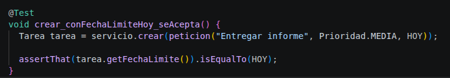

La cambiamos para que espere `HOY.plusDays(1)`, de modo que el test falle:

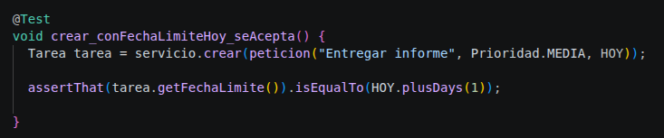

Antes de subirlo lo comprobamos en local con `mvn -B test`. Maven muestra un fallo en `TareaServiceTest.crear_conFechaLimiteHoy_seAcepta:64`, porque esperaba `2026-06-16` y obtuvo `2026-06-15`:

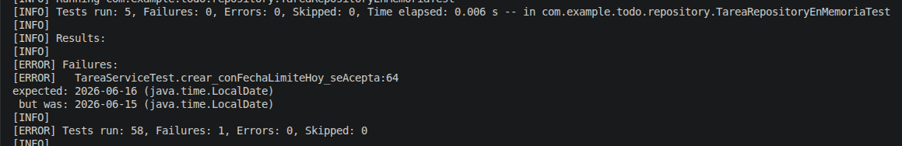

Después hicimos commit y push de la rama y abrimos el PR #18 contra `main`. El diff del PR solo contiene el cambio de la aserción:

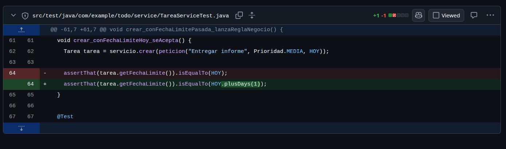

El pipeline se lanzó automáticamente por el evento `pull_request`. Como el código respeta el formato de Spotless, el job `lint` pasó, pero el job `test` falló y el check se puso en **rojo**. El job `package` se saltó (*skipped*) porque depende de `test` mediante `needs`. Además, como los checks están marcados como *Required*, GitHub bloquea la fusión:

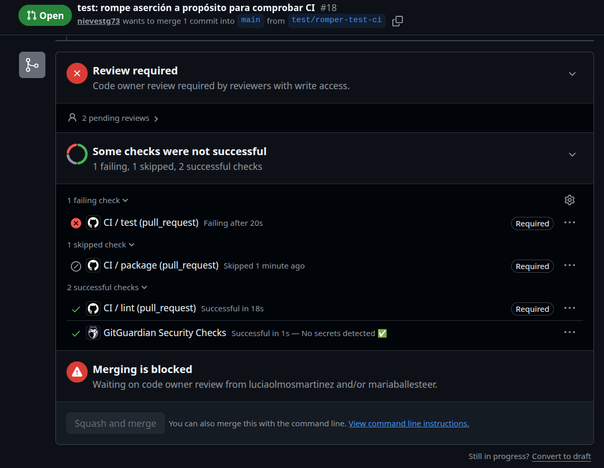

En el detalle del job `test`, el paso «Publicar informe de tests» (dorny/test-reporter) indica que de los 34 tests de `TareaServiceTest` pasan 33 y falla 1, `crear_conFechaLimiteHoy_seAcepta`, con un `AssertionFailedError` (*expected* `2026-06-16`, *but was* `2026-06-15`). Este paso se ejecuta aunque fallen los tests gracias a `if: always()`:

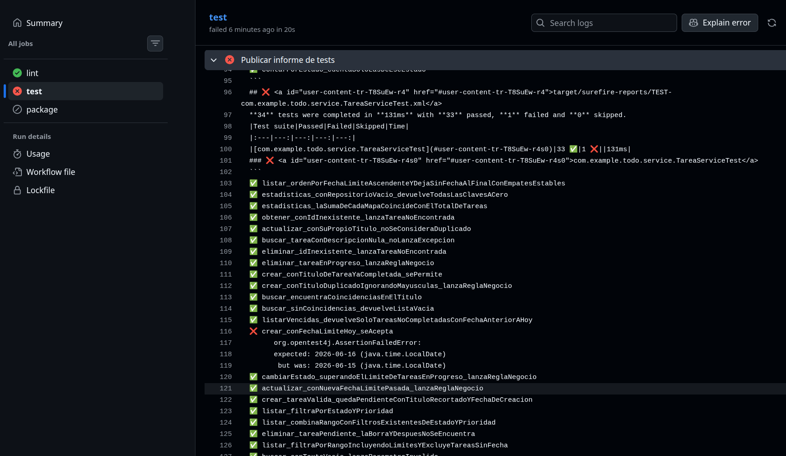

Por último, restauramos la aserción a `isEqualTo(HOY)` y hicimos push a la misma rama. El PR relanzó el pipeline y los tres jobs (`lint`, `test` y `package`) pasaron a **verde**:

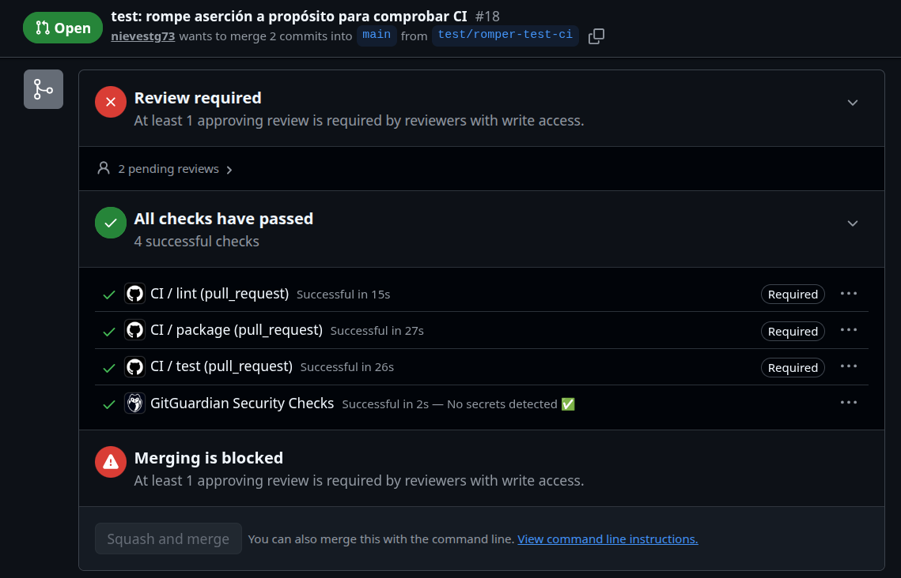

Con esto queda demostrado que el CI detecta una regresión antes de que llegue a `main` y que el feedback llega en pocos segundos. Como el commit que rompe el test y el que lo arregla se anulan entre sí, el PR no cambia el código; se fusionó con squash en `main` (`d1ccaca`) y queda como evidencia.

### Parte C — Separar responsabilidades en jobs

En la rama `ci/jobs` reestructuramos `ci.yml`. Mantuvimos `name`, `on` y `concurrency`, ampliamos `permissions` y sustituimos el job `build` por tres jobs encadenados con `needs`:

- **`lint`:** ejecuta `mvn -B spotless:check`.
- **`test`** (`needs: lint`): ejecuta `mvn -B verify` y publica el informe **Resultados JUnit** con `dorny/test-reporter`.
- **`package`** (`needs: test`): ejecuta `mvn -B package -DskipTests` y sube `target/*.jar` como artefacto `app-jar` con 7 días de retención.

Los permisos nuevos, `actions: read` y `checks: write`, son los que necesita `dorny/test-reporter` para consultar el workflow y publicar el informe como check del PR.

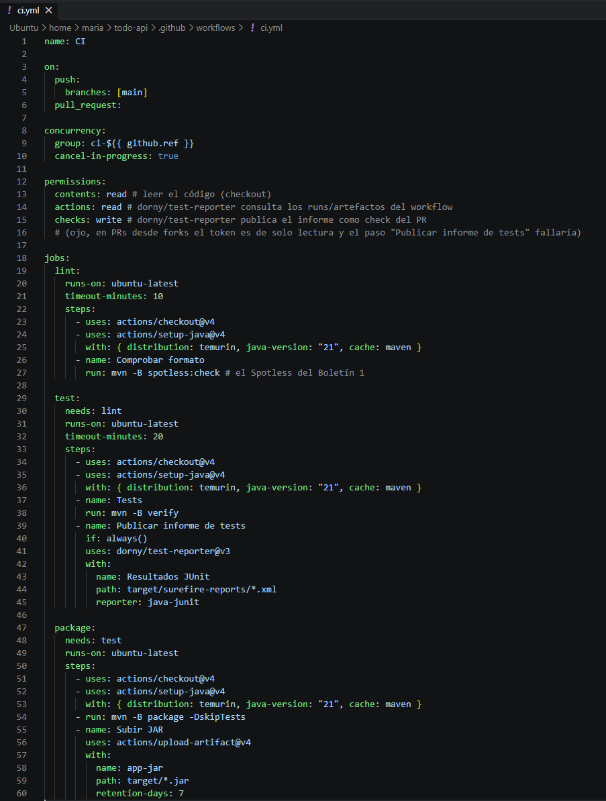

Lo subimos en el PR #13 («ci: separar el pipeline en jobs»):

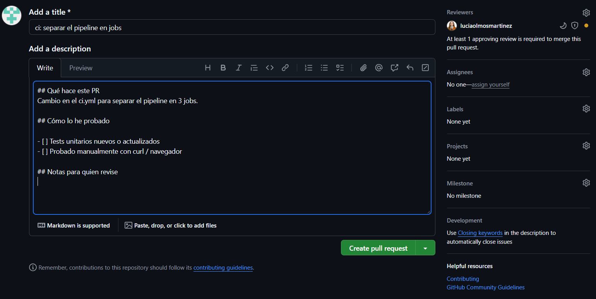

**Provocar el fallo de formato**

En otra rama, `ci/fallo-formato`, desordenamos `TareaController`: sangrías irregulares, espacios antes de los paréntesis y un espacio antes de un `;`. Spotless lo considera mal formateado:

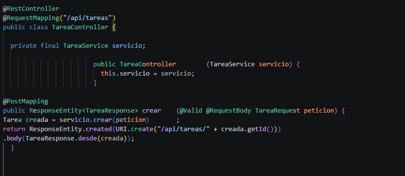

Lo confirmamos saltándonos el hook con `git commit --no-verify` (commit `86cd6ab`) y abrimos el PR #14. El pipeline se puso en rojo en el job `lint`, que falló a los 23 s. Los jobs `test` y `package` ni siquiera se ejecutaron: quedaron como *skipped* porque dependen de `lint` mediante `needs`, y el botón de fusionar aparece deshabilitado:

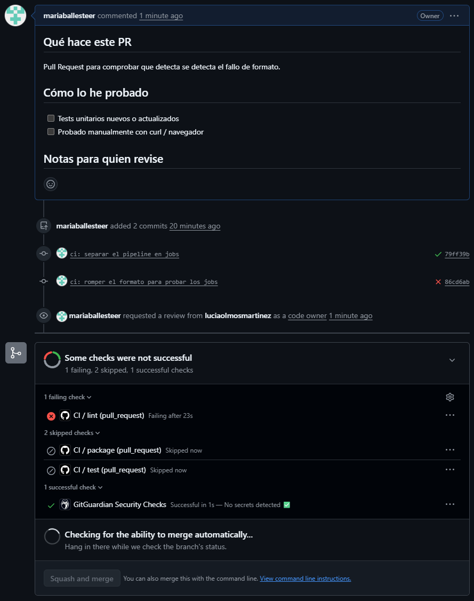

**Corregir el fallo y volver a ejecutar**

Restauramos el formato con Spotless (commit `09141d5`) y hicimos push a la misma rama. El pipeline se relanzó y los tres jobs pasaron a verde (`lint` en 20 s, `test` en 19 s y `package` en 22 s). Con la aprobación de la revisora, el PR quedó listo para fusionar:

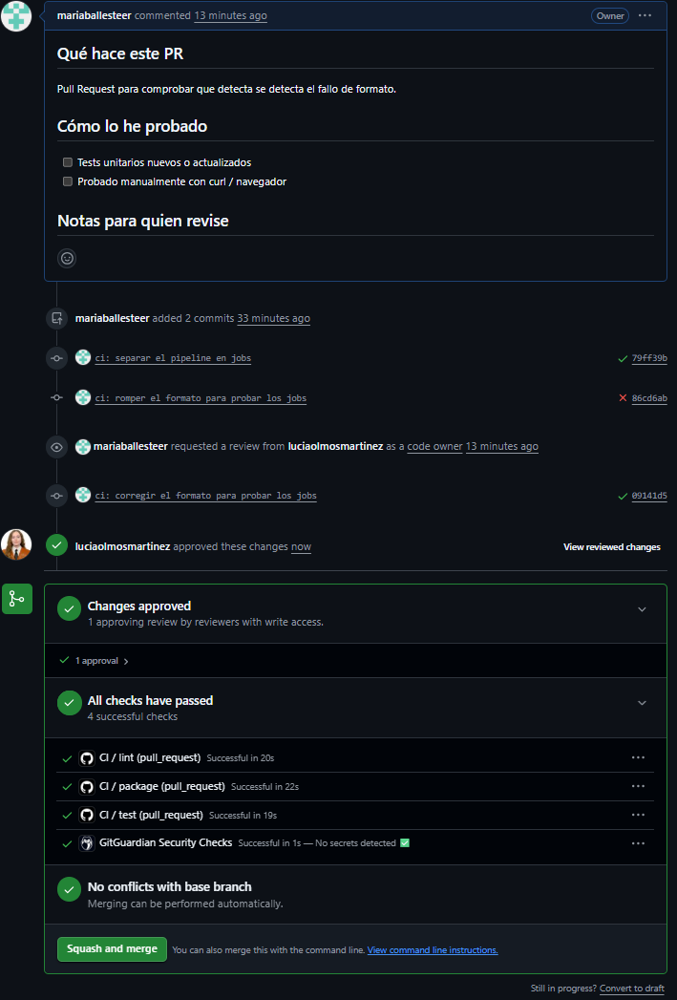

El job `test` publica el informe **Resultados JUnit** a partir de `target/surefire-reports/*.xml`. Aparece como un check más del PR e indica qué test ha fallado y con qué mensaje, como se ve en la captura de la Parte B. El job `package` sube el JAR como artefacto `app-jar`, que se puede descargar desde el resumen de la ejecución durante 7 días.

**Por qué lint va primero**

Es el job más barato y rápido: solo comprueba el formato, sin compilar ni ejecutar tests, y en nuestras ejecuciones tardó entre 13 y 23 s. Como `test` depende de él con `needs: lint`, un fallo de formato corta el pipeline desde el primer momento. No se gastan minutos de runner en tests y empaquetado que no sirven de nada mientras el código no esté bien formateado, y quien hace el push se entera enseguida: en la prueba, `test` y `package` ni arrancaron. Además, cada job rojo apunta a una causa distinta (`lint` es formato, `test` es comportamiento y `package` es empaquetado) y el fallo de formato se arregla con un solo comando, `mvn spotless:apply`.

**Por qué el informe lleva `if: always()`**

Por defecto, un paso solo se ejecuta si todos los anteriores han terminado bien (equivale a `if: success()`). Cuando falla un test, `mvn -B verify` termina con error y el paso del informe se saltaría, justo cuando más falta hace saber qué test ha fallado. Con `if: always()` el paso se ejecuta pase lo que pase y el informe se publica también cuando hay tests rotos.

**Por qué se reconstruye el proyecto**

Cada job se ejecuta en un runner nuevo y limpio, con su propio sistema de ficheros, y al terminar el job el runner se destruye. Aunque `mvn verify` en el job `test` ya compiló y empaquetó el proyecto, el directorio `target/` desaparece con ese runner y `package` parte de cero, por lo que tiene que volver a construirlo.

### Parte D — Convertir el CI en una barrera

En **Settings → Branches** editamos la regla de protección de `main` del Boletín 2 y activamos:

- **Require status checks to pass before merging**, con los checks `lint`, `test` y `package`.
- **Require branches to be up to date before merging**, que obliga a actualizar la rama del PR respecto a `main` antes de fusionar, de modo que los checks se ejecuten con el código más reciente.
- **Do not allow bypassing the above settings**, para que la regla también se aplique a los administradores.

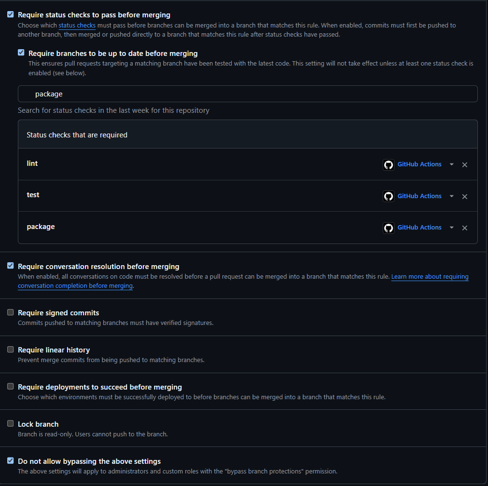

Para verificarlo, creamos la rama `feat/fallo_test` y cambiamos una aserción de `TareaRepositoryEnMemoriaTest.guardar_asignaIdsCorrelativos`: el id esperado del segundo elemento pasa de `2L` a `3L` (commit `b66da59`, una línea modificada). Abrimos el PR #15 contra `main`:

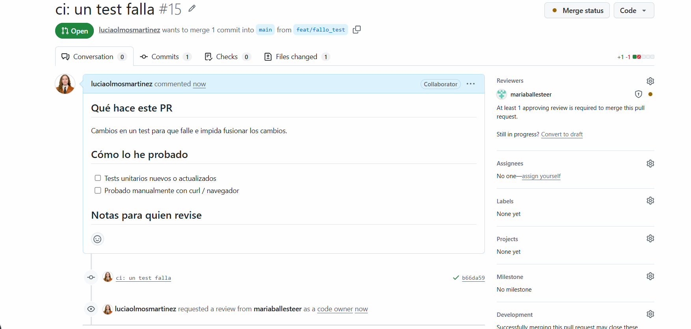

En local, Maven confirma el fallo: `expected: 3L but was: 2L`, con 58 tests ejecutados y 1 fallo.

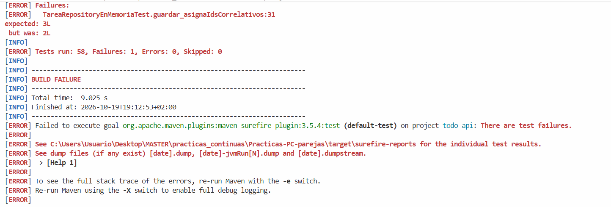

En el PR, `lint` pasa, `test` falla a los 15 s y `package` se salta. Los tres aparecen marcados como **Required**, y GitHub muestra **Merging is blocked** con el botón de fusión deshabilitado. En este caso hay dos barreras: el check obligatorio `test` en rojo y la revisión pendiente de la *code owner*.

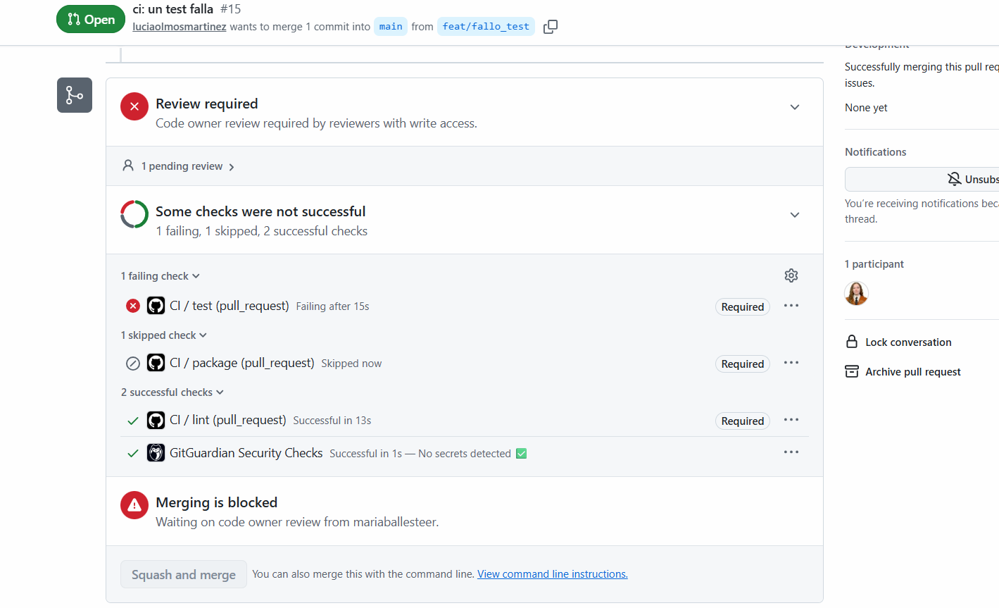

Como este cambio no debe llegar a `main`, cerramos el PR sin fusionar y borramos la rama. Con esto el CI deja de ser solo informativo: `main` solo recibe código que ha pasado formato, tests y empaquetado, y ni los administradores pueden saltarse la regla.

### Parte E — Ampliaciones

#### Gestión de secretos: revisión de PRs con IA

En la rama `feat/ci-ampliaciones` añadimos un nuevo workflow, `.github/workflows/ai-review.yml`, que se dispara con el evento `pull_request` (tipos `opened`, `synchronize` y `reopened`). El workflow obtiene el diff del PR respecto a la rama base, lo recorta a 60 KB para no superar el contexto del modelo y lo envía a la API de Ollama Cloud (modelo `gpt-oss:120b`) pidiendo un resumen en español de los cambios y de sus posibles riesgos. La respuesta se publica como comentario en el PR con la CLI `gh`. Para poder comentar, el workflow declara `permissions: pull-requests: write`.

La API key de Ollama no está en el repositorio. La guardamos como secreto del repositorio en **Settings → Secrets and variables → Actions** con el nombre `OLLAMA_API_KEY`. GitHub la almacena cifrada, no deja ver su valor una vez guardada y la oculta en los logs (aparece como `***`). El workflow la lee con `${{ secrets.OLLAMA_API_KEY }}` y la pasa como variable de entorno al paso que llama a la API:

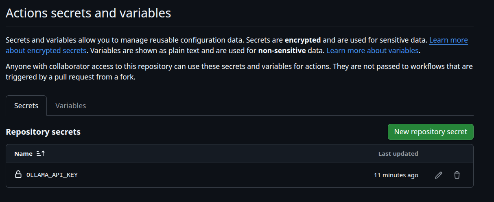

Abrimos el PR #19 contra `main` y el workflow publicó automáticamente un comentario con el resumen generado por la IA. El resumen describe tanto el nuevo workflow como el badge añadido al README, y señala riesgos como el envío del diff a un servicio externo o la dependencia del secreto:

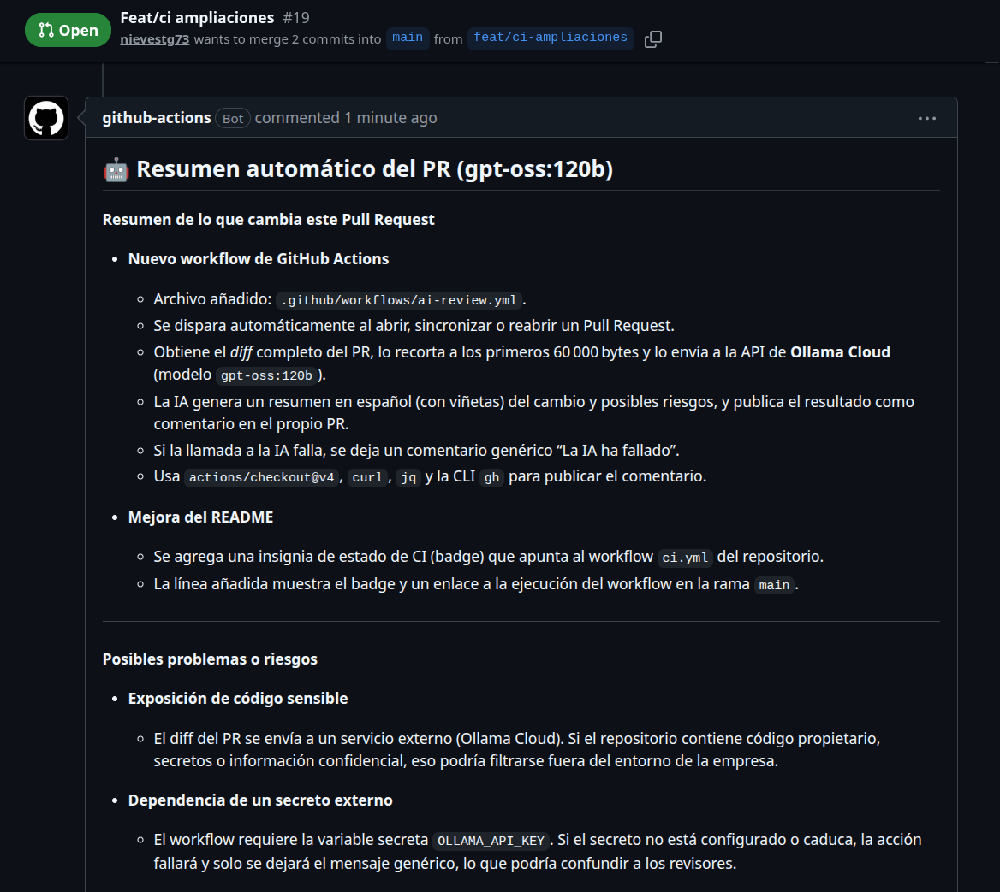

En el PR, el nuevo check `Revisión IA / resumen-ia` aparece junto a los checks de CI (`lint`, `test` y `package`) y todos pasan. La fusión sigue bloqueada porque falta la revisión de los *code owners*:

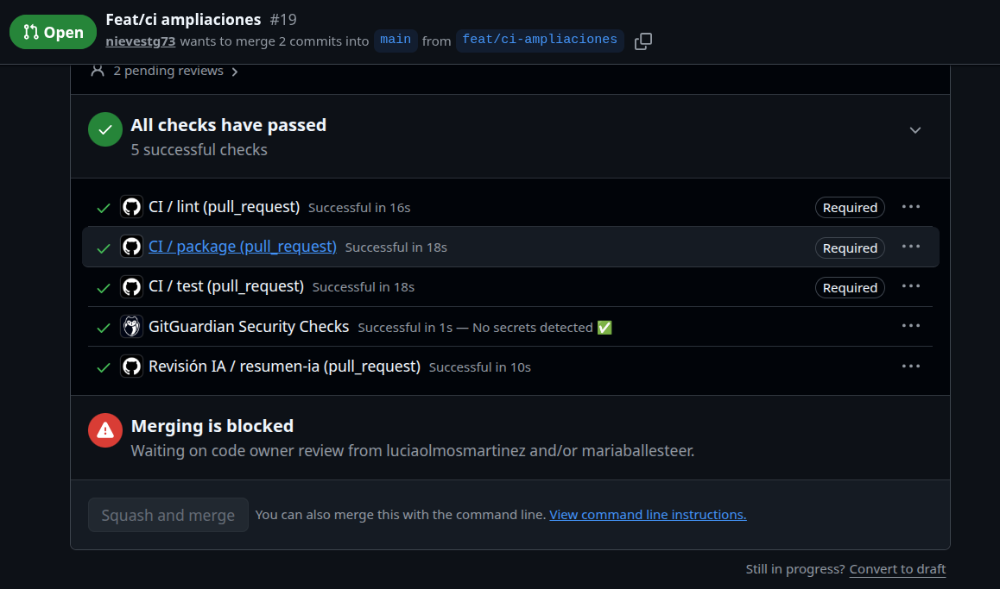

**Gestión de errores.** Si la llamada a la IA falla (código HTTP distinto de 200, respuesta vacía o fallo en un paso anterior), el comentario publicado es "La IA ha fallado". El paso que publica el comentario lleva `if: always()`, así que el comentario se publica pase lo que pase. Para comprobarlo, cambiamos temporalmente el modelo por uno que no existe (`MODELO: noexiste`) y subimos el cambio a la misma rama:

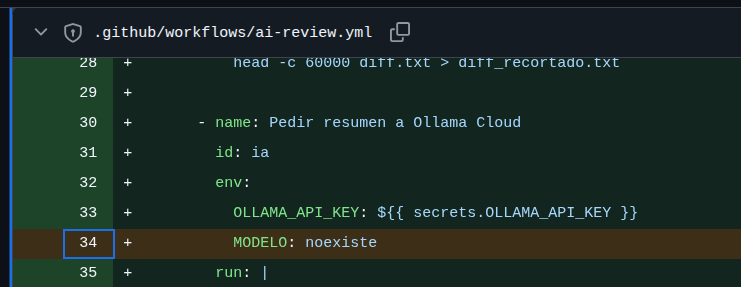

El workflow se volvió a ejecutar y esta vez el bot comentó el mensaje de error esperado:

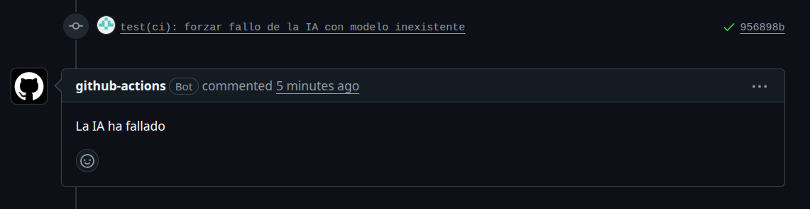

Después restauramos `MODELO: gpt-oss:120b` y el PR volvió a recibir un resumen correcto.

#### Badge de estado del CI

En la misma rama añadimos al `README.md`, justo debajo del título, el badge del workflow `ci.yml` sobre `main`:

```markdown
[](https://github.com/mariaballesteer/Practicas-PC-parejas/actions/workflows/ci.yml)
```

En el diff del PR #19 se ve la línea añadida al README:

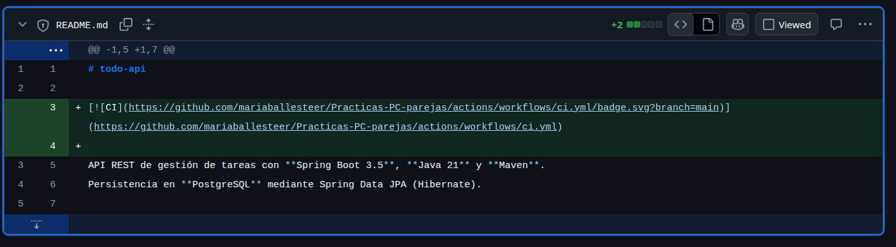

GitHub genera la imagen en el momento con el resultado del último run de CI en `main`. Así, cualquiera que entre al repositorio ve si la rama principal está sana (*passing*) o rota (*failing*), y al hacer clic llega al historial de ejecuciones.