# Boletín 5

## Resumen de commits

| # | Mensaje del commit | Qué se hizo | Autor | Enlace |
|---|--------------------|-------------|-------|--------|
| 1 | `cd: añadir pipeline de publicación (#16)` | 5-A: añade `.github/workflows/release.yml`, que construye la imagen Docker y la publica en GHCR | Lucía Olmos Martínez | [a12861c](https://github.com/mariaballesteer/Practicas-PC-parejas/commit/a12861c8a52bb6566acbcebe1276a67157c7deba) |
| 2 | `chore: docs/pages (#21)` | 5-D: generador de la web de documentación, workflow `pages.yml` y `.gitignore` | María Ballester Martínez | [e670005](https://github.com/mariaballesteer/Practicas-PC-parejas/commit/e670005) |

Las partes 5-B (etiqueta `v1.0.0` y Release) y 5-C (verificar la imagen) no modifican ficheros del repositorio, por lo que no generan commit.

## Detalle por commit

### 1. `cd: añadir pipeline de publicación (#16)` — [a12861c](https://github.com/mariaballesteer/Practicas-PC-parejas/commit/a12861c8a52bb6566acbcebe1276a67157c7deba)

- **Qué se hizo:** se creó `.github/workflows/release.yml` (44 líneas). Se dispara con `push` a `main` y con etiquetas `v*.*.*`, tiene permisos mínimos (`contents: read`, `packages: write`) y un único job `publish` que hace login en GHCR con `docker/login-action` usando `GITHUB_TOKEN`, calcula los tags con `docker/metadata-action` y construye y publica la imagen con `docker/build-push-action`.
- **Autor:** Lucía Olmos Martínez (aprobado por María Ballester como code owner; 4 checks en verde antes del merge).
- **Relación con el boletín:** Parte 5-A.
- **Uso de IA:** nada.

### 2. `chore: docs/pages (#21)` — [e670005](https://github.com/mariaballesteer/Practicas-PC-parejas/commit/e670005)

- **Qué se hizo:** se añadió la carpeta `docs/` con los boletines organizados por carpetas (incluidos los tres del Boletín 1), el script `docs/build_site.py` que convierte los `.md` en HTML con `markdown-it-py` y copia las imágenes, `docs/requirements.txt`, el workflow `.github/workflows/pages.yml` y la entrada `docs/site/` en `.gitignore`.
- **Autor:** María Ballester Martínez.
- **Relación con el boletín:** Parte 5-D.
- **Uso de IA:** Claude escribió el script generador, el CSS de la web y el workflow `pages.yml`.

## Descripción narrativa de lo hecho en la sesión y relación con los commits

### Parte A — Pipeline de publicación

Creamos `.github/workflows/release.yml` en la rama `feat/release_boletin5A`. Hicimos el commit `cd: añadir pipeline de publicación` (`feaf96e`) y lo subimos con `git push --set-upstream origin feat/release_boletin5A`.

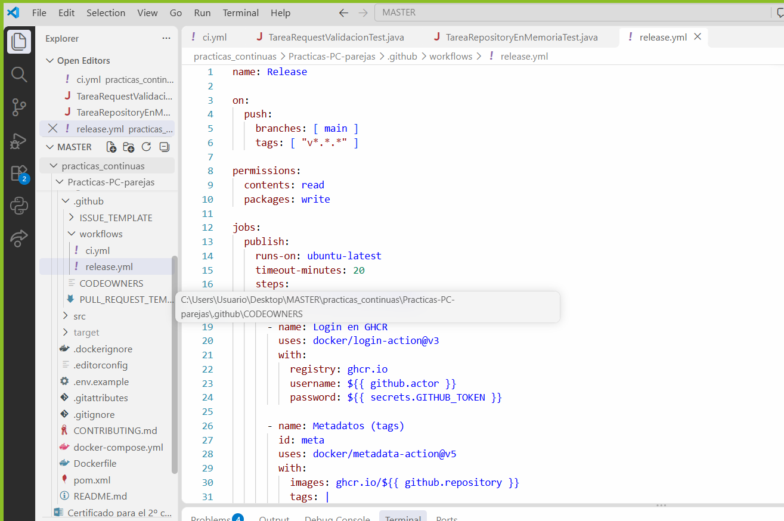

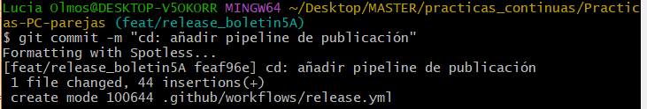

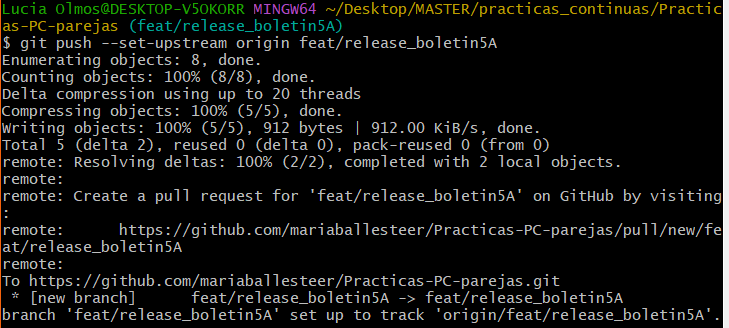

El workflow se ejecuta en dos situaciones: cuando se hace `push` a `main` (es decir, al integrar un PR) y cuando se sube una etiqueta con formato `v*.*.*`. Los permisos se limitan a `contents: read` y `packages: write`, que es lo único que necesita para leer el código y escribir el paquete en GHCR. Los pasos son: login en `ghcr.io` con el `GITHUB_TOKEN` del propio workflow, cálculo de los tags y etiquetas OCI con `docker/metadata-action`, y construcción y publicación con `docker/build-push-action`.

Los tags de la imagen dependen de qué evento dispara el workflow:

- **Al aceptar un PR en `main`:** se publica `sha-<commit>` (inmutable, identifica exactamente el commit) y `latest`, que solo se añade en la rama por defecto.
- **Al subir una etiqueta `vX.Y.Z`:** además se publican los tags semánticos `X.Y.Z`, `X.Y` y `X`.

Abrimos el PR para subir los cambios a la rama `main` con la plantilla del repositorio y pasamos todos los tests.

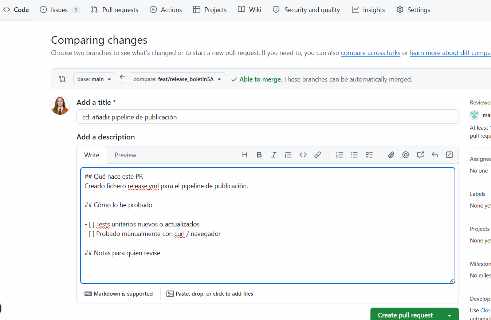

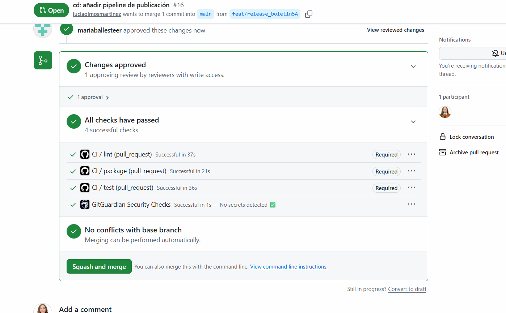

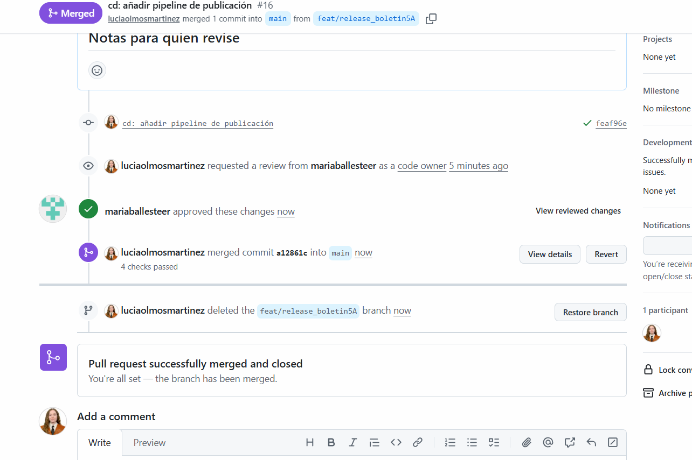

Al integrarse el PR se disparó el workflow `Release` y apareció el paquete `practicas-pc-parejas` en GHCR con los tags `latest` y `sha-a12861c`, que es el commit que acababa de entrar en `main`.

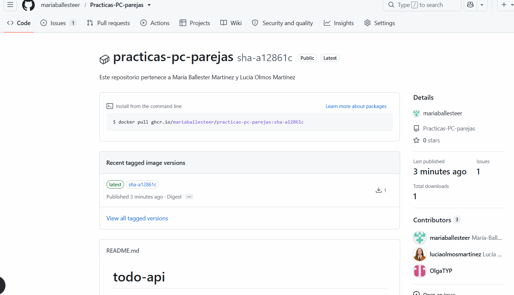

### Parte B — Publicar una versión de verdad

Esta parte no modifica ficheros, así que no tiene commit propio: consiste en publicar la primera versión con una etiqueta Git. Desde `main` actualizada creamos una etiqueta anotada y la subimos:

```
git tag -a v1.0.0 -m "Primera versión publicable de la API de tareas"
git push origin v1.0.0
git tag -n
```

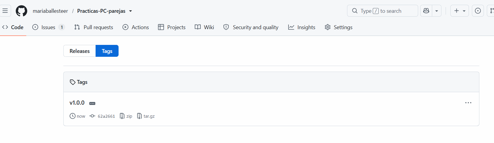

Con la etiqueta creada, el workflow `Release` publicó la imagen con los tags semánticos. En el paquete aparecen juntos `latest`, `1`, `1.0`, `1.0.0` y `sha-a12861c`, todos sobre la misma imagen.

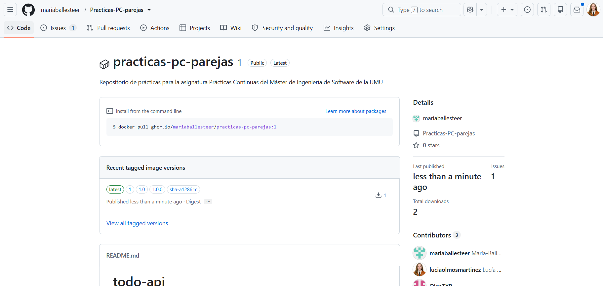

Después creamos la Release en GitHub sobre la etiqueta existente `v1.0.0`, con el título `v1.0.0` y las notas generadas automáticamente con *Generate release notes*, que lista los PR integrados desde el principio del proyecto.

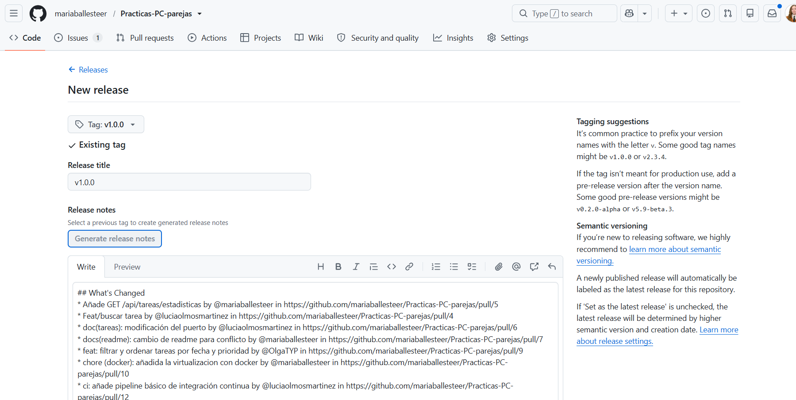

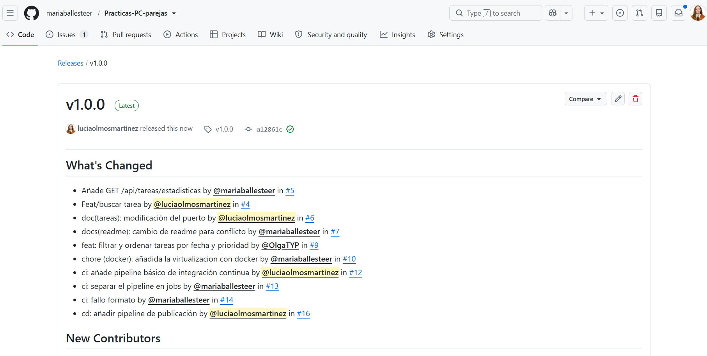

### Parte C — Verificar la imagen publicada

Esta parte no toca el repositorio, así que no tiene commit asociado: consiste en comprobar que la imagen que publicó el workflow `Release` en GHCR funciona fuera del pipeline.

Antes de empezar comprobamos que el package `practicas-pc-parejas` es público: sin hacer `docker login ghcr.io`, el registro devuelve los manifiestos de los tags `1.0.0`, `1.0`, `1` y `latest`. Por eso pudimos hacer el `pull` sin Personal Access Token. El nombre de la imagen va en minúsculas (`ghcr.io/mariaballesteer/practicas-pc-parejas`) porque `docker/metadata-action` lo convierte así y Docker no acepta mayúsculas en el nombre del repositorio.

Como desde el Boletín 3 la API necesita PostgreSQL, reproducimos a mano lo que hace nuestro `docker-compose.yml`:

1. Creamos la red `tareas-net` para que los dos contenedores se vean por nombre (el DNS interno de Docker resuelve `db`).
2. Levantamos `postgres:16` con el nombre `db` y las variables `POSTGRES_DB`, `POSTGRES_USER` y `POSTGRES_PASSWORD`.
3. Esperamos con `pg_isready` a que la base de datos aceptara conexiones. Con `docker run` no hay `depends_on` ni `healthcheck` como en Compose, y si la API arranca antes que Postgres falla al conectar.
4. Descargamos la imagen con `docker pull ghcr.io/mariaballesteer/practicas-pc-parejas:1.0.0`.
5. Arrancamos la API en la misma red, publicando el puerto 8080 y pasándole la conexión por `SPRING_DATASOURCE_URL`, `SPRING_DATASOURCE_USERNAME` y `SPRING_DATASOURCE_PASSWORD`.
6. Consultamos `/actuator/health` hasta que respondió `{"status":"UP"}`.
7. Borramos los contenedores `db` y `api` y la red `tareas-net`.

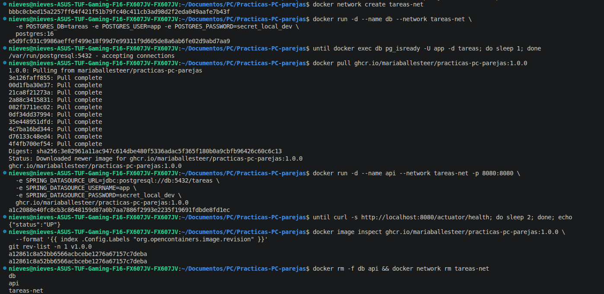

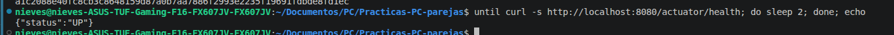

Además comprobamos la trazabilidad de la imagen. La etiqueta OCI `org.opencontainers.image.revision`, que añade `docker/metadata-action`, coincide con el commit al que apunta la etiqueta Git `v1.0.0` (`a12861c8a52bb6566acbcebe1276a67157c7deba`). Es decir, la imagen `1.0.0` del registro se construyó exactamente desde ese commit.

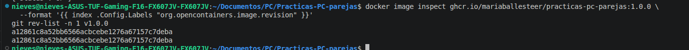

- **Uso de IA:** Claude comprobó que el package era público y estaban todos los tags, y nos dio la secuencia de comandos, incluyendo la espera con `pg_isready` y la comprobación del label `revision` para documentar la trazabilidad.

### Parte D — GitHub Pages de la documentación

El objetivo es publicar todos nuestros boletines como una web. Colocamos los `.md` dentro de `docs/`, una carpeta por boletín y, donde hay más de una persona, una subcarpeta por autor (por ejemplo `docs/boletin1/maria/`, `docs/boletin1/lucia/` y `docs/boletin1/nieves/`), con sus imágenes al lado.

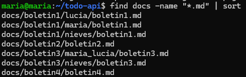

Para generar la web escribimos `docs/build_site.py`. Usa `markdown-it-py` (CommonMark; dependencia fijada en `docs/requirements.txt`) para convertir cada `.md` en HTML, quita el *front-matter*, copia las imágenes conservando sus rutas relativas y genera un `index.html` con una tarjeta por boletín. La salida va a `docs/site/`, que añadimos a `.gitignore` porque es un resultado de compilación y no debe versionarse.

Antes de subir nada lo probamos en local: el script procesó los boletines y sus imágenes, y abrimos el `index.html` generado en el navegador.

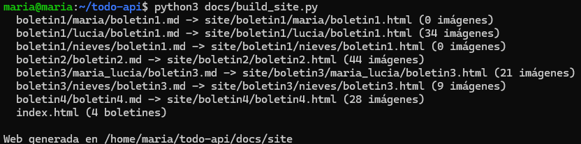

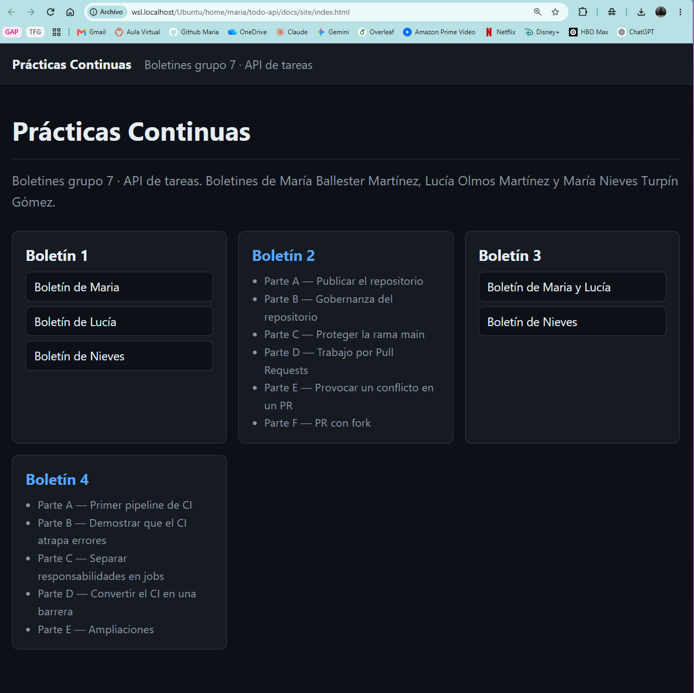

Después creamos `.github/workflows/pages.yml`, con dos jobs encadenados:

- **`build`:** hace checkout, configura Python 3.12 con caché de pip, instala las dependencias, ejecuta `python docs/build_site.py`, y con `actions/configure-pages` y `actions/upload-pages-artifact` sube `docs/site` como artefacto.
- **`deploy`:** con `needs: build`, usa el entorno `github-pages` y `actions/deploy-pages` para publicar el artefacto.

Se dispara en cada `push` a `main` (y manualmente con `workflow_dispatch`). Los permisos son `contents: read`, `pages: write` e `id-token: write` (este último lo pide `deploy-pages` para autenticarse por OIDC). Con `concurrency: group: pages` y `cancel-in-progress: false` solo hay una publicación a la vez y no se cancela una que esté en curso.

En *Settings → Pages* cambiamos **Source** a **GitHub Actions**, para que sea el workflow quien publique en lugar de servir una rama.

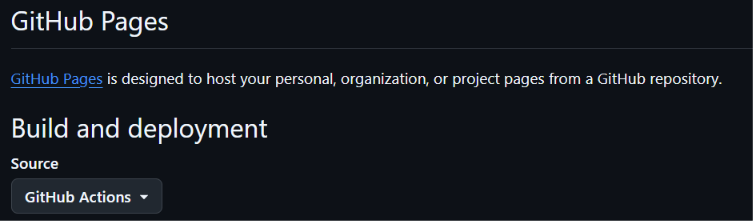

Los cambios entraron en `main` por PR (#21, commit `e670005`) y al integrarse se ejecutó el workflow `Pages`: los jobs `build` y `deploy` terminaron en verde en unos 26 segundos y generaron un artefacto.

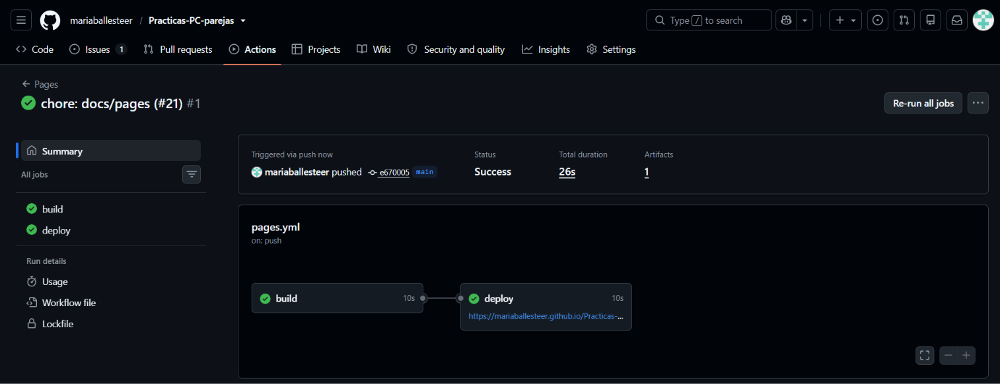

La documentación quedó publicada en `https://mariaballesteer.github.io/Practicas-PC-parejas/`.

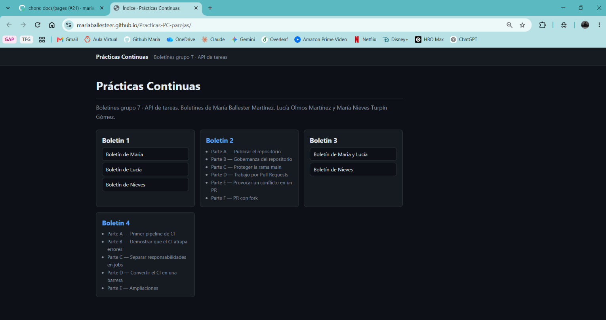
