# Boletín 6

## Resumen de commits

| # | Mensaje del commit | Qué se hizo | Autor | Enlace |
|---|--------------------|-------------|-------|--------|
| 1 | `feat(deploy): servidores y dependencias de Ansible (#23)` | 6-A + 6-B: añade `deploy/requirements.yml` (collection `community.docker` 3.7.0) y `deploy/servidores/docker-compose.yml` (la flota `app1`, `app2` y `db1`) | Lucía Olmos Martínez | [7957f6c](https://github.com/mariaballesteer/Practicas-PC-parejas/commit/7957f6c1a434cae8f408ea8b6a797d5ec9ccf121) |
| 2 | `feat(deploy): inventario (#24)` | 6-C: añade `deploy/inventory.ini`, que agrupa las máquinas por rol (`app`, `db`) | Lucía Olmos Martínez | [0d7f16b](https://github.com/mariaballesteer/Practicas-PC-parejas/commit/0d7f16bd80a5e9247309265482c702c8c7c96add) |
| 3 | `feat(deploy): credenciales cifradas con vault (#25)` | 6-E: añade `deploy/group_vars/servidores/vault.yml`, cifrado con Ansible Vault | María Ballester | [261f0cd](https://github.com/mariaballesteer/Practicas-PC-parejas/commit/261f0cd645aa56b00d342a2fb6ba13cea23fa08d) |
| 4 | `Deploy/playbook (#26)` | 6-D: añade `deploy/deploy.yml` con los tres plays (Docker en la flota, PostgreSQL en `db`, API en `app`) | María Ballester | [3292a32](https://github.com/mariaballesteer/Practicas-PC-parejas/commit/3292a32b061cd323bf0799404c72cf7a4a092d21) |
| 5 | `feat: versión 1.1.0 expuesta en /actuator/info (#27)` | 6-F: sube la versión a `1.1.0` y expone nombre y versión en `/actuator/info`, para desplegar una versión nueva y hacer rollback | Nieves Turpín | [19efaf7](https://github.com/mariaballesteer/Practicas-PC-parejas/commit/19efaf73ecfff816b8e770d6b2e5793cf6b78e70) |
| 6 | `ci: job deploy con Ansible en runner self-hosted (#28)` | 6-G.3: añade a `release.yml` el `outputs.version` del job `publish` y el job `deploy`, que ejecuta el playbook desde el runner autoalojado | Nieves Turpín | [6eba44b](https://github.com/mariaballesteer/Practicas-PC-parejas/commit/6eba44be1aaa64b2575b125f35f9af4677ade153) |
| 7 | `feat: versión 1.2.0 (#29)` | 6-G.4: sube la versión a `1.2.0` para probar el despliegue continuo de extremo a extremo con la etiqueta `v1.2.0` | Nieves Turpín | [6bf8a5b](https://github.com/mariaballesteer/Practicas-PC-parejas/commit/6bf8a5b0551229af7dae2ddfd89f6c0fcc326ff4) |

Hashes y autoría comprobados clonando el repositorio y ejecutando `git log --format='%h|%an|%ad|%s'`. Los hashes de los commits locales que se ven en las capturas (`a22efcb`, `c8ce69a`) cambian al integrarlos en `main` con *squash and merge*; en las tablas usamos los de `main`.

## Detalle por commit

### 1. `feat(deploy): servidores y dependencias de Ansible (#23)` — [7957f6c](https://github.com/mariaballesteer/Practicas-PC-parejas/commit/7957f6c1a434cae8f408ea8b6a797d5ec9ccf121)

- **Qué se hizo:** se crearon dos ficheros. `deploy/requirements.yml` declara la collection `community.docker` en la versión `3.7.0`, para que la dependencia sea reproducible. `deploy/servidores/docker-compose.yml` define los tres contenedores que hacen de máquinas destino (`app1`, `app2` y `db1`), basados en `rastasheep/ubuntu-sshd:18.04`, en modo `privileged` para poder ejecutar Docker dentro, con SSH expuesto en los puertos `2223`, `2224` y `2225` y, en las dos réplicas de la aplicación, el puerto `8080` publicado como `8081` y `8082`.
- **Autor:** Lucía Olmos Martínez.
- **Relación con el boletín:** Partes A y B. Se juntaron en un solo commit porque, con *squash and merge*, cada rama se integra como un único commit, y de la Parte A el único fichero versionado es `requirements.yml`.
- **Uso de IA:** nada.

### 2. `feat(deploy): inventario (#24)` — [0d7f16b](https://github.com/mariaballesteer/Practicas-PC-parejas/commit/0d7f16bd80a5e9247309265482c702c8c7c96add)

- **Qué se hizo:** se creó `deploy/inventory.ini`. Define el grupo `app` (`app1` y `app2`, en `localhost:2223` y `localhost:2224`), el grupo `db` (`db1`, en `localhost:2225`) y el grupo `servidores`, que los agrupa a los dos. En `[servidores:vars]` fija el intérprete de Python de destino, la contraseña SSH de la flota y las opciones para no guardar ni comprobar las claves de host (las máquinas se destruyen y se recrean a menudo).
- **Autor:** Lucía Olmos Martínez.
- **Relación con el boletín:** Parte C.
- **Uso de IA:** nada.

### 3. `feat(deploy): credenciales cifradas con vault (#25)` — [261f0cd](https://github.com/mariaballesteer/Practicas-PC-parejas/commit/261f0cd645aa56b00d342a2fb6ba13cea23fa08d)

- **Qué se hizo:** se creó `deploy/group_vars/servidores/vault.yml` con `ansible-vault create`. El fichero versionado empieza por `$ANSIBLE_VAULT;1.1;AES256` y es ilegible. Dentro hay cinco variables: `ghcr_user`, `ghcr_token`, `db_name`, `db_user` y `db_pass`. Al estar en `group_vars/servidores/`, Ansible las carga solo para las máquinas del grupo `servidores`, sin que el playbook las mencione.
- **Autor:** María Ballester
- **Relación con el boletín:** Parte E.
- **Uso de IA:** Claude explicó el procedimiento paso a paso (qué valores preparar, cómo crear el token con el único permiso `read:packages`, cómo crear y comprobar el fichero cifrado). Los valores y las contraseñas los elegimos nosotras.

### 4. `Deploy/playbook (#26)` — [3292a32](https://github.com/mariaballesteer/Practicas-PC-parejas/commit/3292a32b061cd323bf0799404c72cf7a4a092d21)

- **Qué se hizo:** se creó `deploy/deploy.yml` con tres plays: (1) instalar Docker y el SDK de Python en toda la flota y arrancar `dockerd` a mano, (2) desplegar PostgreSQL 16 en `db` con un volumen y un `healthcheck`, y (3) desplegar la API en `app` con login en GHCR, descarga de la imagen, arranque del contenedor y un *smoke test* contra `/actuator/health`. Partimos del playbook del boletín con dos adaptaciones a nuestro proyecto (ver la Parte D).
- **Autor:** María Ballester
- **Relación con el boletín:** Parte D.
- **Uso de IA:** Claude propuso la adaptación de las variables de entorno del `deploy/deploy.yml`. La ejecución y su comprobación las hicimos nosotras.

### 5. `feat: versión 1.1.0 expuesta en /actuator/info (#27)` — [19efaf7](https://github.com/mariaballesteer/Practicas-PC-parejas/commit/19efaf73ecfff816b8e770d6b2e5793cf6b78e70)

- **Qué se hizo:** se modificaron dos ficheros. En `pom.xml` la versión pasa de `1.0.0` a `1.1.0`. En `application.properties` se activa `management.info.env.enabled` y se añaden `info.app.name=@project.name@` e `info.app.version=@project.version@`, que Maven sustituye al compilar con los valores del `pom.xml`. Así `/actuator/info` devuelve `{"app":{"name":"todo-api","version":"1.1.0"}}`, mientras que en la `1.0.0` devuelve `{}`, y se puede comprobar con un `curl` qué versión corre en cada réplica. No cambia ningún endpoint de la API ni el esquema de la base de datos, de modo que el rollback a `1.0.0` es seguro.
- **Autor:** Nieves Turpín
- **Relación con el boletín:** Parte F (desplegar una versión nueva y volver atrás). Tras integrar el commit en `main` se creó la etiqueta `v1.1.0` sobre `main`, que dispara `release.yml` y publica la imagen `ghcr.io/mariaballesteer/practicas-pc-parejas:1.1.0`.
- **Uso de IA:** Claude propuso usar `/actuator/info` como cambio visible, hizo la modificación de los dos ficheros y comprobó con `mvn process-resources` que la versión se sustituye. También explicó los pasos de la Parte F y ayudó a resolver los problemas de entorno (falta de `sshpass`, flota sin levantar, regla de negocio de prioridad `ALTA` al crear la tarea de prueba). Las ejecuciones del playbook los hice yo.

### 6. `ci: job deploy con Ansible en runner self-hosted (#28)` — [6eba44b](https://github.com/mariaballesteer/Practicas-PC-parejas/commit/6eba44be1aaa64b2575b125f35f9af4677ade153)

- **Qué se hizo:** se modificó `.github/workflows/release.yml`. El job `publish` queda igual salvo un nuevo `outputs.version`, que toma `steps.meta.outputs.version` (`1.2.0` cuando la etiqueta es `v1.2.0`). Se añade el job `deploy`: depende de `publish` (`needs`), solo se ejecuta con etiquetas `v*` (`if: startsWith(github.ref, 'refs/tags/v')`), corre en el runner autoalojado (`runs-on: self-hosted`) y en el entorno `produccion`, instala la collection desde `requirements.yml` y lanza `ansible-playbook` con `--extra-vars "version_app=$VERSION"`. La contraseña del Vault llega del secret `VAULT_PASS` y se escribe en un fichero temporal que `trap` borra siempre al terminar.
- **Autor:** Nieves Turpín
- **Relación con el boletín:** Parte G.3. El job es el del boletín sin cambios.
- **Uso de IA:** nada.

### 7. `feat: versión 1.2.0 (#29)` — [6bf8a5b](https://github.com/mariaballesteer/Practicas-PC-parejas/commit/6bf8a5b0551229af7dae2ddfd89f6c0fcc326ff4)

- **Qué se hizo:** se modificó `pom.xml`: la versión pasa de `1.1.0` a `1.2.0`. Como `/actuator/info` ya expone `@project.version@` (commit 5), no hace falta tocar nada más para que la versión nueva se vea en el endpoint.
- **Autor:** Nieves Turpín
- **Relación con el boletín:** Parte G.4. Tras integrarlo se creó la etiqueta `v1.2.0`, que dispara el despliegue automático.
- **Uso de IA:** Claude indicó el cambio de la Parte G.4 y ayudó a diagnosticar el primer fallo del job `deploy` (flota sin levantar en el equipo del runner). También preparó el diagrama de arquitectura. El commit, la etiqueta y la aprobación del despliegue los hicimos nosotras.

## Descripción narrativa de lo hecho en la sesión y relación con los commits

### Parte A — Instalar Ansible y sus dependencias

Trabajamos en la rama `feat/deploy-requirements`, creada con `git switch -c`.

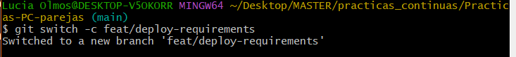

Instalamos Ansible con `pipx` (en Ubuntu sobre WSL2), instalamos la collection que aporta los módulos de Docker y declaramos la dependencia en `deploy/requirements.yml`, que es el único fichero que esta parte deja en el repositorio (commit 1). Después comprobamos que `ansible-galaxy collection install -r deploy/requirements.yml` reconoce el fichero: responde `Nothing to do. All requested collections are already installed`, porque `community.docker:3.7.0` ya estaba instalada.

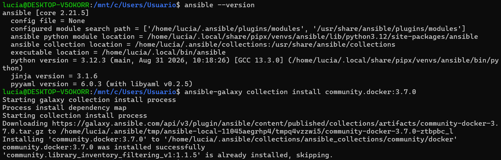

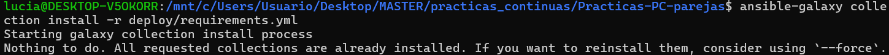

> **Nota sobre la versión.** El boletín pide Ansible 2.16.x, pero en esta captura se ve `ansible [core 2.21.5]`. La incidencia que nos causó una versión más nueva de la pedida al desplegar está en la Parte D.

### Parte B — Preparar la flota de servidores destino

Creamos `deploy/servidores/docker-compose.yml` con el contenido del boletín: tres contenedores `app1`, `app2` y `db1`, cada uno con SSH en un puerto distinto del anfitrión (`2223`, `2224` y `2225`). Los dos de la aplicación publican además el `8080` interno como `8081` y `8082`, que es donde quedará la API una vez desplegada. Es un fichero distinto del `docker-compose.yml` de la aplicación (Boletín 3): aquí los contenedores simulan servidores, no la aplicación.

Levantamos la flota con `docker compose -f deploy/servidores/docker-compose.yml up -d`, que descargó la imagen y creó la red `servidores_default` y los tres contenedores. Antes de usar Ansible comprobamos a mano que entramos por SSH en las tres máquinas (puertos `2223`, `2224` y `2225`, contraseña `root`) y que cada una tiene su propio nombre de host (`d109bca0811c`, `47cec4adc8a6` y `df85a29d94df`).

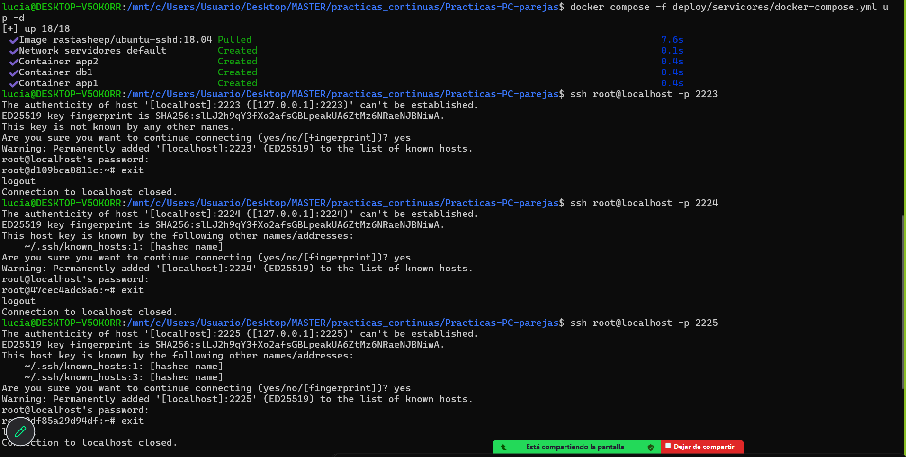

Los ficheros de las partes A y B se subieron en un único commit (`feat(deploy): servidores y dependencias de Ansible`), con la rama `feat/deploy-requirements`. El hook de pre-commit ejecutó Spotless antes del commit (se ve `Formatting with Spotless...`), como en el resto del proyecto.

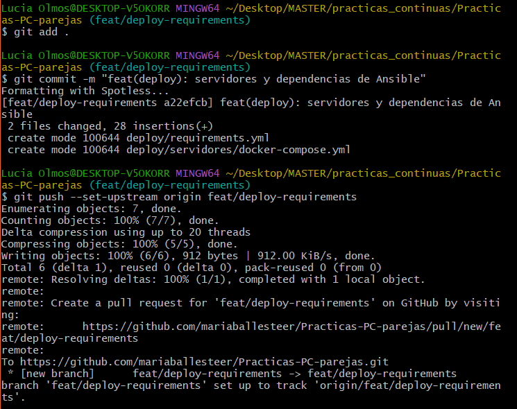

### Parte C — El inventario

Creamos la rama `feat/deploy-inventory` desde `main` y escribimos `deploy/inventory.ini`, que agrupa las máquinas por rol: `app` (`app1` y `app2`), `db` (`db1`) y `servidores`, que contiene a los dos anteriores y es el grupo al que se dirige el primer play.

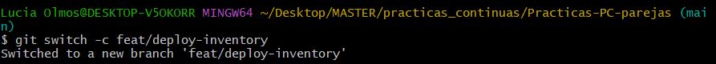

Instalamos `sshpass`, que permite a Ansible enviar por SSH la contraseña definida en el inventario (`ansible_password=root`). Esta instalación no modifica el repositorio.

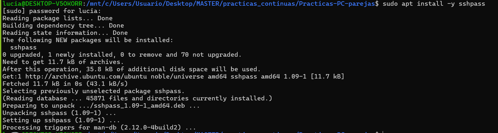

Verificamos la conexión con un *ping* de Ansible al grupo `servidores`: respondieron `pong` `app1`, `app2` y `db1`, de modo que Ansible ya controla la flota. En esta captura el comando que se ejecuta es `ansible-legacy`.

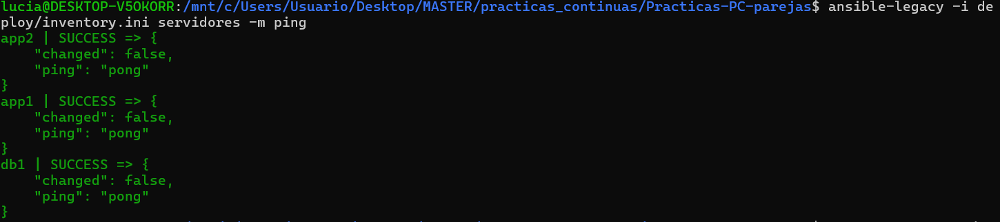

Se realizó el commit (`feat(deploy): inventario`).

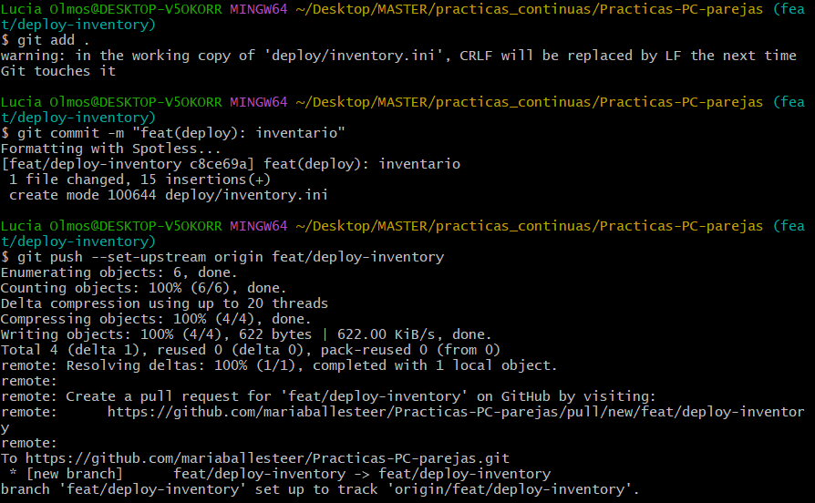

### Parte D — El playbook de despliegue

Escribimos `deploy/deploy.yml` a partir del playbook del boletín, que ya trae los tres plays, y lo adaptamos a nuestro proyecto. Solo cambiamos dos cosas:

1. **La imagen:** `ghcr.io/mariaballesteer/practicas-pc-parejas:{{ version_app }}`, que es la que publica `docker/metadata-action` desde el Boletín 5. La versión por defecto es `1.0.0` y el CI la sobrescribe con `--extra-vars`.
2. **Las variables de entorno de la API:** nuestra aplicación lee la conexión a la base de datos de `DB_URL`, `DB_USER` y `DB_PASSWORD` (así está en `application.properties`), no de las `SPRING_DATASOURCE_*` del boletín. Por eso el contenedor `tareas-api` recibe `DB_URL: "jdbc:postgresql://{{ host_bd }}:5432/{{ db_name }}"`, `DB_USER: "{{ db_user }}"` y `DB_PASSWORD: "{{ db_pass }}"`, con los valores del Vault.

El *smoke test* se queda como en el boletín, contra `/actuator/health`, porque nuestro `pom.xml` incluye `spring-boot-starter-actuator`. El resto (los plays 1 y 2, el login en GHCR, la descarga de la imagen, `network_mode: host` y `recreate: false`) es igual que el boletín. Las credenciales no aparecen en el playbook: salen del Vault, y no se pasan por `--extra-vars`.

```text
maria@maria:~/todo-api/deploy$ cat deploy.yml
- name: Preparar Docker en toda la flota
  hosts: servidores
  tasks:
    - name: Instalar Docker y el SDK de Python
      apt:
        name: [ docker.io, python3-docker ]
        state: present
        update_cache: true

    - name: Arrancar dockerd (los contenedores no tienen systemd)
      shell: |
        nohup dockerd > /var/log/dockerd.log 2>&1 &
        for i in $(seq 1 30); do docker info >/dev/null 2>&1 && exit 0; sleep 1; done
        cat /var/log/dockerd.log
        exit 1
      args:
        creates: /var/run/docker.pid


- name: Desplegar la base de datos
  hosts: db
  tasks:
    - name: Base de datos PostgreSQL
      community.docker.docker_container:
        name: tareas-db
        image: postgres:16
        state: started
        restart_policy: always
        network_mode: host
        volumes: [ "tareas-db-data:/var/lib/postgresql/data" ]
        env:
          POSTGRES_DB: "{{ db_name }}"
          POSTGRES_USER: "{{ db_user }}"
          POSTGRES_PASSWORD: "{{ db_pass }}"
        healthcheck:
          test: [ "CMD-SHELL", "pg_isready -U {{ db_user }}" ]
          interval: 5s
          retries: 10

- name: Desplegar la API de tareas
  hosts: app
  vars:
    version_app: "1.0.0"
    imagen: "ghcr.io/mariaballesteer/practicas-pc-parejas:{{ version_app }}"
    host_bd: "{{ groups['db'][0] }}"                        # primer host del grupo db

  tasks:
    - name: Login en GHCR
      community.docker.docker_login:
        registry_url: ghcr.io
        username: "{{ ghcr_user }}"
        password: "{{ ghcr_token }}"

    - name: Descargar la imagen de la aplicación
      community.docker.docker_image:
        name: "{{ imagen }}"
        source: pull

    - name: Arrancar el contenedor de la API
      community.docker.docker_container:
        name: tareas-api
        image: "{{ imagen }}"
        state: started
        recreate: false          # idempotencia: no lo toca si ya es esta versión
        restart_policy: always
        network_mode: host       # comparte red con esta máquina: así ve a "{{ host_bd }}" por su nombre
        env:
          DB_URL: "jdbc:postgresql://{{ host_bd }}:5432/{{ db_name }}"
          DB_USER: "{{ db_user }}"
          DB_PASSWORD: "{{ db_pass }}"

    - name: Smoke test — esperar a que la API esté sana
      uri:
        url: "http://localhost:8080/actuator/health"
        status_code: 200
      register: salud
      retries: 20
      delay: 5
      until: salud.json.status is defined and salud.json.status == "UP"
```

Al lanzar el playbook por primera vez aparecieron cuatro problemas, todos de entorno y no del playbook:

- **Inventario ausente.** Ansible respondió `Unable to parse deploy/inventory.ini as an inventory source` porque la rama de trabajo se había creado antes de integrar el commit 2. Se arregló con `git fetch` y `git merge origin/main`, que trajo el inventario y el Vault sin tocar `deploy.yml`.
- **Contraseña del Vault.** `ansible -m ping` falló con `Attempting to decrypt but no vault secrets found`: al haber ya `vault.yml` en `group_vars`, hay que pasar `--ask-vault-pass` también al ping.
- **Versión de Ansible.** Con `ansible-core 2.21.5` sobre Python 3.14, la tarea `Gathering Facts` falló en las tres máquinas con `SyntaxError: future feature annotations is not defined`. La causa es que las máquinas de la flota usan Ubuntu 18.04, con Python 3.6, y las versiones nuevas de Ansible generan módulos que requieren Python 3.7 o superior. Es el motivo por el que el boletín pide la 2.16.x. Desinstalamos la versión de `pipx` e instalamos `ansible==9.13.0`, que trae `ansible-core 2.16.19`, con Python 3.12 (`pipx install --python 3.12 --fetch-missing-python --include-deps "ansible==9.13.0"`).
- **`sshpass`.** Faltaba en este equipo (`you must install the sshpass program`) y se instaló con `apt`.

Corregido todo esto, el ping devolvió `pong` en las tres máquinas y el playbook terminó con `failed=0` en `app1`, `app2` y `db1`: `ok=8 changed=5` en las dos réplicas de la aplicación y `ok=5 changed=3` en la base de datos. Es la primera ejecución, por eso casi todas las tareas aparecen como `changed`. El *smoke test* reintentó un par de veces (`FAILED - RETRYING`) mientras Spring Boot arrancaba y terminó en `ok` en las dos réplicas, lo que además confirma que Actuator está activo.

### Parte E — Proteger las credenciales con Ansible Vault

Creamos el fichero cifrado con `ansible-vault create deploy/group_vars/servidores/vault.yml`, que pide una contraseña maestra y abre el editor. Dentro guardamos `ghcr_user`, `ghcr_token`, `db_name`, `db_user` y `db_pass`. Para `ghcr_token` generamos un Personal Access Token (classic) con el único permiso `read:packages`, suficiente para que las máquinas descarguen la imagen de GHCR. Como `db_name` usamos `tododb`, el nombre por defecto de nuestra aplicación, en lugar del `tareas` del boletín.

Comprobamos con `cat` que el fichero que se versiona es ilegible: empieza por `$ANSIBLE_VAULT;1.1;AES256` y el resto es texto cifrado. Con `ansible-vault view` y la contraseña maestra se puede leer el contenido (esa salida no se incluye aquí porque muestra las credenciales en claro).

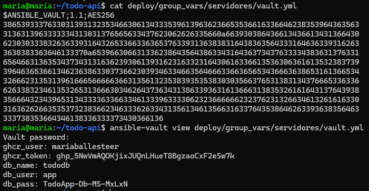

La contraseña maestra no está en el repositorio: se comparte por un canal privado y, en el pipeline, se guarda como secret `VAULT_PASS` (Parte G.2).

### Parte F — Ejecutar el despliegue a mano

Antes de lanzar el playbook levantamos la flota (`docker compose -f deploy/servidores/docker-compose.yml up -d`), porque los contenedores no estaban arrancados y la primera ejecución terminó con `Connection refused` en los puertos `2223`, `2224` y `2225`. También hubo que instalar `sshpass` en este equipo.

**Primer despliegue.** Lanzamos el playbook contra toda la flota con la versión `1.0.0` y guardamos la salida con `tee ejecucion1.txt`. Terminó con `failed=0` en las tres máquinas: `ok=8 changed=5` en `app1` y `app2`, y `ok=5 changed=3` en `db1`. Casi todo aparece como `changed` porque se instala Docker, se arranca `dockerd`, se crea PostgreSQL, se hace login en GHCR, se descarga la imagen y se arranca la API. El *smoke test* reintenta una vez en cada réplica mientras Spring Boot arranca y termina en `ok`.

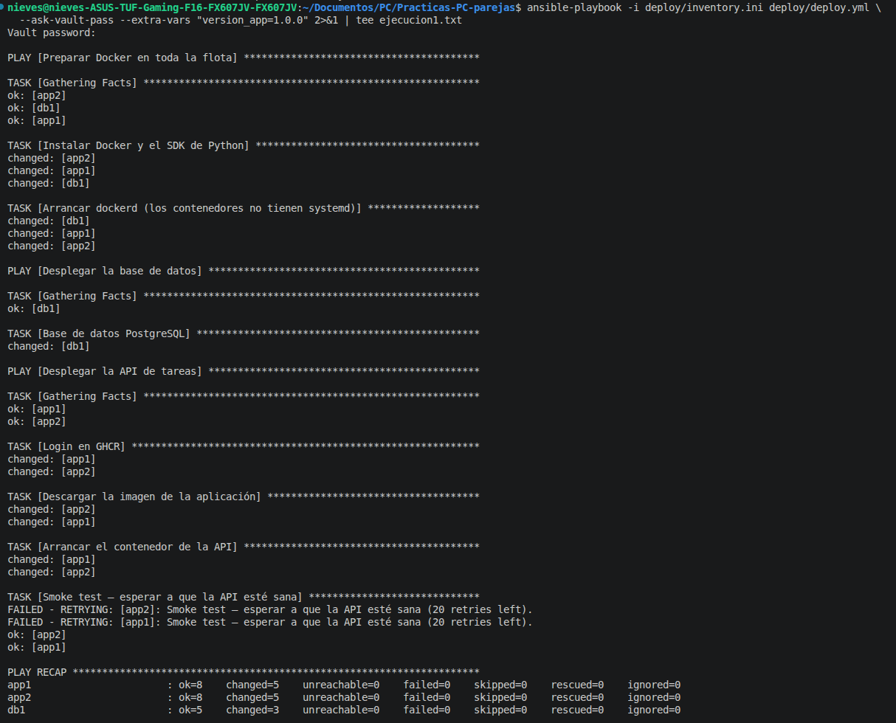

**Las dos réplicas comparten la base de datos.** En nuestra API la ruta es `/api/tareas`, no la `/api/tasks` del boletín. Creamos una tarea con un `POST` a `app1` (`localhost:8081`) y la leímos con un `GET` desde `app2` (`localhost:8082`): aparece la misma tarea con `id: 1`, lo que demuestra que las dos réplicas hablan con el mismo PostgreSQL en `db1`. La tarea lleva `fechaLimite` porque nuestra aplicación exige fecha límite en las tareas de prioridad `ALTA` (sin ella responde `422`).

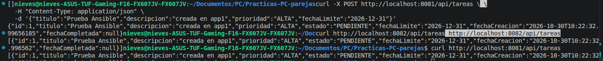

**Idempotencia.** Relanzamos exactamente el mismo comando (`tee ejecucion2.txt`). El `PLAY RECAP` muestra `changed=0` en `app1`, `app2` y `db1`: todo estaba ya en el estado deseado y Ansible no tocó nada. En particular, `recreate: false` evita que el contenedor de la API se recree si la imagen es la misma.

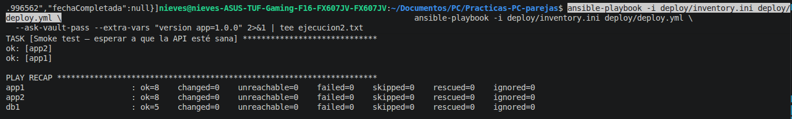

**Versión nueva.** Para tener una `1.1.0` con un cambio visible integramos el commit 5 (versión expuesta en `/actuator/info`) y creamos la etiqueta `v1.1.0` sobre `main`. Al subirla, `release.yml` publicó la imagen `1.1.0` en GHCR. Relanzamos el playbook con `--extra-vars "version_app=1.1.0"`: ahora hay `changed=2` en `app1` y `app2` (descarga de la imagen nueva y recreación del contenedor) y `changed=0` en `db1`, que no cambia. El *smoke test* vuelve a pasar en las dos réplicas, y `curl localhost:8081/actuator/info` y `curl localhost:8082/actuator/info` responden `{"app":{"name":"todo-api","version":"1.1.0"}}`.

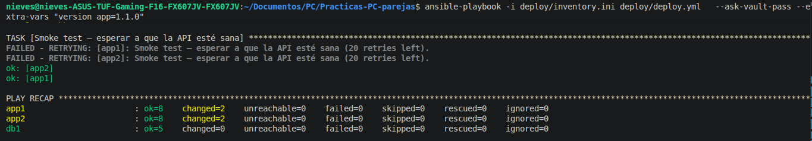

**Rollback.** Relanzamos con `version_app=1.0.0` midiendo el tiempo con `time`. El recap muestra `changed=1` en `app1` y `app2` (solo se recrea el contenedor; la imagen `1.0.0` ya estaba descargada en las máquinas) y `changed=0` en `db1`. Tardó **23 segundos** (`real 0m23,136s`), contando lo que se tarda en escribir la contraseña del Vault, así que el rollback está muy por debajo del minuto en las dos réplicas.

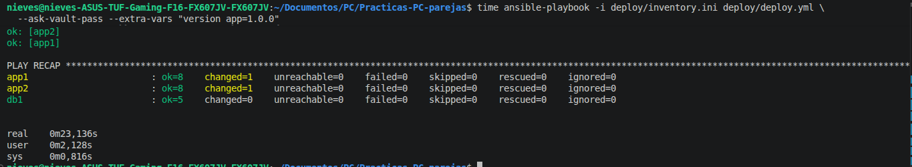

Después del rollback, `/actuator/info` vuelve a responder `{}` en las dos réplicas, porque la `1.0.0` no exponía la versión: las dos están de nuevo en la versión anterior.

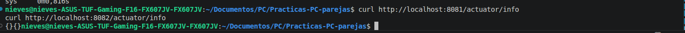

El rollback es posible porque las etiquetas de las imágenes son inmutables: `1.0.0` siempre apunta a la misma imagen, así que volver atrás es desplegar otra vez esa etiqueta. Con `latest` no sabríamos a qué versión estamos volviendo.

### Parte G — Disparar el despliegue desde GitHub Actions (cierre CD)

Las partes G.1 y G.2 requieren permisos de administrador del repositorio, así que las hizo María como propietaria. No modifican ficheros del repositorio y no generan commit.

#### G.1 — Registrar tu ordenador como runner

Desde **Settings → Actions → Runners → New self-hosted runner** generamos el comando de registro para Linux/x64 y ejecutamos `./config.sh --url https://github.com/mariaballesteer/Practicas-PC-parejas --token ...` en el equipo de María, aceptando los valores por defecto (grupo `Default`, nombre `maria`, sin etiquetas adicionales y carpeta `_work`). El registro terminó con `Runner successfully added` y `Settings Saved`. Después lanzamos `./run.sh`, que muestra `Connected to GitHub` y `Listening for Jobs`.

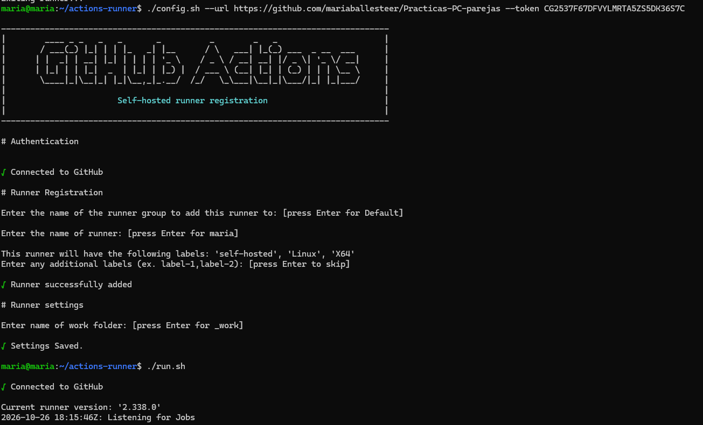

En la configuración del repositorio el runner `maria` aparece con las etiquetas `self-hosted`, `Linux` y `X64`, que son las que el job `deploy` pedirá con `runs-on: self-hosted`.

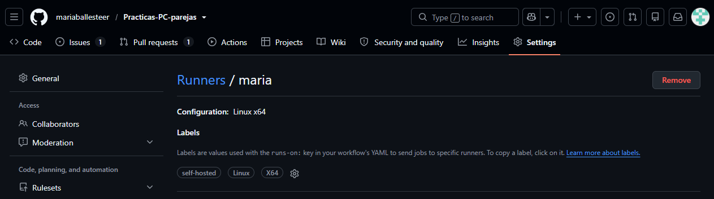

Como los trabajos se ejecutan en esa máquina, el runner necesita lo mismo que usamos a mano en la Parte F: Ansible 2.16, `sshpass`, la collection y la flota levantada en ese mismo equipo. Mientras `./run.sh` no esté en marcha, el despliegue queda esperando.

#### G.2 — Entorno protegido y secreto del Vault

En **Settings → Environments** creamos el entorno `produccion` con la regla *Required reviewers* y tres revisores: `luciaolmosmartinez`, `mariaballesteer` y `nievestg73`. Cualquier job que declare `environment: produccion` se queda en pausa hasta que uno de ellos lo apruebe. Dentro del entorno añadimos el secret `VAULT_PASS` con la contraseña maestra del Vault, que se puede sobrescribir pero no leer después.

Las demás opciones quedaron como estaban: *Prevent self-review* sin marcar (quien lanza el despliegue puede aprobarlo), *Wait timer* desactivado, *Allow administrators to bypass configured protection rules* marcada y sin restricción de ramas ni etiquetas.

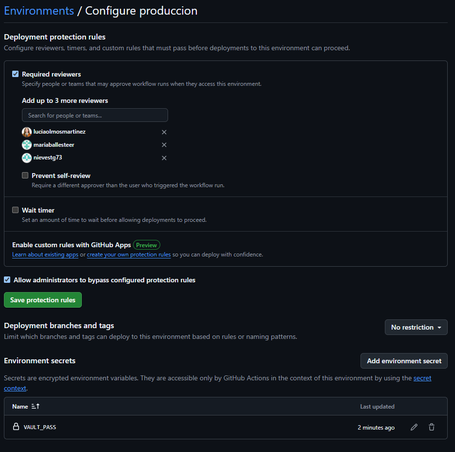

#### G.3 — Ampliar el `release.yml`

Ampliamos el `release.yml` del Boletín 5 con el job del boletín, sin cambios (commit 6). En el job `publish` solo se añade `outputs.version`, que pasa al siguiente job la versión semántica que calcula `docker/metadata-action` (`1.2.0` para la etiqueta `v1.2.0`). Debajo va el job `deploy`:

- `needs: publish`: no se despliega una imagen que no se ha llegado a publicar.
- `if: startsWith(github.ref, 'refs/tags/v')`: solo se despliega al publicar una versión, no en cada push a `main`.
- `runs-on: self-hosted`: el job corre en el runner `maria` de la Parte G.1, el único que llega a la flota (`localhost:2223-2225`).
- `environment: produccion`: el job espera la aprobación de un revisor y es el único que recibe el secret `VAULT_PASS`.
- La contraseña del Vault se escribe en un fichero temporal (`mktemp`) que se pasa con `--vault-password-file` y que `trap ... EXIT` borra siempre, también si el despliegue falla. Así la contraseña no aparece en la línea de comandos.

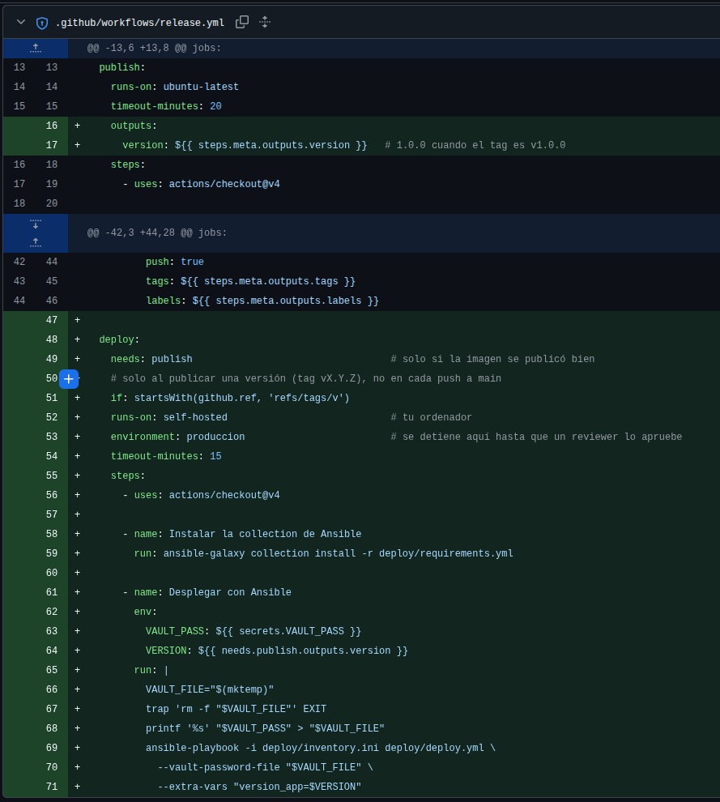

Al integrar el commit en `main`, el workflow se ejecutó por el push a la rama: `publish` terminó bien y `deploy` no se ejecutó, porque la referencia no era una etiqueta `v*`.

#### G.4 — Pruébalo de extremo a extremo

Para tener una versión nueva visible integramos el commit 7 (versión `1.2.0` en `pom.xml`), creamos la etiqueta `v1.2.0` sobre `main` y la subimos.

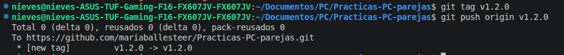

En **Actions** aparecen dos ejecuciones del commit `6bf8a5b`: la del push a `main` (#16), ya terminada, y la de la etiqueta `v1.2.0` (#17), en curso.

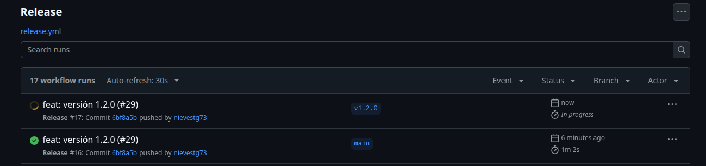

`publish` construyó y publicó la imagen en 58 s en un runner de GitHub. Después, `deploy` se quedó en pausa con el aviso *nievestg73 requested your review to deploy to produccion*.

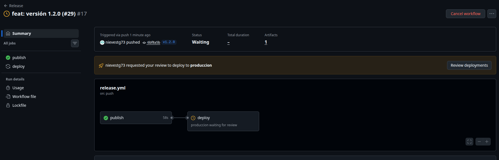

Desde **Review deployments** aprobamos el despliegue en `produccion`. La ventana indica que puede aprobarlo cualquiera de los tres revisores de la Parte G.2.

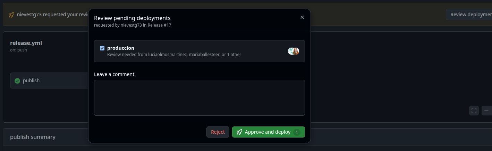

Tras la aprobación, el job pasa a *Deploying to produccion* y se queda en cola hasta que lo recoge el runner autoalojado.

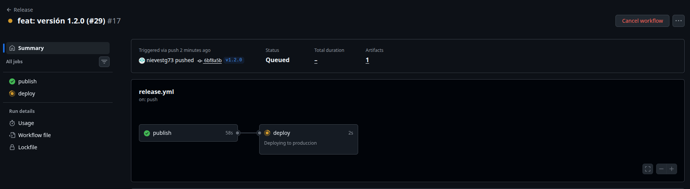

**Incidencia.** Los dos primeros intentos del job `deploy` fallaron. El primero terminó en `Gathering Facts` con `Connection refused` en `localhost:2223`, `2224` y `2225`: la flota no estaba levantada en el equipo de María. El `localhost` del inventario es la máquina donde corre el runner, no la de quien sube la etiqueta, así que la flota tiene que estar en el mismo equipo que el runner. Levantamos la flota con `docker compose -f deploy/servidores/docker-compose.yml up -d` y relanzamos el job con **Re-run failed jobs**, sin crear otra etiqueta, porque la imagen `1.2.0` ya estaba publicada. El tercer intento terminó bien.

En la terminal de `./run.sh` del equipo de María se ven los tres intentos: dos `Failed` y el último `Succeeded`.

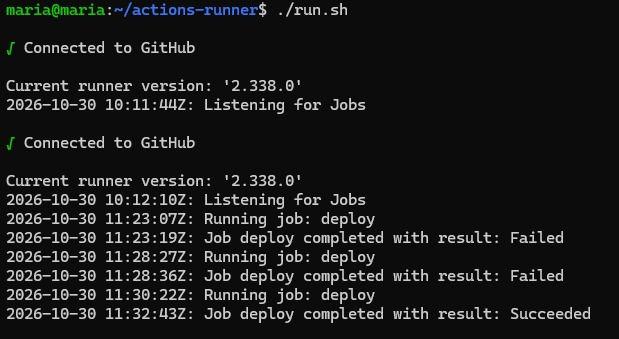

El log del paso **Desplegar con Ansible** muestra los tres plays. Como la flota se acababa de crear, casi todo aparece como `changed`, igual que en la primera ejecución de la Parte F: se arranca PostgreSQL en `db1`, y en `app1` y `app2` se hace login en GHCR, se descarga la imagen `1.2.0` y se arranca la API. El *smoke test* reintenta una vez en cada réplica mientras Spring Boot arranca y termina en `ok`. El `PLAY RECAP` acaba con `failed=0` en las tres máquinas: `ok=8 changed=5` en `app1` y `app2`, y `ok=5 changed=3` en `db1`.

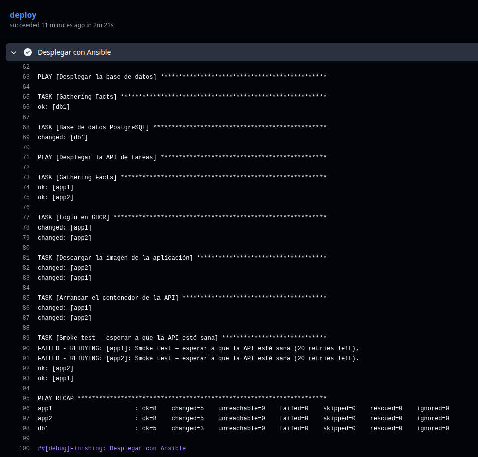

El workflow terminó en verde: `publish` en 58 s y `deploy` en 2 min 21 s (2 min 33 s en total, en el tercer intento).

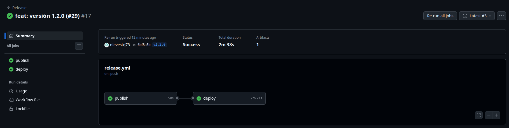

Por último comprobamos en el equipo de María que las dos réplicas sirven la versión nueva: `curl localhost:8081/actuator/info` y `curl localhost:8082/actuator/info` responden `{"app":{"name":"todo-api","version":"1.2.0"}}`.

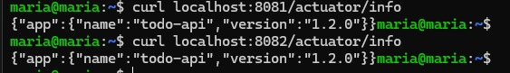

**Diagrama de la arquitectura.** El diagrama muestra dónde corre cada pieza:

- **En GitHub:** el repositorio, GitHub Actions con los jobs `publish` (en un runner de GitHub) y `deploy`, el entorno `produccion` con su aprobación y el secret `VAULT_PASS`, y GHCR.
- **En el equipo de María, el anfitrión físico:** el runner autoalojado, Ansible y el Docker que ejecuta la flota.
- **En la flota:** `app1`, `app2` y `db1`, cada una con su `sshd`, sus puertos publicados y su propio `dockerd`, y dentro de este `tareas-api` o `tareas-db`.

Cada flecha sale de quien inicia la conexión e indica el protocolo. El runner no recibe conexiones de GitHub: es él quien consulta a GitHub por HTTPS si hay trabajos. Ansible entra por SSH en las máquinas, los `dockerd` de las máquinas descargan las imágenes por HTTPS y la API abre la conexión JDBC con `db1:5432`.

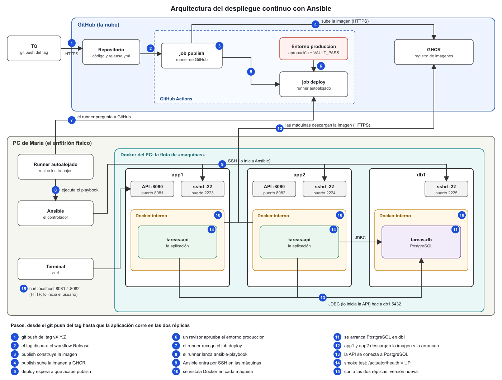

Los pasos numerados en el diagrama, desde el `git push` de la etiqueta hasta que la aplicación queda corriendo en las dos réplicas:

1. `git push origin v1.2.0` desde el equipo de un miembro del equipo.
2. La etiqueta dispara el workflow `Release`.
3. `publish` hace checkout y construye la imagen en un runner de GitHub (`ubuntu-latest`).
4. Sube la imagen a GHCR con las etiquetas `1.2.0`, `1.2`, `1` y `sha-…`, y expone `outputs.version = 1.2.0`.
5. `deploy` espera a que termine `publish` (`needs`).
6. Un revisor aprueba el entorno `produccion`.
7. El runner `maria`, que consulta a GitHub por HTTPS, recoge el job, hace checkout del repositorio y recibe `VAULT_PASS`.
8. El runner lanza `ansible-playbook` con el Vault descifrado desde el fichero temporal.
9. Ansible entra por SSH en `app1`, `app2` y `db1` (`localhost:2223`, `2224` y `2225`).
10. Instala Docker en cada máquina y arranca su `dockerd`.
11. En `db1`, descarga `postgres:16` de Docker Hub y arranca `tareas-db`.
12. En `app1` y `app2`, hace login en GHCR, descarga la imagen `1.2.0` y arranca `tareas-api`.
13. Cada réplica de la API se conecta a PostgreSQL en `db1:5432` por la red `servidores_default`.
14. El *smoke test* de `/actuator/health` devuelve `UP` en las dos réplicas y el job termina en verde.
15. Se comprueba con `curl` a `localhost:8081` y `localhost:8082` que las dos sirven la `1.2.0`.